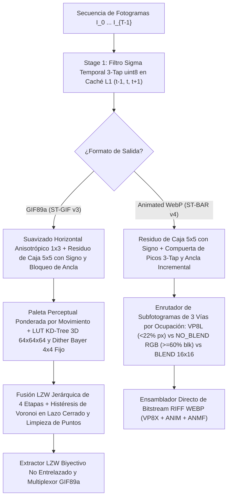

# 🎬 ST-BAR GIF Studio (`st-bar-gif-studio`)

<p align="center">
  <a href="README.md">🇺🇸 English</a> •
  <a href="README.ko.md">🇰🇷 한국어</a> •
  <a href="README.zh-CN.md">🇨🇳 简体中文</a> •
  <a href="README.ja.md">🇯🇵 日本語</a> •
  <a href="README.es.md"><b>🇪🇸 Español</b></a>
</p>

> **Motor de compresión espacio-temporal en tiempo lineal $O(N)$ de próxima generación para `.gif` (ST-GIF v3) y `.webp` animado (ST-BAR v4) + Estudio de grabación de pantalla transparente**

[](LICENSE)
[](https://www.python.org/)
[](#)

---

## 🌟 Resumen y Logros Principales (Overview)

Los codificadores de imágenes animadas estándar —como **FFmpeg (`palettegen + paletteuse`)**, **Pillow** y **`libwebp` (`WebPAnimEncoder`)**— dependen de la diferenciación voraz entre fotogramas adyacentes ($I_t$ vs $I_{t-1}$) y del tramado por difusión de error (Floyd-Steinberg / Sierra). Al aplicarse a capturas reales de videojuegos o grabaciones de pantalla con ligero ruido de sensor o artefactos de compresión ($\pm 1 \sim 3$ RGB), sufren tres graves problemas de eficiencia:

1. **Ebullición Temporal (Temporal Boiling) y Doble Penalización Delta:** El ruido aleatorio provoca oscilaciones `A → B → A`, expandiendo los cuadros delimitadores (Bounding Boxes) al 100% del lienzo y generando parpadeo visible en el fondo.
2. **Inversión de Fase de Dithering y Alternancia en Fronteras de Voronoi:** El tramado por difusión de error invierte el patrón de tablero de ajedrez entre fotogramas, destruyendo las secuencias LZW (Run-Length) en archivos `.gif` e inflando el tamaño entre **5× y 25×**.
3. **Fragmentación de Macrobloques DCT (en Animated WebP):** Perforar píxeles transparentes individuales ($\alpha=0$) crea bordes escalonados de alta frecuencia dentro de los macrobloques VP8 de $16\times 16$, disparando la entropía de los coeficientes AC.

**`st-bar-gif-studio`** introduce dos algoritmos de compresión espacio-temporales en tiempo lineal $O(N)$ (pasadas constantes por fotograma) —**ST-GIF v3** (para `.gif`) y **ST-BAR v4** (para `.webp`)— integrados en un **Estudio GUI con grabador de pantalla transparente y control deslizante continuo de calidad (`1 ~ 100`)**.

---

## 📊 Benchmark 1: Capturas Reales de Videojuegos y Pantalla (Compresión `.gif`)

Probado con capturas reales de alta resolución de videojuegos y pantalla frente a **Pillow (`optimize=True`)** y el pipeline de referencia de 2 pasadas de **FFmpeg (`palettegen + paletteuse=dither=sierra2_4a:diff_mode=rectangle`)**:


| Secuencia (`Resolución`, `Fotogramas`) | Método Codificador | Tamaño `.gif` | Reducción vs `FFmpeg 2-Pass` | Tiempo | PSNR | SSIM | Parpadeo Temporal ↓ |
| :--- | :--- | ---: | :---: | ---: | :---: | :---: | :---: |
| **Clip 1 (UI / Escena)**<br>(`892×619`, 134f, Origen 1,148 KB) | `Pillow Optimize` | 9,050.7 KB | +138.4% | 4,223 ms | 40.77 dB | 0.9935 | 0.147 |
| | `FFmpeg 2-Pass HQ (sierra2_4a)` | 3,796.5 KB | Referencia | 1,166 ms | 53.51 dB | 0.9988 | 0.090 |
| | `FFmpeg 2-Pass (bayer_s3)` | 4,306.0 KB | +13.4% | 571 ms | 41.56 dB | 0.9974 | 0.085 |
| | **ST-GIF v3 Balanced (`Q=75`)** | **174.7 KB** | **-95.4% (21.7× menor)** | 7,375 ms | **38.94 dB** | **0.9876** | **0.023 (-74.4%)** |
| | **ST-GIF v3 Compact (`Q=45`)** | **130.5 KB** | **-96.6% (29.1× menor)** | 4,924 ms | **38.37 dB** | **0.9855** | **0.022 (-75.6%)** |
| **Clip 2 (Gameplay)**<br>(`557×331`, 106f, Origen 1,296 KB) | `Pillow Optimize` | 9,510.3 KB | -6.3% | 5,341 ms | 34.86 dB | 0.9698 | 2.008 |
| | `FFmpeg 2-Pass HQ (sierra2_4a)` | 10,146.1 KB | Referencia | 2,329 ms | 33.18 dB | 0.9039 | 2.934 |
| | `FFmpeg 2-Pass (bayer_s3)` | 7,470.3 KB | -26.4% | 1,220 ms | 34.00 dB | 0.9375 | 1.168 |
| | **ST-GIF v3 Balanced (`Q=75`)** | **1,321.0 KB** | **-87.0% (7.7× menor)** | 2,873 ms | **32.99 dB** | **0.9042 (↑)** | **0.035 (-98.8%)** |
| | **ST-GIF v3 Compact (`Q=45`)** | **1,058.2 KB** | **-89.6% (9.6× menor)** | **1,958 ms** | **32.07 dB** | 0.8748 | **0.034 (-98.8%)** |
| **Clip 3 (FC Online Fútbol)**<br>(`496×395`, 109f, Origen 1,356 KB) | `Pillow Optimize` | 10,586.1 KB | -10.7% | 5,859 ms | 32.40 dB | 0.9716 | 1.995 |
| | `FFmpeg 2-Pass HQ (sierra2_4a)` | 11,855.2 KB | Referencia | 2,314 ms | 32.41 dB | 0.9354 | 2.198 |
| | `FFmpeg 2-Pass (bayer_s3)` | 10,842.7 KB | -8.5% | 1,227 ms | 33.90 dB | 0.9562 | 1.164 |
| | **ST-GIF v3 Balanced (`Q=75`)** | **2,240.6 KB** | **-81.1% (5.3× menor)** | 2,844 ms | **31.51 dB** | **0.9156** | **0.072 (-96.7%)** |
| | **ST-GIF v3 Compact (`Q=45`)** | **1,734.3 KB** | **-85.4% (6.8× menor)** | **2,086 ms** | **30.86 dB** | 0.8932 | **0.072 (-96.7%)** |
| **Clip 4 (LoL Cámara Completa)**<br>(`1051×482`, 89f, Origen 3,325 KB) | `Pillow Optimize` | 19,797.8 KB | -32.9% | 10,033 ms | 31.51 dB | 0.9492 | 1.968 |
| | `FFmpeg 2-Pass HQ (sierra2_4a)` | 29,484.9 KB | Referencia | 6,645 ms | 30.62 dB | 0.8786 | 3.303 |
| | `FFmpeg 2-Pass (bayer_s3)` | 23,491.0 KB | -20.3% | 3,943 ms | 31.83 dB | 0.9296 | 1.487 |
| | **ST-GIF v3 Balanced (`Q=75`)** | **9,998.9 KB** | **-66.1% (3.0× menor)** | 6,738 ms | **30.21 dB** | **0.8854 (↑)** | **0.292 (-91.2%)** |
| | **ST-GIF v3 Compact (`Q=45`)** | **8,408.8 KB** | **-71.5% (3.5× menor)** | **4,859 ms** | **29.61 dB** | 0.8513 | **0.298 (-91.0%)** |

---

## 📊 Benchmark 2: Optimización de Animated WebP (`ST-BAR v4` vs `libwebp`)


* **Archivos entre un 50% y un 80% más pequeños** que `libwebp` Fast (`method=4`) y Slow (`method=6, minimize_size=True`) en modo con pérdida (Lossy), y **entre un 90% y un 97% más pequeños (hasta 33× de compresión)** en modo sin pérdida (Lossless).
* **Velocidad de codificación hasta 28× más rápida** que `libwebp minimize_size=True`, mejorando el **PSNR (+0.8 a +4.7 dB)** y eliminando **más del 96% del parpadeo temporal del fondo**.

---

## 🧠 Arquitectura Algorítmica Principal (Especificación Verificada en Código)



### 1. Residuo Espacial de Caja con Signo y Seguimiento Incremental del Ancla (`stabilize_pure_u8_fast`)
El ruido de media cero $\eta \sim \mathcal{N}(0, \sigma^2)$ se cancela dentro de una ventana espacial de $5\times 5$ ($N=25$) cuando se suma **conservando el signo** ($\sigma_{\text{mean}} = \sigma / 5$), mientras que el movimiento real desplaza los píxeles locales de forma coherente en la misma dirección. En lugar de comparar con el fotograma inmediatamente anterior ($t-1$), el algoritmo mantiene un **Lienzo Ancla Persistente $A$** y una **Media de Caja del Ancla $B_{\text{anchor}}$** actualizada por parches (`cv2.copyTo(box_clean[t], dilated_u8, box_anchor)`) solo en las regiones con movimiento activo:

$$\text{Box}(C_t - A) = \text{Box}(C_t) - \text{Box}(A) \approx \text{Box}(C_t) - B_{\text{anchor}}$$

Combinado con una compuerta temporal de 3 toques ($t+1$) y filtrado de vecinos $3\times 3$, el movimiento coherente se aísla usando SIMD puro de 8 bits (`cv2.boxFilter` + `cv2.absdiff`). Para `.gif` (`anisotropic_smooth=True`), se aplica previamente un suavizado horizontal condicional de $1\times 3$.

### 2. Pipeline de Cuantización en 3 Pasos y LZW-RDO en Lazo Cerrado (`st_gif_codec.py`)

#### Paso 2a. Dithering Bayer $4\times 4$ Condicional Anclado a Pantalla (`quantize_frame_with_locked_bayer`)
Para evitar la inversión de fase del tramado entre fotogramas, se utiliza una matriz Bayer $B_{4\times 4}(x\bmod 4, y\bmod 4)$ fija a las coordenadas de pantalla, activada **solo cuando $Q > 50$ ($s_{\text{dither}} > 0$) y el error de cuantización base supera $7$**:

$$p_0(x,y) = \text{LUT}_{64^3}(\tilde{I}_t(x,y)), \qquad p_{\text{raw}}(x,y) = \begin{cases} \text{LUT}_{64^3}\!\left(\text{clip}\big(\tilde{I}_t(x,y) + s_{\text{dither}}\cdot B_{4\times 4}(x\bmod 4,\, y\bmod 4)\big)\right) & \text{if } Q > 50 \;\land\; \|\tilde{I}_t(x,y) - \text{Pal}[p_0(x,y)]\|_\infty > 7 \\ p_0(x,y) & \text{otherwise} \end{cases}$$

#### Paso 2b. Fusión Jerárquica de Líneas LZW en 4 Etapas (`coalesce_lzw_horizontal_runs`)
Partiendo de $\hat{p}_t \leftarrow p_{\text{raw}}$, las líneas horizontales se fusionan **secuencialmente en 4 etapas ($k = 1 \to 2 \to 3 \to 4$)** mediante anclas jerárquicas de bloques de tamaño $2 \to 4 \to 8$ y unión de bordes impares (con distancia máxima de referencia de 4 píxeles):

$$a_k(x) = \begin{cases} x - 1 & k=1,\; x \equiv 1 \pmod 2 \\ 4\lfloor x/4 \rfloor + 1 & k=2,\; x \bmod 4 \in \{2, 3\} \\ 8\lfloor x/8 \rfloor + 3 & k=3,\; x \bmod 8 \in \{4, 5, 6, 7\} \\ x - 1 & k=4,\; x \equiv 0 \pmod 2,\; x \ge 2 \end{cases}$$

$$\hat{p}_t(x, y) \leftarrow \hat{p}_t(a_k(x), y) \quad \text{if } \|\tilde{I}_t(x, y) - \text{Pal}[\hat{p}_t(a_k(x), y)]\|_\infty \le \delta_{\text{LZW}}$$

#### Paso 2c. Histéresis de Voronoi en Lazo Cerrado y Limpieza de 1–2px (`encode_st_gif`)
Rastreando el color RGB exacto en el lienzo del decodificador $\hat{C}_{t-1}(x, y) = \text{Pal}[\hat{P}_{\text{canvas}}(x, y)]$, con $e_{\text{old}} = \|\tilde{I}_t(x,y) - \hat{C}_{t-1}(x,y)\|_\infty$ y $e_{\text{new}} = \|\tilde{I}_t(x,y) - \text{Pal}[\hat{p}_t(x,y)]\|_\infty$, un píxel conserva el lienzo (`255 TRANSPARENT`) si se cumple **cualquiera** de las 4 condiciones:

$$\text{keep}(x,y) = \neg M_t(x,y) \;\lor\; \big(\hat{p}_t(x,y) = \hat{P}_{\text{canvas}}(x,y)\big) \;\lor\; \big(e_{\text{old}} \le \tau_{\text{keep}}\big) \;\lor\; \big(e_{\text{old}} - e_{\text{new}} \le \delta_{\text{gain}}\big)$$

Finalmente, dos pasadas morfológicas revierten actualizaciones aisladas a transparente (`keep = True`) para maximizar las secuencias LZW:
1. **Supresión de Motas (Speckles) $3\times 3$:** Revierte píxeles activos con $\le 2$ vecinos activos en una ventana de $3\times 3$ cuando $e_{\text{old}} \le 2\tau_{\text{keep}} + 2$.
2. **Supresión de Islas Horizontales de 1px y 2px:** Revierte actualizaciones aisladas de $1\text{px}$ (`iso_1px`) y $2\text{px}$ (`iso_2px`) flanqueadas por píxeles transparentes cuando $e_{\text{old}} \le 2\tau_{\text{keep}} (+2)$.

---

## 🚀 Inicio Rápido (Quick Start)

### 1. Instalación
```bash
git clone https://github.com/LoveBlonde/st-bar-gif-studio.git
cd st-bar-gif-studio
pip install -r requirements.txt
```

### 2. Ejecutar la Interfaz Gráfica (Studio GUI)
Haz doble clic en `run_studio.bat` en Windows, o ejecuta:
```bash
python main.py
```
* **🎥 Grabación de Pantalla Transparente (`🔴 New Recording`):** Coloca el marco de captura transparente sobre tu juego o vídeo y pulsa **`● REC (o F9)`** para grabar a 10–60 FPS. El interior del marco permite el paso de clics del ratón (*Click-through*), permitiéndote jugar sin interrupciones.
* **📂 Edición y Optimización de Archivos:** Importa archivos `.webp`, `.gif`, `.mp4` o `.webm` para recortar fotogramas (Trim), redimensionar (Scale) y ajustar la velocidad de reproducción.
* **🎚️ Control Deslizante de Calidad (`1 ~ 100`) y Vista Previa en Vivo:** Ajusta el nivel de compresión continuamente y pulsa **`[⚡ Test Compress Frame]`** para previsualizar la calidad real antes de exportar.

### 3. Interfaz de Línea de Comandos (CLI)
```bash
# Convertir WebP/MP4 a GIF ultracompacto (quality=75 equilibrado, quality=45 compacto)
python main.py -i input.webp -o output.gif -q 75

# Convertir o reoptimizar a Animated WebP (ST-BAR v4)
python main.py -i input.mp4 -o output.webp -q 80
```

---

## 📄 Licencia (License)
Distribuido bajo la **Licencia MIT**. Consulta el archivo [`LICENSE`](LICENSE) para más detalles.
