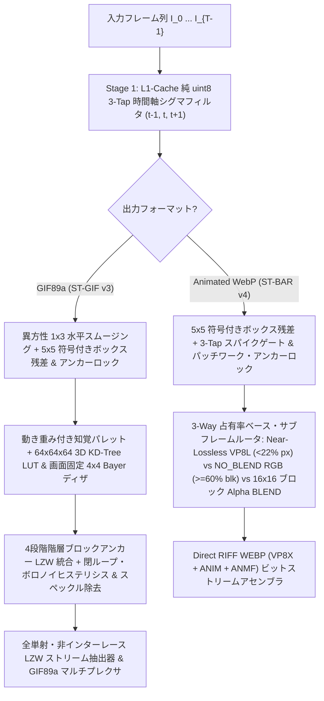

# 🎬 ST-BAR GIF Studio (`st-bar-gif-studio`)

<p align="center">
  <a href="README.md">🇺🇸 English</a> •
  <a href="README.ko.md">🇰🇷 한국어</a> •
  <a href="README.zh-CN.md">🇨🇳 简体中文</a> •
  <a href="README.ja.md"><b>🇯🇵 日本語</b></a> •
  <a href="README.es.md">🇪🇸 Español</a>
</p>

> **次世代線形時間 $O(N)$ 時空間 LZW-RDO `.gif` (ST-GIF v3) ＆ ブロック整列 `.webp` (ST-BAR v4) 圧縮最適化エンジン + 透過フレーム画面録画スタジオ**

[](LICENSE)
[](https://www.python.org/)
[](#)

---

## 🌟 研究背景と主な成果 (Overview)

従来のアニメーション画像エンコーダ（**FFmpeg (`palettegen + paletteuse`)**、**Pillow**、**`libwebp` (`WebPAnimEncoder`)** など）は、隣接フレーム間の単純なピクセル差分（$I_t$ vs $I_{t-1}$）と誤差拡散ディザリング（Floyd-Steinberg / Sierra）に依存しています。微細なセンサーノイズや圧縮アーティファクト（$\pm 1 \sim 3$ RGB）を含む実際のゲーム録画や画面キャプチャに適用すると、以下の3つの致命的な非効率が発生します。

1. **時間軸ボイリング (Temporal Boiling) と二重デルタペナルティ:** ランダムな微小ノイズが `A → B → A` の振動を引き起こし、サブフレームのバウンディングボックスが画面全体（100%）に膨張して背景のちらつき（フリッカー）を生じさせます。
2. **ディザパターンの位相反転とボロノイ境界のトグル:** 誤差拡散ディザリングがフレームごとにチェッカーボードパターンの位相を反転させるため、`.gif` の LZW 辞書ランレングス（Run-Length）が破壊され、ファイルサイズが **5倍〜25倍** に肥大化します。
3. **DCT マクロブロックの断片化 (Animated WebP):** ピクセル単位で透明な穴（$\alpha=0$）を開けると、VP8 の $16\times 16$ マクロブロック内部に人工的な高周波ステップエッジが生成され、AC 係数のエントロピーが急増します。

**`st-bar-gif-studio`** は、線形時間 $O(N)$（フレームあたり定数パス）で動作する時空間圧縮アルゴリズムである **ST-GIF v3**（`.gif` 用）および **ST-BAR v4**（`.webp` 用）を独自実装し、直感的に使える **クリック透過型の画面録画フレーム＆連続品質スライダー (`1 ~ 100`) 搭載 GUI スタジオ** を提供します。

---

## 📊 ベンチマーク 1：実際のゲーム・画面キャプチャ (`.gif` 圧縮比較)

高解像度の実際のゲーム・画面キャプチャ素材を用いて、**Pillow (`optimize=True`)** および **FFmpeg 最高品質 2-Pass パイプライン (`palettegen + paletteuse=dither=sierra2_4a:diff_mode=rectangle`)** と比較した結果です。


| キャプチャシーケンス (`解像度`, `フレーム数`) | エンコーダ方式 | 出力 `.gif` サイズ | `FFmpeg 2-Pass` 比削減率 | 処理時間 | PSNR | SSIM | 背景ちらつき (Flicker ↓) |
| :--- | :--- | ---: | :---: | ---: | :---: | :---: | :---: |
| **Clip 1 (UI / デスクトップ)**<br>(`892×619`, 134f, 元 1,148 KB) | `Pillow Optimize` | 9,050.7 KB | +138.4% | 4,223 ms | 40.77 dB | 0.9935 | 0.147 |
| | `FFmpeg 2-Pass HQ (sierra2_4a)` | 3,796.5 KB | 基準 (Baseline) | 1,166 ms | 53.51 dB | 0.9988 | 0.090 |
| | `FFmpeg 2-Pass (bayer_s3)` | 4,306.0 KB | +13.4% | 571 ms | 41.56 dB | 0.9974 | 0.085 |
| | **ST-GIF v3 Balanced (`Q=75`)** | **174.7 KB** | **-95.4% (21.7分の1)** | 7,375 ms | **38.94 dB** | **0.9876** | **0.023 (-74.4%)** |
| | **ST-GIF v3 Compact (`Q=45`)** | **130.5 KB** | **-96.6% (29.1分の1)** | 4,924 ms | **38.37 dB** | **0.9855** | **0.022 (-75.6%)** |
| **Clip 2 (ゲームプレイ映像)**<br>(`557×331`, 106f, 元 1,296 KB) | `Pillow Optimize` | 9,510.3 KB | -6.3% | 5,341 ms | 34.86 dB | 0.9698 | 2.008 |
| | `FFmpeg 2-Pass HQ (sierra2_4a)` | 10,146.1 KB | 基準 (Baseline) | 2,329 ms | 33.18 dB | 0.9039 | 2.934 |
| | `FFmpeg 2-Pass (bayer_s3)` | 7,470.3 KB | -26.4% | 1,220 ms | 34.00 dB | 0.9375 | 1.168 |
| | **ST-GIF v3 Balanced (`Q=75`)** | **1,321.0 KB** | **-87.0% (7.7分の1)** | 2,873 ms | **32.99 dB** | **0.9042 (↑)** | **0.035 (-98.8%)** |
| | **ST-GIF v3 Compact (`Q=45`)** | **1,058.2 KB** | **-89.6% (9.6分の1)** | **1,958 ms** | **32.07 dB** | 0.8748 | **0.034 (-98.8%)** |
| **Clip 3 (FC Online サッカー)**<br>(`496×395`, 109f, 元 1,356 KB) | `Pillow Optimize` | 10,586.1 KB | -10.7% | 5,859 ms | 32.40 dB | 0.9716 | 1.995 |
| | `FFmpeg 2-Pass HQ (sierra2_4a)` | 11,855.2 KB | 基準 (Baseline) | 2,314 ms | 32.41 dB | 0.9354 | 2.198 |
| | `FFmpeg 2-Pass (bayer_s3)` | 10,842.7 KB | -8.5% | 1,227 ms | 33.90 dB | 0.9562 | 1.164 |
| | **ST-GIF v3 Balanced (`Q=75`)** | **2,240.6 KB** | **-81.1% (5.3分の1)** | 2,844 ms | **31.51 dB** | **0.9156** | **0.072 (-96.7%)** |
| | **ST-GIF v3 Compact (`Q=45`)** | **1,734.3 KB** | **-85.4% (6.8分の1)** | **2,086 ms** | **30.86 dB** | 0.8932 | **0.072 (-96.7%)** |
| **Clip 4 (LoL 全画面カメラパン)**<br>(`1051×482`, 89f, 元 3,325 KB) | `Pillow Optimize` | 19,797.8 KB | -32.9% | 10,033 ms | 31.51 dB | 0.9492 | 1.968 |
| | `FFmpeg 2-Pass HQ (sierra2_4a)` | 29,484.9 KB | 基準 (Baseline) | 6,645 ms | 30.62 dB | 0.8786 | 3.303 |
| | `FFmpeg 2-Pass (bayer_s3)` | 23,491.0 KB | -20.3% | 3,943 ms | 31.83 dB | 0.9296 | 1.487 |
| | **ST-GIF v3 Balanced (`Q=75`)** | **9,998.9 KB** | **-66.1% (3.0分の1)** | 6,738 ms | **30.21 dB** | **0.8854 (↑)** | **0.292 (-91.2%)** |
| | **ST-GIF v3 Compact (`Q=45`)** | **8,408.8 KB** | **-71.5% (3.5分の1)** | **4,859 ms** | **29.61 dB** | 0.8513 | **0.298 (-91.0%)** |

---

## 📊 ベンチマーク 2：Animated WebP 最適化 (`ST-BAR v4` vs `libwebp`)


* すべての非可逆（Lossy）テストにおいて、`libwebp` Fast (`method=4`) および Slow (`method=6, minimize_size=True`) と比較して **ファイルサイズを 50%〜80% 削減**、可逆（Lossless）モードでは **90%〜97% 削減（最大 33倍の圧縮率）** を達成。
* `libwebp minimize_size=True` よりも **最大 28倍高速** にエンコードしながら、**Ground-Truth PSNR を +0.8〜+4.7 dB 向上** させ、背景のノイズちらつきを **96% 以上除去** します。

---

## 🧠 コア数理モデルとアルゴリズム構造（コード検証済み仕様）



### 1. 符号付き空間ボックス残差 ＆ パッチワーク・アンカー追跡 (`stabilize_pure_u8_fast`)
平均ゼロのセンサー・圧縮ノイズ $\eta \sim \mathcal{N}(0, \sigma^2)$ は、$5\times 5$ 空間ウィンドウ（$N=25$）内で**符号を保持したまま合算**すると互いに相殺され（$\sigma_{\text{mean}} = \sigma / 5$）、一方で実際の物体の移動は局所ピクセルを同一方向へ一貫してシフトさせます。直前のフレーム（$t-1$）と単純比較するのではなく、動きが検出された領域のみ更新される**永続アンカーフレーム $A$** と、動きマスク（`dilated_u8`）部分にのみ `box_clean[t]` を上書きする**パッチワーク・アンカーボックス平均 $B_{\text{anchor}}$**（`cv2.copyTo(box_clean[t], dilated_u8, box_anchor)`）を追跡します：

$$\text{Box}(C_t - A) = \text{Box}(C_t) - \text{Box}(A) \approx \text{Box}(C_t) - B_{\text{anchor}}$$

これに $t+1$ フレームを参照する 3-Tap スパイクゲートと $3\times 3$ 近傍フィルタリングを組み合わせ、純粋な 8-bit SIMD（`cv2.boxFilter` + `cv2.absdiff`）のみで真の動きを分離します。（`.gif` エンコード時は `anisotropic_smooth=True` により条件付き $1\times 3$ 水平スムージングが先行適用されます。）

### 2. ST-GIF v3 3段階量子化および閉ループ LZW-RDO パイプライン (`st_gif_codec.py`)

#### Step 2a. 画面絶対座標固定・条件付き $4\times 4$ Bayer ディザリング (`quantize_frame_with_locked_bayer`)
フレームごとのディザ位相反転を防ぐため、画面絶対座標に固定された $4\times 4$ Bayer 行列 $B_{4\times 4}(x\bmod 4, y\bmod 4)$ を使用し、**$Q > 50$（$s_{\text{dither}} > 0$）かつ基本量子化誤差が $7$ を超えるピクセルにのみ**適用します：

$$p_0(x,y) = \text{LUT}_{64^3}(\tilde{I}_t(x,y)), \qquad p_{\text{raw}}(x,y) = \begin{cases} \text{LUT}_{64^3}\!\left(\text{clip}\big(\tilde{I}_t(x,y) + s_{\text{dither}}\cdot B_{4\times 4}(x\bmod 4,\, y\bmod 4)\big)\right) & \text{if } Q > 50 \;\land\; \|\tilde{I}_t(x,y) - \text{Pal}[p_0(x,y)]\|_\infty > 7 \\ p_0(x,y) & \text{otherwise} \end{cases}$$

#### Step 2b. 4段階階層型ブロックアンカー LZW 走査線統合 (`coalesce_lzw_horizontal_runs`)
$\hat{p}_t \leftarrow p_{\text{raw}}$ から開始し、$2 \to 4 \to 8$ サイズのブロック固定アンカーと奇数境界の結合を行う **4段階（$k = 1 \to 2 \to 3 \to 4$）を順次（カスケード）適用**します（最大参照距離は 4 ピクセル）：

$$a_k(x) = \begin{cases} x - 1 & k=1,\; x \equiv 1 \pmod 2 \\ 4\lfloor x/4 \rfloor + 1 & k=2,\; x \bmod 4 \in \{2, 3\} \\ 8\lfloor x/8 \rfloor + 3 & k=3,\; x \bmod 8 \in \{4, 5, 6, 7\} \\ x - 1 & k=4,\; x \equiv 0 \pmod 2,\; x \ge 2 \end{cases}$$

$$\hat{p}_t(x, y) \leftarrow \hat{p}_t(a_k(x), y) \quad \text{if } \|\tilde{I}_t(x, y) - \text{Pal}[\hat{p}_t(a_k(x), y)]\|_\infty \le \delta_{\text{LZW}}$$

#### Step 2c. 閉ループ・ボロノイヒステリシス ＆ 1–2px 孤立点除去 (`encode_st_gif`)
デコーダ画面上に表示されているキャンバス色 $\hat{C}_{t-1}(x, y) = \text{Pal}[\hat{P}_{\text{canvas}}(x, y)]$ に対し、$e_{\text{old}} = \|\tilde{I}_t(x,y) - \hat{C}_{t-1}(x,y)\|_\infty$、$e_{\text{new}} = \|\tilde{I}_t(x,y) - \text{Pal}[\hat{p}_t(x,y)]\|_\infty$ とするとき、以下の **4条件のいずれかを満たせば** キャンバスを維持（`255 TRANSPARENT`）します：

$$\text{keep}(x,y) = \neg M_t(x,y) \;\lor\; \big(\hat{p}_t(x,y) = \hat{P}_{\text{canvas}}(x,y)\big) \;\lor\; \big(e_{\text{old}} \le \tau_{\text{keep}}\big) \;\lor\; \big(e_{\text{old}} - e_{\text{new}} \le \delta_{\text{gain}}\big)$$

さらに LZW の透明ランレングスを最大化するため、2段階の後処理を行います：
1. **$3\times 3$ スペックル除去：** $3\times 3$ 範囲内の更新ピクセルが $2$ 個以下かつ $e_{\text{old}} \le 2\tau_{\text{keep}} + 2$ の孤立点を透明（`keep = True`）に戻します。
2. **水平 1px / 2px 孤立更新の抑制：** 両側を透明（`keep`）に挟まれた水平 $1\text{px}$（`iso_1px`）および $2\text{px}$（`iso_2px`）の孤立更新（$e_{\text{old}} \le 2\tau_{\text{keep}} (+2)$）を透明に戻します。

---

## 🚀 クイックスタート (Quick Start)

### 1. インストール
```bash
git clone https://github.com/LoveBlonde/st-bar-gif-studio.git
cd st-bar-gif-studio
pip install -r requirements.txt
```

### 2. Studio GUI の起動
Windows では `run_studio.bat` をダブルクリックするか、以下のコマンドを実行します：
```bash
python main.py
```
* **🎥 画面領域キャプチャ (`🔴 New Recording`)：** 透過キャプチャフレームをゲームや動画の上に配置し、**`● REC (または F9)`** キーを押すだけで任意の FPS（10〜60 FPS）で即座に録画できます。フレーム内部はマウスクリックが透過（Click-through）するため、録画中もそのままゲームやアプリを操作可能です。
* **📂 既存 GIF・動画の編集と最適化：** `.webp`、`.gif`、`.mp4`、`.webm` ファイルを読み込み、開始・終了フレームのトリミング（Trim）、リサイズ（Scale）、再生速度の調整が行えます。
* **🎚️ 連続品質スライダー (`1 ~ 100`) ＆ リアルタイムプレビュー：** スライダーで圧縮強度を自在に調整し、**`[⚡ Test Compress Frame]`** ボタンを押すことで書き出し前に圧縮後の画質を即座に確認できます。

### 3. コマンドラインインターフェース (CLI)
```bash
# WebP/MP4 を超高圧縮 GIF に変換 (quality=75 バランス, quality=45 超軽量)
python main.py -i input.webp -o output.gif -q 75

# Animated WebP (ST-BAR v4) への変換・再最適化
python main.py -i input.mp4 -o output.webp -q 80
```

---

## 📄 ライセンス (License)
本プロジェクトは **MIT License** の下で公開されています。詳細は [`LICENSE`](LICENSE) をご覧ください。
