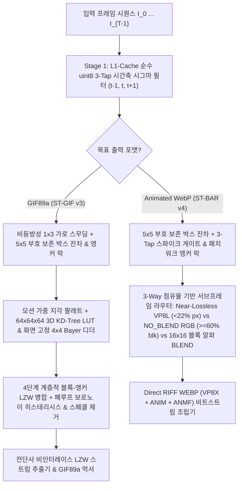

# 🎬 ST-BAR GIF Studio (`st-bar-gif-studio`)

<p align="center">
  <a href="README.md">🇺🇸 English</a> •
  <a href="README.ko.md"><b>🇰🇷 한국어</b></a> •
  <a href="README.zh-CN.md">🇨🇳 简体中文</a> •
  <a href="README.ja.md">🇯🇵 日本語</a> •
  <a href="README.es.md">🇪🇸 Español</a>
</p>

> **차세대 선형 시간 $O(N)$ 시공간 LZW-RDO `.gif` (ST-GIF v3) 및 블록 정렬 `.webp` (ST-BAR v4) 압축 최적화 엔진 & 투명 프레임 움짤 녹화 스튜디오**

[](LICENSE)
[](https://www.python.org/)
[](#)

---

## 🌟 연구 배경 및 핵심 성과 (Overview)

기존의 대표적인 움짤 인코더들—**FFmpeg (`palettegen + paletteuse`)**, **Pillow**, **`libwebp` (`WebPAnimEncoder`)**—은 인접한 두 프레임 간의 단순 픽셀 차분($I_t$ vs $I_{t-1}$)과 오차 확산 디더링(Floyd-Steinberg / Sierra)에 의존합니다. 미세한 센서 노이즈나 영상 압축 잔상($\pm 1 \sim 3$ RGB)이 포함된 실제 게임 화면 및 화면 녹화 영상에서는 다음 3가지 치명적인 비효율이 발생합니다:

1. **시간축 끓어오름(Temporal Boiling) & 이중 델타 페널티:** 미세한 랜덤 노이즈가 `A → B → A` 형태의 진동을 유발하여 서브프레임 바운딩 박스가 전체 화면(100%)으로 팽창하고 배경이 자글거립니다.
2. **디더 패턴 위상 반전 & 보로노이 경계 토글링:** 오차 확산 디더링이 매 프레임마다 체크무늬 패턴의 위상을 뒤집어 `.gif`의 LZW 사전 런-렝스(Run-Length)를 파괴하고 용량을 **5배~25배** 폭증시킵니다.
3. **DCT 매크로블록 파편화 (Animated WebP):** 픽셀 단위로 투명 구멍($\alpha=0$)을 뚫으면 VP8 $16\times 16$ 매크로블록 내부에 인위적인 고주파 계단 경계면이 생성되어 AC 계수 엔트로피가 급증합니다.

**`st-bar-gif-studio`**는 선형 시간 $O(N)$(프레임당 상수 패스)으로 동작하는 시공간 압축 알고리즘인 **ST-GIF v3**(`.gif` 전용)와 **ST-BAR v4**(`.webp` 전용)를 새롭게 설계하고, 누구나 직관적으로 사용할 수 있는 **클릭 투과형 투명 화면 캡처 프레임 & 연속 품질 슬라이더(`1 ~ 100`) 스튜디오 GUI**를 제공합니다.

---

## 📊 벤치마크 1: 실제 게임·화면 캡처 `.gif` 압축 비교

실제 고해상도 게임 및 화면 캡처 원본들을 대상으로 **Pillow (`optimize=True`)** 및 **FFmpeg 최고급 2-Pass 파이프라인 (`palettegen + paletteuse=dither=sierra2_4a:diff_mode=rectangle`)**과 비교 측정한 결과입니다:


| 캡처 시퀀스 (`해상도`, `프레임 수`) | 인코더 방식 | 출력 `.gif` 용량 | `FFmpeg 2-Pass` 대비 절감률 | 인코딩 시간 | PSNR | SSIM | 배경 자글거림 (Flicker ↓) |
| :--- | :--- | ---: | :---: | ---: | :---: | :---: | :---: |
| **Clip 1 (UI / 일상 캡처)**<br>(`892×619`, 134f, 원본 1,148 KB) | `Pillow Optimize` | 9,050.7 KB | +138.4% | 4,223 ms | 40.77 dB | 0.9935 | 0.147 |
| | `FFmpeg 2-Pass HQ (sierra2_4a)` | 3,796.5 KB | 기준점 (Baseline) | 1,166 ms | 53.51 dB | 0.9988 | 0.090 |
| | `FFmpeg 2-Pass (bayer_s3)` | 4,306.0 KB | +13.4% | 571 ms | 41.56 dB | 0.9974 | 0.085 |
| | **ST-GIF v3 Balanced (`Q=75`)** | **174.7 KB** | **-95.4% (21.7배 축소)** | 7,375 ms | **38.94 dB** | **0.9876** | **0.023 (-74.4%)** |
| | **ST-GIF v3 Compact (`Q=45`)** | **130.5 KB** | **-96.6% (29.1배 축소)** | 4,924 ms | **38.37 dB** | **0.9855** | **0.022 (-75.6%)** |
| **Clip 2 (게임플레이 캡처)**<br>(`557×331`, 106f, 원본 1,296 KB) | `Pillow Optimize` | 9,510.3 KB | -6.3% | 5,341 ms | 34.86 dB | 0.9698 | 2.008 |
| | `FFmpeg 2-Pass HQ (sierra2_4a)` | 10,146.1 KB | 기준점 (Baseline) | 2,329 ms | 33.18 dB | 0.9039 | 2.934 |
| | `FFmpeg 2-Pass (bayer_s3)` | 7,470.3 KB | -26.4% | 1,220 ms | 34.00 dB | 0.9375 | 1.168 |
| | **ST-GIF v3 Balanced (`Q=75`)** | **1,321.0 KB** | **-87.0% (7.7배 축소)** | 2,873 ms | **32.99 dB** | **0.9042 (↑)** | **0.035 (-98.8%)** |
| | **ST-GIF v3 Compact (`Q=45`)** | **1,058.2 KB** | **-89.6% (9.6배 축소)** | **1,958 ms** | **32.07 dB** | 0.8748 | **0.034 (-98.8%)** |
| **Clip 3 (FC 온라인 경기)**<br>(`496×395`, 109f, 원본 1,356 KB) | `Pillow Optimize` | 10,586.1 KB | -10.7% | 5,859 ms | 32.40 dB | 0.9716 | 1.995 |
| | `FFmpeg 2-Pass HQ (sierra2_4a)` | 11,855.2 KB | 기준점 (Baseline) | 2,314 ms | 32.41 dB | 0.9354 | 2.198 |
| | `FFmpeg 2-Pass (bayer_s3)` | 10,842.7 KB | -8.5% | 1,227 ms | 33.90 dB | 0.9562 | 1.164 |
| | **ST-GIF v3 Balanced (`Q=75`)** | **2,240.6 KB** | **-81.1% (5.3배 축소)** | 2,844 ms | **31.51 dB** | **0.9156** | **0.072 (-96.7%)** |
| | **ST-GIF v3 Compact (`Q=45`)** | **1,734.3 KB** | **-85.4% (6.8배 축소)** | **2,086 ms** | **30.86 dB** | 0.8932 | **0.072 (-96.7%)** |
| **Clip 4 (LoL 카메라 패닝 한타)**<br>(`1051×482`, 89f, 원본 3,325 KB) | `Pillow Optimize` | 19,797.8 KB | -32.9% | 10,033 ms | 31.51 dB | 0.9492 | 1.968 |
| | `FFmpeg 2-Pass HQ (sierra2_4a)` | 29,484.9 KB | 기준점 (Baseline) | 6,645 ms | 30.62 dB | 0.8786 | 3.303 |
| | `FFmpeg 2-Pass (bayer_s3)` | 23,491.0 KB | -20.3% | 3,943 ms | 31.83 dB | 0.9296 | 1.487 |
| | **ST-GIF v3 Balanced (`Q=75`)** | **9,998.9 KB** | **-66.1% (3.0배 축소)** | 6,738 ms | **30.21 dB** | **0.8854 (↑)** | **0.292 (-91.2%)** |
| | **ST-GIF v3 Compact (`Q=45`)** | **8,408.8 KB** | **-71.5% (3.5배 축소)** | **4,859 ms** | **29.61 dB** | 0.8513 | **0.298 (-91.0%)** |

---

## 📊 벤치마크 2: Animated WebP 최적화 (`ST-BAR v4` vs `libwebp`)


* 손실(Lossy) 압축 전 구간에서 `libwebp` Fast(`method=4`) 및 Slow(`method=6, minimize_size=True`) 대비 **파일 용량 50% ~ 80% 절감**, 무손실(Lossless) 모드에서는 **90% ~ 97% 절감(최대 33배 압축)**.
* `libwebp minimize_size=True` 대비 **최대 28배 빠른 인코딩 속도**를 달성함과 동시에 **Ground-Truth PSNR 화질을 +0.8 ~ +4.7 dB 향상**시키고 배경 노이즈 끓어오름을 **96% 이상 제거**.

---

## 🧠 핵심 수리 모델 및 알고리즘 아키텍처 (코드 검증 명세)



### 1. 부호 보존 공간 박스 잔차 & 패치워크 앵커 추적 (`stabilize_pure_u8_fast`)
평균이 0인 가우시안 노이즈 $\eta \sim \mathcal{N}(0, \sigma^2)$는 $5\times 5$ 공간 윈도우($N=25$)에서 **부호를 보존한 채 합산**하면 서로 상쇄되어 표준편차가 $\sigma_{\text{mean}} = \sigma / 5$로 줄어들지만, 실제 물체의 이동은 같은 방향으로 일관된 편향을 만듭니다. 직전 프레임($t-1$)과 단순 비교하는 대신, 움직임이 감지될 때만 갱신되는 **앵커 프레임 $A$**와 움직인 영역(`dilated_u8`)에만 `box_clean[t]`를 덮어쓰는 **패치워크 앵커 박스 평균 $B_{\text{anchor}}$**(`cv2.copyTo(box_clean[t], dilated_u8, box_anchor)`)를 별도로 추적합니다:

$$\text{Box}(C_t - A) = \text{Box}(C_t) - \text{Box}(A) \approx \text{Box}(C_t) - B_{\text{anchor}}$$

여기에 $t+1$ 프레임을 참조하는 3-Tap 스파이크 게이트 및 $3\times 3$ 이웃 필터링을 결합하여 순수 8비트 SIMD(`cv2.boxFilter` + `cv2.absdiff`) 연산으로 실제 움직임만 분리합니다. (`.gif` 인코딩 시에는 `anisotropic_smooth=True`가 활성화되어 LZW 가로 런 효율을 높이기 위한 조건부 $1\times 3$ 가로 스무딩이 선행됩니다.)

### 2. ST-GIF v3 3단계 양자화 및 폐루프 LZW-RDO 파이프라인 (`st_gif_codec.py`)

#### Step 2a. 화면 절대좌표 고정 조건부 $4\times 4$ Bayer 디더링 (`quantize_frame_with_locked_bayer`)
프레임마다 디더 패턴의 위상이 뒤집히는 문제를 막기 위해 화면 절대좌표에 고정된 $4\times 4$ Bayer 행렬 $B_{4\times 4}(x\bmod 4, y\bmod 4)$를 사용하며, **$Q > 50$ ($s_{\text{dither}} > 0$)이면서 기본 양자화 오차가 $7$을 초과하는 픽셀에만** 선택적으로 적용합니다:

$$p_0(x,y) = \text{LUT}_{64^3}(\tilde{I}_t(x,y)), \qquad p_{\text{raw}}(x,y) = \begin{cases} \text{LUT}_{64^3}\!\left(\text{clip}\big(\tilde{I}_t(x,y) + s_{\text{dither}}\cdot B_{4\times 4}(x\bmod 4,\, y\bmod 4)\big)\right) & \text{if } Q > 50 \;\land\; \|\tilde{I}_t(x,y) - \text{Pal}[p_0(x,y)]\|_\infty > 7 \\ p_0(x,y) & \text{otherwise} \end{cases}$$

#### Step 2b. 4단계 계층적 블록-앵커 LZW 스캔라인 병합 (`coalesce_lzw_horizontal_runs`)
$\hat{p}_t \leftarrow p_{\text{raw}}$에서 시작하여, $2 \to 4 \to 8$ 크기의 블록 고정 앵커 및 홀수 경계 봉합을 수행하는 **4단계($k = 1 \to 2 \to 3 \to 4$)를 순차적(연쇄적)으로 적용**합니다(최대 참조 거리 4칸):

$$a_k(x) = \begin{cases} x - 1 & k=1,\; x \equiv 1 \pmod 2 \\ 4\lfloor x/4 \rfloor + 1 & k=2,\; x \bmod 4 \in \{2, 3\} \\ 8\lfloor x/8 \rfloor + 3 & k=3,\; x \bmod 8 \in \{4, 5, 6, 7\} \\ x - 1 & k=4,\; x \equiv 0 \pmod 2,\; x \ge 2 \end{cases}$$

$$\hat{p}_t(x, y) \leftarrow \hat{p}_t(a_k(x), y) \quad \text{if } \|\tilde{I}_t(x, y) - \text{Pal}[\hat{p}_t(a_k(x), y)]\|_\infty \le \delta_{\text{LZW}}$$

#### Step 2c. 폐루프 보로노이 히스테리시스 & 1–2px 고립점 제거 (`encode_st_gif`)
디코더 화면에 표시 중인 실제 캔버스 색상 $\hat{C}_{t-1}(x,y) = \text{Pal}[\hat{P}_{\text{canvas}}(x,y)]$에 대해 $e_{\text{old}} = \|\tilde{I}_t(x,y) - \hat{C}_{t-1}(x,y)\|_\infty$, $e_{\text{new}} = \|\tilde{I}_t(x,y) - \text{Pal}[\hat{p}_t(x,y)]\|_\infty$라 할 때, 다음 **4가지 조건 중 하나라도 만족하면** 기존 캔버스를 유지(`255 TRANSPARENT`)합니다:

$$\text{keep}(x,y) = \neg M_t(x,y) \;\lor\; \big(\hat{p}_t(x,y) = \hat{P}_{\text{canvas}}(x,y)\big) \;\lor\; \big(e_{\text{old}} \le \tau_{\text{keep}}\big) \;\lor\; \big(e_{\text{old}} - e_{\text{new}} \le \delta_{\text{gain}}\big)$$

이어서 LZW 투명 런(Run)이 자잘한 점들에 의해 끊어지지 않도록 2단계 후처리를 수행합니다:
1. **$3\times 3$ 스페클(Speckle) 제거:** $3\times 3$ 범위 내 갱신 픽셀이 $2$개 이하이고 $e_{\text{old}} \le 2\tau_{\text{keep}} + 2$인 점들을 투명(`keep = True`)으로 되돌립니다.
2. **가로 1px / 2px 고립 갱신 제거:** 양옆이 투명(`keep`)으로 둘러싸인 가로 $1\text{px}$(`iso_1px`) 및 $2\text{px}$(`iso_2px`) 고립 갱신 구간($e_{\text{old}} \le 2\tau_{\text{keep}} (+2)$)을 투명으로 되돌려 긴 LZW 투명 런을 보장합니다.

---

## 🚀 설치 및 사용법 (Quick Start)

### 1. 설치 (Installation)
```bash
git clone https://github.com/LoveBlonde/st-bar-gif-studio.git
cd st-bar-gif-studio
pip install -r requirements.txt
```

### 2. 스튜디오 GUI 실행
Windows에서 `run_studio.bat` 파일을 더블클릭하거나 아래 명령어를 실행하세요:
```bash
python main.py
```
* **🎥 화면 영역 녹화 (`🔴 New Recording`):** 투명한 캡처 프레임 창을 게임이나 영상 위에 올려두고 **`● REC (또는 F9)`** 키를 눌러 원하는 FPS(10~60 FPS)로 즉시 캡처합니다. 캡처 영역 내부는 마우스 클릭이 투과(Click-through)되어 게임을 그대로 조작할 수 있습니다.
* **📂 기존 움짤/영상 불러오기:** `.webp`, `.gif`, `.mp4`, `.webm` 파일을 불러와 시작/끝 프레임 구간 자르기(Trim), 크기 조절(Scale), 재생 배속 조절을 수행합니다.
* **🎚️ 연속 품질 슬라이더 (`1 ~ 100`) & 실시간 프리뷰:** 슬라이더로 압축 강도를 자유롭게 조절하고 **`[⚡ Test Compress Frame]`** 버튼을 눌러 전체 인코딩 전에 현재 프레임의 압축 화질을 즉시 비교할 수 있습니다.

### 3. CLI 명령줄 변환
```bash
# WebP/MP4를 초고압축 GIF로 변환 (quality=75 균형 모드, quality=45 초경량 모드)
python main.py -i input.webp -o output.gif -q 75

# Animated WebP (ST-BAR v4)로 변환 또는 재최적화
python main.py -i input.mp4 -o output.webp -q 80
```

---

## 📄 라이선스 (License)
본 프로젝트는 **MIT License** 하에 배포됩니다. 자세한 내용은 [`LICENSE`](LICENSE) 파일을 참고하세요.
