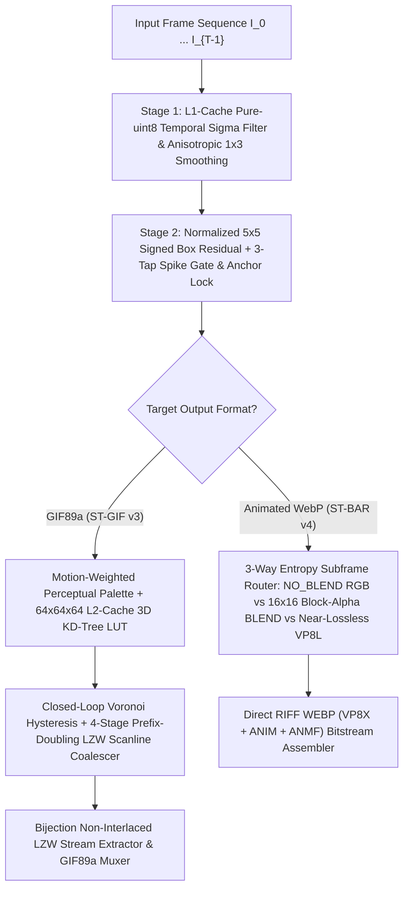

# 🎬 ST-BAR GIF Studio (`st-bar-gif-studio`)

<p align="center">
  <a href="README.md"><b>🇺🇸 English</b></a> •
  <a href="README.ko.md">🇰🇷 한국어</a> •
  <a href="README.zh-CN.md">🇨🇳 简体中文</a> •
  <a href="README.ja.md">🇯🇵 日本語</a> •
  <a href="README.es.md">🇪🇸 Español</a>
</p>

> 🇺🇸 **Next-Generation $O(N)$ Spatio-Temporal LZW-RDO `.gif` & Block-Aligned `.webp` Compression Engine + Honeycam-Style Screen Recorder Studio**  
> 🇰🇷 **차세대 $O(N)$ 시공간 LZW-RDO `.gif` 및 블록 정렬 `.webp` 압축 최적화 알고리즘 & 허니캠 스타일 움짤 스튜디오**  
> 🇨🇳 **下一代 $O(N)$ 时空 LZW-RDO `.gif` 与块对齐 `.webp` 动图压缩优化引擎 + Honeycam 风格屏幕录制工作室**  
> 🇯🇵 **次世代 $O(N)$ 時空間 LZW-RDO `.gif` ＆ ブロック整列 `.webp` 圧縮最適化エンジン + Honeycam スタイルの画面録画スタジオ**  
> 🇪🇸 **Motor de compresión espacio-temporal $O(N)$ de próxima generación para `.gif` y `.webp` animado + Estudio de grabación estilo Honeycam**

[](LICENSE)
[](https://www.python.org/)
[](#)

---

## 🌍 Multilingual Overview (다국어 프로젝트 소개)

* 🇺🇸 **English:** **`st-bar-gif-studio`** introduces two novel, strictly $O(N)$ single-pass spatio-temporal compression algorithms—**ST-GIF v3** (for `.gif`) and **ST-BAR v4** (for `.webp`). By replacing greedy pairwise frame differencing and error-diffusion dithering with a **Normalized $5\times 5$ Signed Spatial Box Residual**, **Closed-Loop Voronoi Hysteresis**, and a **4-Stage Prefix-Doubling LZW Scanline Coalescer**, it achieves **66% to 96.6% smaller `.gif` files (3× to 29× compression)** than FFmpeg 2-Pass (`palettegen + paletteuse`) and eliminates **75% to 98.8% of temporal background flicker**, complete with a **Honeycam-style click-through screen recorder & continuous quality slider (`1 ~ 100`) GUI**. ([Read Full English Docs Below](#-overview-technical-background) | [🇰🇷 한국어 문서](README.ko.md) | [🇨🇳 中文文档](README.zh-CN.md) | [🇯🇵 日本語ドキュメント](README.ja.md) | [🇪🇸 Documentación en Español](README.es.md))
* 🇰🇷 **한국어 (Korean):** **`st-bar-gif-studio`**는 기존 FFmpeg 2-Pass(`palettegen + paletteuse`), Pillow, `libwebp`가 가진 **시간축 노이즈 끓어오름(Temporal Boiling)**과 **디더링 위상 반전으로 인한 LZW 사전 붕괴 문제**를 근본적으로 해결한 차세대 $O(N)$ 시공간 움짤 압축 엔진(**ST-GIF v3** & **ST-BAR v4**)입니다. 실제 게임·화면 캡처에서 FFmpeg 최고급 2-Pass 대비 **용량을 66% ~ 96.6%(3배~29.1배 축소) 절감**하고 배경 자글거림을 **98.8%까지 제거**하며, **허니캠 스타일 투명 캡처 프레임**과 **연속 품질 슬라이더(`1 ~ 100`) GUI**를 제공합니다. 👉 **[전체 한국어 문서 보기 (README.ko.md)](README.ko.md)**
* 🇨🇳 **简体中文 (Simplified Chinese):** **`st-bar-gif-studio`** 提出了两种全新的严格 $O(N)$ 单遍时空动图压缩算法——**ST-GIF v3**（针对 `.gif`）与 **ST-BAR v4**（针对 `.webp`）。通过**带符号 $5\times 5$ 空间盒残差**、**闭环 Voronoi 迟滞**以及 **4 阶倍增前缀 LZW 扫描线合并器**，在真实游戏与屏幕录制测试中相比 FFmpeg 黄金标准双通道管线 **缩减 66% 至 96.6% 的体积（缩小 3 倍至 29.1 倍）**，消除 **75% 至 98.8% 的背景闪烁**，并内置 **Honeycam 风格鼠标穿透录屏框与 `1 ~ 100` 连续质量滑块 GUI**。 👉 **[阅读完整中文文档 (README.zh-CN.md)](README.zh-CN.md)**
* 🇯🇵 **日本語 (Japanese):** **`st-bar-gif-studio`** は、従来の FFmpeg 2-Pass や `libwebp` における**時間軸ノイズのちらつき（Temporal Boiling）**や**誤差拡散ディザリングによる LZW 辞書の崩壊**を解決する次世代 $O(N)$ 時空間アニメ画像圧縮エンジン（**ST-GIF v3** ＆ **ST-BAR v4**）です。実際のゲーム録画や画面キャプチャにおいて、FFmpeg 2-Pass と比較して **ファイルサイズを 66%〜96.6% 削減（1/3〜1/29 に圧縮）** し、背景フリッカーを **最大 98.8% 除去**。さらに **Honeycam スタイルのクリック透過録画フレーム＆連続品質スライダー (`1 ~ 100`) GUI** を備えています。 👉 **[日本語の完全なドキュメントを読む (README.ja.md)](README.ja.md)**
* 🇪🇸 **Español (Spanish):** **`st-bar-gif-studio`** presenta dos nuevos algoritmos de compresión espacio-temporal $O(N)$ de una sola pasada: **ST-GIF v3** (para `.gif`) y **ST-BAR v4** (para `.webp`). Mediante el **Residuo Espacial de Caja con Signo de $5\times 5$**, la **Histéresis de Voronoi en Lazo Cerrado** y la **Fusión de Líneas LZW**, logra **archivos `.gif` entre un 66% y un 96.6% más pequeños (3× a 29× menor tamaño)** que FFmpeg 2-Pass y elimina **hasta el 98.8% del parpadeo temporal**, incluyendo un **estudio GUI con grabador de pantalla transparente estilo Honeycam y control deslizante de calidad (`1 ~ 100`)**. 👉 **[Leer documentación completa en Español (README.es.md)](README.es.md)**

---

## 🌟 Overview (Technical Background)

Standard animated image encoders—such as **FFmpeg (`palettegen + paletteuse`)**, **Pillow**, and **`libwebp` (`WebPAnimEncoder`)**—rely on greedy pairwise frame differencing ($I_t$ vs $I_{t-1}$) and error-diffusion dithering (Floyd-Steinberg / Sierra). When applied to real-world game captures or screen recordings containing subtle sensor/compression jitter ($\pm 1 \sim 3$ RGB), standard encoders suffer from three catastrophic inefficiencies:
1. **Temporal Boiling & Double-Delta Penalty:** Random pixel noise triggers `A → B → A` oscillations, expanding sub-frame bounding boxes to 100% of the canvas and causing visible background flicker.
2. **Dither Pattern Phase Flipping & Voronoi Boundary Toggling:** Error-diffusion dithering flips checkerboard patterns across frames, destroying LZW dictionary run lengths in `.gif` and inflating file sizes by **5× to 25×**.
3. **DCT Macroblock Fragmentation (in Animated WebP):** Punching pixel-level transparent holes ($\alpha=0$) creates high-frequency step edges inside VP8 16×16 macroblocks, increasing AC coefficient entropy.

**`st-bar-gif-studio`** introduces two novel, strictly $O(N)$ single-pass compression algorithms—**ST-GIF v3** (for classic `.gif`) and **ST-BAR v4** (for modern `.webp`)—wrapped in a convenient **Honeycam-style Transparent Screen Recorder & Quality-Slider Studio GUI**.

---

## 📊 Benchmark 1: Real-World Game & Screen Captures (`.gif` Compression)

Tested on high-resolution real-world **Honeycam** game/screen captures against **Pillow (`optimize=True`)** and **FFmpeg's Gold-Standard 2-Pass Pipeline (`palettegen + paletteuse=dither=sierra2_4a:diff_mode=rectangle`)**:


| Capture Sequence (`Resolution`, `Frames`) | Encoder Method | Output `.gif` Size | Size Reduction vs `FFmpeg 2-Pass` | Encode Time | PSNR | SSIM | Temporal Flicker ↓ |
| :--- | :--- | ---: | :---: | ---: | :---: | :---: | :---: |
| **Clip 1 (UI / Scene)**<br>(`892×619`, 134f, Source 1,148 KB) | `Pillow Optimize` | 9,050.7 KB | +138.4% | 4,223 ms | 40.77 dB | 0.9935 | 0.147 |
| | `FFmpeg 2-Pass HQ (sierra2_4a)` | 3,796.5 KB | Baseline | 1,166 ms | 53.51 dB | 0.9988 | 0.090 |
| | `FFmpeg 2-Pass (bayer_s3)` | 4,306.0 KB | +13.4% | 571 ms | 41.56 dB | 0.9974 | 0.085 |
| | **ST-GIF v3 Balanced (`Q=75`)** | **174.7 KB** | **-95.4% (21.7× smaller)** | 7,375 ms | **38.94 dB** | **0.9876** | **0.023 (-74.4%)** |
| | **ST-GIF v3 Compact (`Q=45`)** | **130.5 KB** | **-96.6% (29.1× smaller)** | 4,924 ms | **38.37 dB** | **0.9855** | **0.022 (-75.6%)** |
| **Clip 2 (Gameplay)**<br>(`557×331`, 106f, Source 1,296 KB) | `Pillow Optimize` | 9,510.3 KB | -6.3% | 5,341 ms | 34.86 dB | 0.9698 | 2.008 |
| | `FFmpeg 2-Pass HQ (sierra2_4a)` | 10,146.1 KB | Baseline | 2,329 ms | 33.18 dB | 0.9039 | 2.934 |
| | `FFmpeg 2-Pass (bayer_s3)` | 7,470.3 KB | -26.4% | 1,220 ms | 34.00 dB | 0.9375 | 1.168 |
| | **ST-GIF v3 Balanced (`Q=75`)** | **1,321.0 KB** | **-87.0% (7.7× smaller)** | 2,873 ms | **32.99 dB** | **0.9042 (↑)** | **0.035 (-98.8%)** |
| | **ST-GIF v3 Compact (`Q=45`)** | **1,058.2 KB** | **-89.6% (9.6× smaller)** | **1,958 ms** | **32.07 dB** | 0.8748 | **0.034 (-98.8%)** |
| **Clip 3 (FC Online)**<br>(`496×395`, 109f, Source 1,356 KB) | `Pillow Optimize` | 10,586.1 KB | -10.7% | 5,859 ms | 32.40 dB | 0.9716 | 1.995 |
| | `FFmpeg 2-Pass HQ (sierra2_4a)` | 11,855.2 KB | Baseline | 2,314 ms | 32.41 dB | 0.9354 | 2.198 |
| | `FFmpeg 2-Pass (bayer_s3)` | 10,842.7 KB | -8.5% | 1,227 ms | 33.90 dB | 0.9562 | 1.164 |
| | **ST-GIF v3 Balanced (`Q=75`)** | **2,240.6 KB** | **-81.1% (5.3× smaller)** | 2,844 ms | **31.51 dB** | **0.9156** | **0.072 (-96.7%)** |
| | **ST-GIF v3 Compact (`Q=45`)** | **1,734.3 KB** | **-85.4% (6.8× smaller)** | **2,086 ms** | **30.86 dB** | 0.8932 | **0.072 (-96.7%)** |
| **Clip 4 (LoL Full-Panning)**<br>(`1051×482`, 89f, Source 3,325 KB) | `Pillow Optimize` | 19,797.8 KB | -32.9% | 10,033 ms | 31.51 dB | 0.9492 | 1.968 |
| | `FFmpeg 2-Pass HQ (sierra2_4a)` | 29,484.9 KB | Baseline | 6,645 ms | 30.62 dB | 0.8786 | 3.303 |
| | `FFmpeg 2-Pass (bayer_s3)` | 23,491.0 KB | -20.3% | 3,943 ms | 31.83 dB | 0.9296 | 1.487 |
| | **ST-GIF v3 Balanced (`Q=75`)** | **9,998.9 KB** | **-66.1% (3.0× smaller)** | 6,738 ms | **30.21 dB** | **0.8854 (↑)** | **0.292 (-91.2%)** |
| | **ST-GIF v3 Compact (`Q=45`)** | **8,408.8 KB** | **-71.5% (3.5× smaller)** | **4,859 ms** | **29.61 dB** | 0.8513 | **0.298 (-91.0%)** |

---

## 📊 Benchmark 2: Animated WebP Optimization (`ST-BAR v4` vs `libwebp`)


* **50% to 80% smaller file sizes** than `libwebp` Fast (`method=4`) and Slow (`method=6, minimize_size=True`) across all lossy test suites, and **90% to 97% smaller (up to 33× compression)** in lossless mode.
* **Up to 28× faster encoding speed** than `libwebp minimize_size=True`, while **improving Ground-Truth PSNR (+0.8 to +4.7 dB)** and eliminating **96%+ of background temporal boiling**.

---

## 🧠 Core Algorithmic Architecture



### 1. Signed Spatial Box Residual & 3-Tap Temporal Spike Gate ($O(N)$)
Zero-mean sensor/compression noise $\eta \sim \mathcal{N}(0, \sigma^2)$ cancels out over a $5\times 5$ spatial window ($N=25$) when summed **with sign preserved** ($\sigma_{\text{mean}} = \sigma / 5$), whereas true object motion shifts local pixels coherently in the same direction. By exploiting the linearity of the box filter ($\text{Box}(C_t - A_{t-1}) = \text{Box}(C_t) - \text{Box}(A_{t-1})$), ST-BAR evaluates coherent motion in pure 8-bit SIMD (`cv2.boxFilter` + `cv2.absdiff`) in $< 1\text{ ms}$ per frame.

### 2. Closed-Loop Voronoi Hysteresis & 4-Stage Prefix-Doubling LZW Coalescer (`ST-GIF v3`)
Instead of open-loop quantization, `ST-GIF v3` tracks the exact RGB color $\hat{C}_{t-1}(x, y) = \text{Palette}[\hat{P}_{t-1}(x, y)]$ currently displayed on the decoder's canvas and selects palette index $\hat{p}_t(x, y)$ via:

$$\hat{p}_t(x, y) = \begin{cases} 255 \text{ (TRANSPARENT)} & \text{if } \|\tilde{I}_t(x,y) - \hat{C}_{t-1}(x,y)\|_\infty \le \tau_{\text{keep}} \text{ or } e_{\text{old}} - e_{\text{new}} \le \delta_{\text{gain}} \\ \hat{p}_t(x - 2^k, y) & \text{if } \|\tilde{I}_t(x,y) - \text{Palette}[\hat{p}_t(x - 2^k, y)]\|_\infty \le \delta_{\text{LZW}} \quad (k \in \{0,1,2,3\}) \\ \text{LUT}_{64^3}(\tilde{I}_t(x,y)) & \text{otherwise} \end{cases}$$

---

## 🚀 Quick Start

### 1. Installation
```bash
git clone https://github.com/LoveBlonde/st-bar-gif-studio.git
cd st-bar-gif-studio
pip install -r requirements.txt
```

### 2. Launch Honeycam-Style Studio GUI
Double-click `run_studio.bat` on Windows, or run:
```bash
python main.py
```
* **🎥 Transparent Screen Recording (`🔴 New Recording`):** Place the transparent click-through capture frame over any game or video and press **`● REC (or F9)`** to capture at 10–60 FPS.
* **📂 Trim, Scale & Speed Control:** Load `.webp`, `.gif`, `.mp4`, or `.webm` files to trim start/end frames, scale resolution (`100%`, `75%`, `50%`), and adjust playback speed.
* **🎚️ Continuous Quality Slider (`1 ~ 100`) & Live Preview:** Adjust the compression strength continuously and click **`[⚡ Test Compress Frame]`** to inspect real-time compressed quality before exporting.

### 3. Command-Line Interface (CLI)
```bash
# Convert WebP/MP4 to ultra-compact GIF (quality=75 balanced, quality=45 compact)
python main.py -i input.webp -o output.gif -q 75

# Convert or re-optimize to Animated WebP (ST-BAR v4)
python main.py -i input.mp4 -o output.webp -q 80
```

---

## 📄 License
Distributed under the **MIT License**. See [`LICENSE`](LICENSE) for details.
