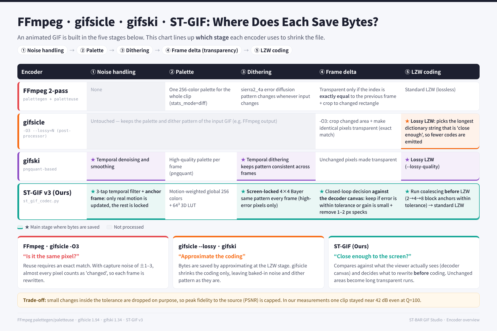
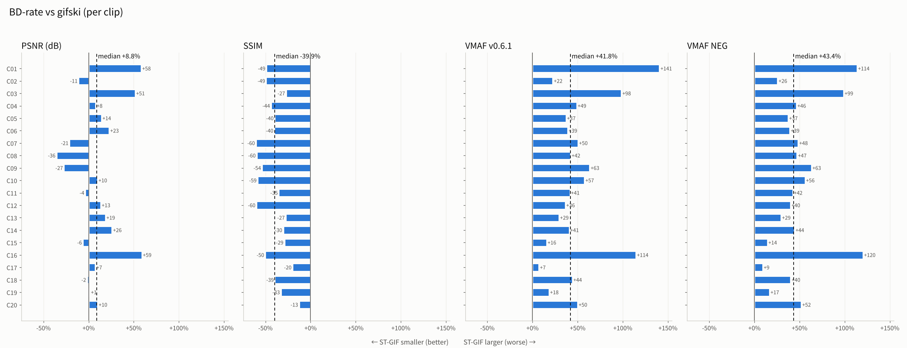
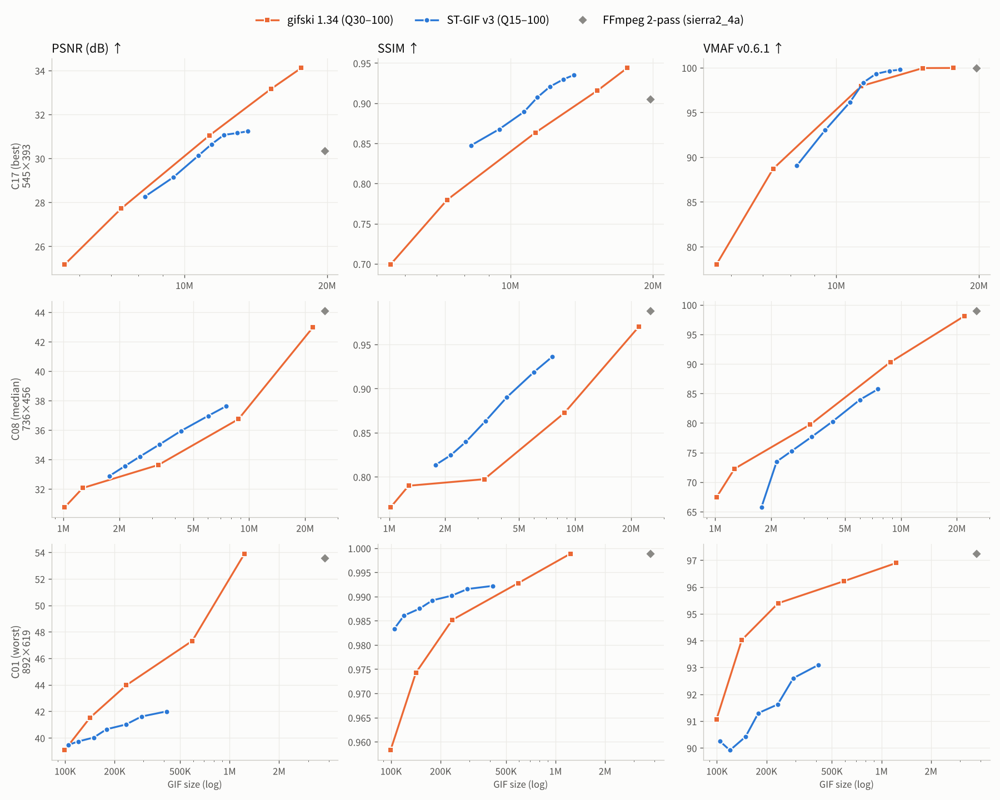
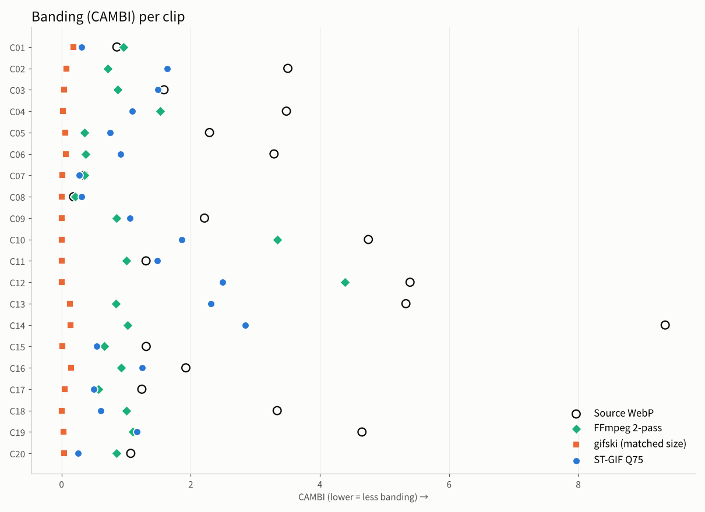

# ST-GIF v3 Benchmark vs gifski · gifsicle · FFmpeg

> Measured 2026-10-26 · 20 real screen/game capture clips · PSNR, SSIM, VMAF (v0.6.1 / NEG), CAMBI, Flicker, TDE
> Raw data and reproduction code: [`data/`](../data), [`code/`](../code).

## Summary

| | Result |
|---|---|
| **vs FFmpeg 2-pass** | At Q75, median size **25%** of FFmpeg (≈4.0× smaller); static-region flicker 2.06 → **0.11** |
| **vs gifsicle `--lossy`** | **-32.4%** bytes at equal PSNR (wins 20/20 clips) |
| **vs gifski (PSNR)** | +8.8% bytes at equal PSNR (wins 7/20, not significant) |
| **vs gifski (SSIM)** | **-39.9%** bytes at equal SSIM (wins 20/20) |
| **vs gifski (VMAF)** | **+41.8%** bytes at equal VMAF (wins 0/20) — **gifski is better** |
| **Banding (CAMBI, matched size)** | ST-GIF **1.08** vs gifski **0.035** (gifski better on 20/20 clips) |

**Bottom line:** ST-GIF v3 produces clearly smaller and more stable GIFs than FFmpeg and gifsicle, but it **does not beat gifski**. It wins on SSIM and loses on VMAF and CAMBI, mainly because of banding: the dither is effectively disabled in the current implementation (see [Known issue](#known-issue-the-bayer-dither-is-effectively-off)).



## What was measured

- **Data:** 20 clips stratified by file-size rank from 95 screen-capture Animated WebP recordings. Resolution 376×293 – 1102×687, first 140 frames per clip, source 1.2 – 51.9 MB. See the [clip list](#appendix-clip-ids).
- **Encoders and parameter sweeps**

  | Encoder | Settings | Sweep |
  |---|---|---|
  | ST-GIF v3 | `encode_st_gif`, source variable frame durations | Q = 15, 30, 45, 60, 75, 90, 100 |
  | gifski 1.34 | PNG frames, `--fps <mean>`, source width | Q = 30, 50, 70, 90, 100 |
  | FFmpeg 6.1.1 | `palettegen=stats_mode=diff` + `paletteuse=dither=sierra2_4a:diff_mode=rectangle` | single point |
  | gifsicle 1.94 | `-O3 --lossy=N` on FFmpeg output | N = 20, 40, 80, 140, 200 |

- **Metrics:** the reference is the decoded source WebP.
  - PSNR: mean over all frames
  - SSIM: about 20 sampled frames, 2× subsampled
  - VMAF v0.6.1 and VMAF-NEG: libvmaf, yuv444p
  - CAMBI: libvmaf defaults (banding, lower is better)
  - Flicker: frame-to-frame change of the output on pixels that are static in the source
  - TDE: mismatch between the output's and the source's frame-to-frame change. Penalizes both flicker and frozen motion.
- **BD-rate:** PCHIP interpolation of (quality, log bytes), mean rate difference over the overlapping quality range. Negative favors ST-GIF.
- **Temporal alignment:** FFmpeg and gifski receive a constant frame rate, so they are aligned on a uniform timeline; ST-GIF is aligned on the source's variable timeline. Mixing the two understates baseline PSNR badly (e.g. FFmpeg on C01: 35.4 dB vs. the correct 53.5 dB).

## Results

### BD-rate vs gifski

| Anchor | Quality metric | Median BD-rate | 95% CI (bootstrap) | ST-GIF wins | Wilcoxon p |
|---|---|---:|---|---:|---:|
| gifski 1.34 | PSNR (dB) | **+8.8%** | [-2.7%, +16.3%] | 7/20 | 0.13 |
| gifski 1.34 | SSIM | **-39.9%** | [-49.7%, -31.5%] | 20/20 | < 0.001 |
| gifski 1.34 | VMAF v0.6.1 | **+41.8%** | [+36.6%, +50.2%] | 0/20 | < 0.001 |
| gifski 1.34 | VMAF NEG | **+43.4%** | [+38.2%, +50.1%] | 0/20 | < 0.001 |
| FFmpeg + gifsicle --lossy | PSNR (dB) | **-32.4%** | [-49.0%, -24.3%] | 20/20 | < 0.001 |
| FFmpeg + gifsicle --lossy | SSIM | **-53.6%** | [-61.1%, -43.1%] | 19/19 | < 0.001 |



RD curves of three representative clips, chosen by VMAF BD-rate: best C17, median C08, worst C01.



Full 20-clip grids: [PSNR](figures/en/rd_psnr_grid.png) · [SSIM](figures/en/rd_ssim_grid.png) · [VMAF](figures/en/rd_vmaf_grid.png).

### Matched-size comparison (ST-GIF Q75 vs the gifski setting closest in size)

Median size ratio (ST / gifski) is **1.06**.

| Metric | ST-GIF Q75 | gifski (nearest size) | FFmpeg 2-pass | ST − gifski (median) | Clips where ST is better |
|---|---:|---:|---:|---:|---:|
| PSNR (dB) ↑ | 33.22 | 32.74 | 33.77 | +0.01 | 10/20 |
| SSIM ↑ | 0.9187 | 0.8623 | 0.9423 | +0.0571 | 19/20 |
| VMAF ↑ | 85.2 | 89.7 | 97.3 | -2.4 | 5/20 |
| VMAF-NEG ↑ | 82.8 | 87.8 | 96.2 | -2.8 | 5/20 |
| CAMBI ↓ | 1.078 | 0.035 | 0.863 | +1.068 | 0/20 |
| Flicker ↓ | 0.109 | 0.247 | 2.056 | -0.120 | 17/20 |
| TDE ↓ | 2.664 | 2.901 | 3.235 | -0.082 | 12/20 |
| Encoding time (s) | 8.3 | 9.9 | 9.5 | -3.0 | — |

### Banding



The source WebP itself has a median CAMBI of 2.25. Dithering encoders mask this banding: gifski reaches 0.035 and stays below the source on every clip, and FFmpeg reaches 0.86 and stays below it on 17 of 20 clips. ST-GIF only roughly halves it (1.08).

### Fidelity ceiling

Medians at Q=100:

| | PSNR | VMAF |
|---|---:|---:|
| ST-GIF | 33.9 dB | 87.6 |
| gifski | 39.2 dB | 98.0 |

ST-GIF deliberately discards changes inside its tolerance, so even at the highest quality it never fully converges to the source.

## Component contributions (ablation)

Each component was removed or replaced on 10 clips at Q45 and Q75, and the result was compared **against the full pipeline's RD curve at the same size**. Negative ΔPSNR/ΔSSIM or positive ΔTDE means the component helps.

| Component removed / replaced | ΔPSNR (dB) | ΔSSIM | ΔTDE | ΔFlicker | Points worse |
|---|---:|---:|---:|---:|---:|
| ① Spatio-temporal stabilization | -0.08 | -0.0025 | +0.040 | +0.024 | 13/20 |
| ④ LZW run coalescing | -0.09 | -0.0040 | +0.014 | -0.007 | 15/20 |
| ③ Bayer dither (off) | +0.00 | +0.0000 | +0.000 | +0.000 | 1/20 |
| ③ Bayer → Floyd–Steinberg | -1.17 | -0.0153 | +0.264 | +0.015 | 18/18 |
| ⑤ Tolerance-based keep decision | -0.23 | -0.0036 | +0.150 | +0.267 | 10/13 |
| ⑤ Speckle / isolated-run removal | -0.18 | -0.0037 | +0.066 | +0.007 | 19/20 |

- The **tolerance-based keep decision** contributes most. Removing it grows files by +66% at Q45.
- Speckle removal helps a little but consistently (19/20). LZW run coalescing (15/20) and stabilization (13/20) help less and vary by clip.
- Replacing the ordered dither with Floyd–Steinberg hurts every metric, so the choice of position-locked quantization is right.

### Known issue: the Bayer dither is effectively off

`quantize_frame_with_locked_bayer` multiplies `BAYER_4X4` (−7 … +8) by the dither strength and truncates the result to `int16`.
- The dither strength is 0.14 at Q75, 0.224 at Q90 and 0.28 at Q100.
- That leaves only **1/16** non-zero offsets at Q75 (0…1), 7/16 at Q90 and 9/16 at Q100.
- The 3D LUT bins RGB in steps of 4, so a ±1–2 offset almost never changes the selected palette entry.

As a result, turning the dither off gave **byte-identical files** at Q45 (10/10; the strength is already 0 there) and practically identical ones at Q75 (at most 0.28% size and 0.003 dB PSNR difference). This is the most likely cause of the VMAF and CAMBI deficit and the first thing to fix.

## Difference from the numbers in the main README

The README's "3–29× smaller than FFmpeg" was measured on the **four smallest files** (size ranks 0, 1, 2, 8). Over 20 clips spanning the whole size range, the median is **≈4.0×**. Please quote the README table together with its sample.

## Limitations

- The reference is a lossy WebP, so removing its compression noise is penalized by PSNR.
- 20 clips from one person's capture folder; each setting was measured once.
- Encoding times come from a 2-vCPU cloud container and include periods of parallel execution.
- VMAF and CAMBI were measured for ST-GIF, gifski and FFmpeg only. gifsicle was already far behind on PSNR and SSIM.

## Reproduction

See [`code/README.md`](../code/README.md). Requires `ffmpeg`, `gifsicle` ≥ 1.92, `gifski` and the Netflix libvmaf `vmaf` CLI.

```bash
python rd_bench.py 0 2 & python rd_bench.py 1 2      # encode + PSNR/SSIM/Flicker/TDE
python vmaf_bench.py 0 2 & python vmaf_bench.py 1 2  # VMAF + CAMBI
python ablation.py                                   # ablation
python build_reports.py out                          # figures, tables, documents
```

## Appendix: clip IDs

| ID | Source file |
|---|---|
| C01 | `C01_892x619_134f_10fps.webp` |
| C02 | `C02_557x331_106f_10fps.webp` |
| C03 | `C03_496x395_109f_28fps.webp` |
| C04 | `C04_714x410_244f_30fps.webp` |
| C05 | `C05_1051x482_89f_6fps.webp` |
| C06 | `C06_1051x482_102f_30fps.webp` |
| C07 | `C07_751x516_230f_31fps.webp` |
| C08 | `C08_736x456_317f_31fps.webp` |
| C09 | `C09_1052x599_251f_33fps.webp` |
| C10 | `C10_751x516_348f_31fps.webp` |
| C11 | `C11_518x360_400f_30fps.webp` |
| C12 | `C12_751x516_512f_31fps.webp` |
| C13 | `C13_1018x538_204f_31fps.webp` |
| C14 | `C14_894x520_200f_31fps.webp` |
| C15 | `C15_376x293_780f_60fps.webp` |
| C16 | `C16_860x548_189f_30fps.webp` |
| C17 | `C17_545x393_599f_30fps.webp` |
| C18 | `C18_1052x599_339f_33fps.webp` |
| C19 | `C19_1102x687_584f_33fps.webp` |
| C20 | `C20_724x564_1410f_60fps.webp` |

## Appendix: per-clip BD-rate vs gifski

| ID | Resolution | Frames | Source | BD PSNR | BD SSIM | BD VMAF | BD VMAF-NEG | CAMBI ST / gifski |
|---|---|---:|---:|---:|---:|---:|---:|---:|
| C01 | 892×619 | 134 | 1.2 MB | +58.2% | -48.9% | +140.6% | +113.6% | 0.31 / 0.18 |
| C02 | 557×331 | 106 | 1.3 MB | -11.1% | -49.2% | +22.5% | +25.6% | 1.63 / 0.07 |
| C03 | 496×395 | 109 | 1.4 MB | +51.5% | -27.1% | +98.3% | +98.7% | 1.49 / 0.04 |
| C04 | 714×410 | 140 | 2.6 MB | +7.8% | -43.8% | +48.8% | +46.4% | 1.10 / 0.02 |
| C05 | 1051×482 | 89 | 3.4 MB | +14.1% | -39.7% | +37.0% | +37.2% | 0.75 / 0.05 |
| C06 | 1051×482 | 102 | 3.6 MB | +22.7% | -40.0% | +38.8% | +39.1% | 0.91 / 0.06 |
| C07 | 751×516 | 140 | 4.5 MB | -21.2% | -60.5% | +50.4% | +48.4% | 0.28 / 0.01 |
| C08 | 736×456 | 140 | 4.9 MB | -35.6% | -59.6% | +42.2% | +47.0% | 0.31 / 0.00 |
| C09 | 1052×599 | 140 | 5.7 MB | -27.3% | -53.7% | +63.3% | +63.0% | 1.06 / 0.00 |
| C10 | 751×516 | 140 | 6.2 MB | +9.8% | -58.6% | +57.4% | +55.9% | 1.87 / 0.01 |
| C11 | 518×360 | 140 | 7.5 MB | -3.6% | -35.1% | +41.4% | +42.5% | 1.48 / 0.00 |
| C12 | 751×516 | 140 | 8.0 MB | +13.3% | -59.9% | +36.2% | +39.9% | 2.49 / 0.00 |
| C13 | 1018×538 | 140 | 8.6 MB | +18.5% | -27.4% | +29.3% | +29.4% | 2.31 / 0.13 |
| C14 | 894×520 | 140 | 9.2 MB | +25.9% | -30.2% | +40.6% | +44.3% | 2.85 / 0.14 |
| C15 | 376×293 | 140 | 10.5 MB | -6.3% | -28.9% | +15.5% | +14.3% | 0.54 / 0.01 |
| C16 | 860×548 | 140 | 12.9 MB | +58.9% | -50.3% | +114.5% | +120.2% | 1.24 / 0.15 |
| C17 | 545×393 | 140 | 15.1 MB | +7.4% | -19.9% | +7.1% | +9.1% | 0.50 / 0.05 |
| C18 | 1052×599 | 140 | 17.0 MB | -1.7% | -39.5% | +44.0% | +40.1% | 0.61 / 0.01 |
| C19 | 1102×687 | 140 | 22.1 MB | +1.4% | -32.8% | +18.2% | +16.6% | 1.16 / 0.03 |
| C20 | 724×564 | 140 | 51.9 MB | +10.0% | -12.6% | +49.9% | +51.8% | 0.26 / 0.04 |
