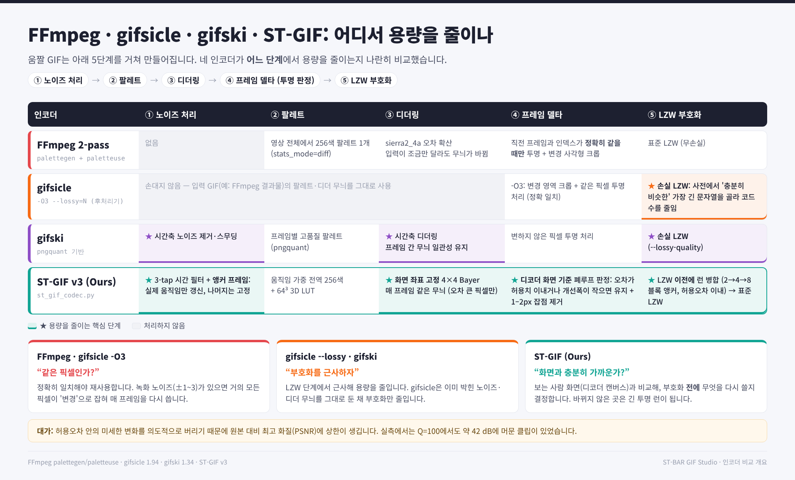
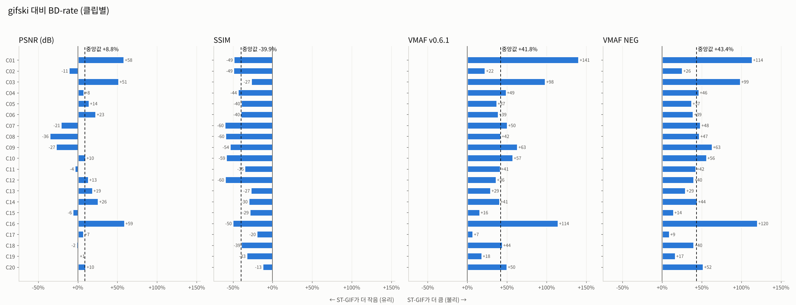
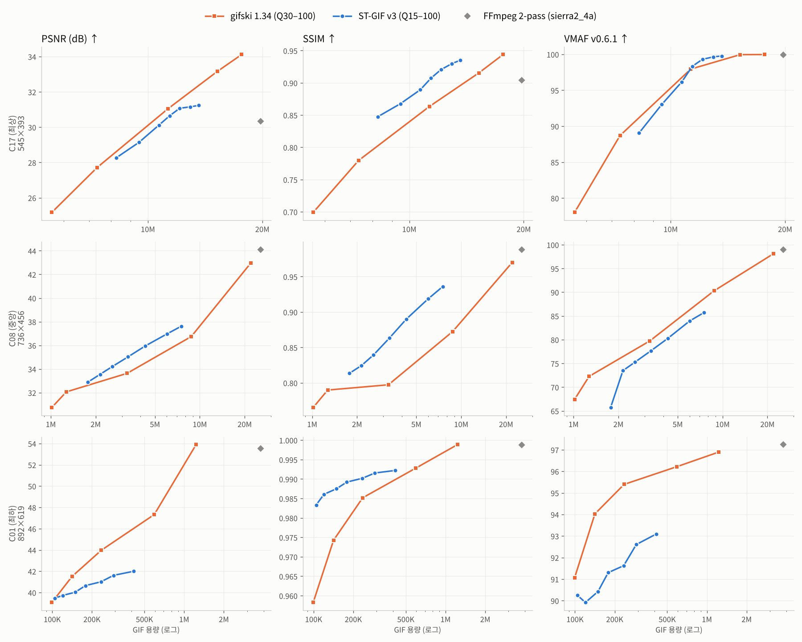
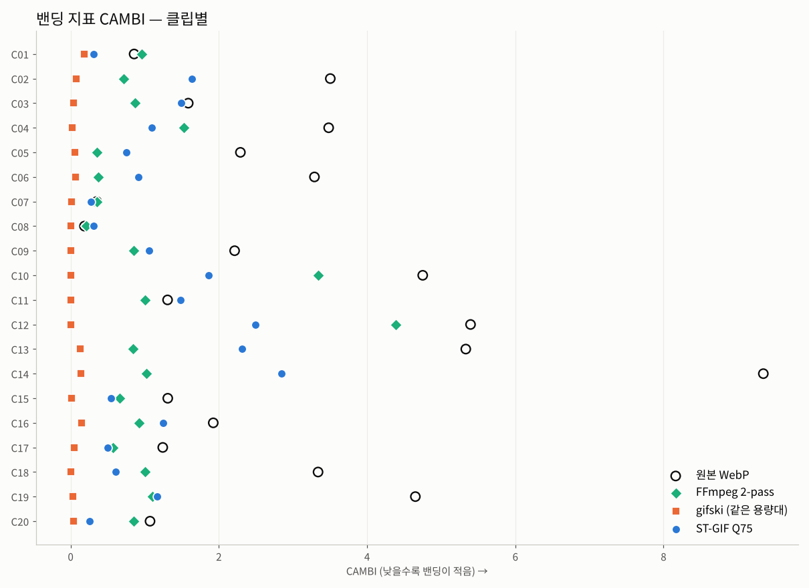

# ST-GIF v3 벤치마크: gifski · gifsicle · FFmpeg와의 비교

> 측정일 2026-10-26 · 실제 화면·게임 캡처 20개 클립 · 지표 PSNR, SSIM, VMAF(v0.6.1 / NEG), CAMBI, Flicker, TDE
> 원자료와 재현 코드는 [`data/`](../data), [`code/`](../code)에 있습니다.

## 요약

| | 결과 |
|---|---|
| **FFmpeg 2-pass 대비** | Q75 기준 용량 중앙값 **25%** (약 4.0배 축소), 정적 영역 Flicker 2.06 → **0.11** |
| **gifsicle `--lossy` 대비** | 같은 PSNR에서 용량 **-32.4%** (20/20 클립 우위) |
| **gifski 대비 (PSNR)** | 같은 PSNR에서 용량 +8.8% (7/20 클립 우위, 유의하지 않음) |
| **gifski 대비 (SSIM)** | 같은 SSIM에서 용량 **-39.9%** (20/20 클립 우위) |
| **gifski 대비 (VMAF)** | 같은 VMAF에서 용량 **+41.8%** (0/20 클립 우위) — **gifski가 우세** |
| **밴딩 (CAMBI, 같은 용량대)** | ST-GIF **1.08** vs gifski **0.035** (gifski가 20/20 클립에서 우세) |

**한 줄 정리:** ST-GIF v3는 FFmpeg와 gifsicle보다 확실히 작고 안정적인 GIF를 만듭니다. 하지만 **gifski보다 낫다고 말할 수는 없습니다.** SSIM에서는 앞서지만 VMAF와 CAMBI에서는 뒤지고, 그 주된 원인은 현재 구현에서 디더가 사실상 동작하지 않아 생기는 밴딩입니다(아래 [알려진 문제](#알려진-문제-bayer-디더가-사실상-꺼져-있음) 참고).



## 무엇을 어떻게 측정했나

- **데이터:** 화면 캡처 도구로 녹화한 Animated WebP 95개 중 파일 크기 순위로 층화 추출한 **20개**. 해상도 376×293 ~ 1102×687, 클립당 앞 140프레임까지 사용, 원본 1.2 ~ 51.9 MB. 클립 목록은 [부록](#부록-클립-id)에 있습니다.
- **인코더와 파라미터 sweep**

  | 인코더 | 설정 | sweep |
  |---|---|---|
  | ST-GIF v3 | `encode_st_gif`, 원본의 가변 프레임 지속시간 사용 | Q = 15, 30, 45, 60, 75, 90, 100 |
  | gifski 1.34 | PNG 프레임 입력, `--fps <평균>`, 원본 폭 | Q = 30, 50, 70, 90, 100 |
  | FFmpeg 6.1.1 | `palettegen=stats_mode=diff` + `paletteuse=dither=sierra2_4a:diff_mode=rectangle` | 단일점 |
  | gifsicle 1.94 | FFmpeg 출력에 `-O3 --lossy=N` | N = 20, 40, 80, 140, 200 |

- **지표:** 기준 영상은 원본 WebP를 디코딩한 프레임입니다.
  - PSNR: 전체 프레임 평균
  - SSIM: 약 20프레임 샘플, 2배 다운샘플
  - VMAF v0.6.1과 VMAF-NEG: libvmaf, yuv444p
  - CAMBI: libvmaf 기본 설정 (밴딩 지표, 낮을수록 좋음)
  - Flicker: 원본이 변하지 않은 픽셀에서 결과물이 프레임 간에 변한 정도
  - TDE: 원본의 프레임 간 변화와 결과물의 프레임 간 변화가 어긋난 정도. 깜빡임과 얼어붙음을 모두 벌점으로 줍니다.
- **BD-rate:** (품질, log 용량) 곡선을 PCHIP으로 보간한 뒤 겹치는 품질 구간에서 평균 용량 차이를 계산합니다. 음수면 ST-GIF가 유리합니다.
- **시간축 정렬:** FFmpeg와 gifski는 고정 fps로 입력하므로 균등 시간축으로, ST-GIF는 원본 시간축으로 정렬했습니다. 둘을 섞으면 기준선 PSNR이 실제보다 크게 낮게 나옵니다(예: C01의 FFmpeg는 35.4 dB, 올바른 값은 53.5 dB).

## 결과

### gifski 대비 BD-rate

| 기준 인코더 | 품질 지표 | BD-rate 중앙값 | 95% CI (부트스트랩) | ST-GIF 우위 | Wilcoxon p |
|---|---|---:|---|---:|---:|
| gifski 1.34 | PSNR (dB) | **+8.8%** | [-2.7%, +16.3%] | 7/20 | 0.13 |
| gifski 1.34 | SSIM | **-39.9%** | [-49.7%, -31.5%] | 20/20 | < 0.001 |
| gifski 1.34 | VMAF v0.6.1 | **+41.8%** | [+36.6%, +50.2%] | 0/20 | < 0.001 |
| gifski 1.34 | VMAF NEG | **+43.4%** | [+38.2%, +50.1%] | 0/20 | < 0.001 |
| FFmpeg + gifsicle --lossy | PSNR (dB) | **-32.4%** | [-49.0%, -24.3%] | 20/20 | < 0.001 |
| FFmpeg + gifsicle --lossy | SSIM | **-53.6%** | [-61.1%, -43.1%] | 19/19 | < 0.001 |



대표 클립 3개의 RD 곡선입니다. VMAF BD-rate 기준으로 최상 C17, 중앙 C08, 최하 C01를 골랐습니다.



전체 20개 클립의 RD 곡선은 [PSNR](figures/ko/rd_psnr_grid.png) · [SSIM](figures/ko/rd_ssim_grid.png) · [VMAF](figures/ko/rd_vmaf_grid.png)에서 볼 수 있습니다.

### 같은 용량대 비교 (ST-GIF Q75 vs 용량이 가장 가까운 gifski 설정)

용량 비 중앙값(ST / gifski)은 **1.06**입니다.

| 항목 | ST-GIF Q75 | gifski (최근접 용량) | FFmpeg 2-pass | ST − gifski (중앙값) | ST가 나은 클립 |
|---|---:|---:|---:|---:|---:|
| PSNR (dB) ↑ | 33.22 | 32.74 | 33.77 | +0.01 | 10/20 |
| SSIM ↑ | 0.9187 | 0.8623 | 0.9423 | +0.0571 | 19/20 |
| VMAF ↑ | 85.2 | 89.7 | 97.3 | -2.4 | 5/20 |
| VMAF-NEG ↑ | 82.8 | 87.8 | 96.2 | -2.8 | 5/20 |
| CAMBI ↓ | 1.078 | 0.035 | 0.863 | +1.068 | 0/20 |
| Flicker ↓ | 0.109 | 0.247 | 2.056 | -0.120 | 17/20 |
| TDE ↓ | 2.664 | 2.901 | 3.235 | -0.082 | 12/20 |
| 인코딩 시간 (s) | 8.3 | 9.9 | 9.5 | -3.0 | — |

### 밴딩



원본 WebP 자체의 CAMBI 중앙값은 2.25입니다. 디더를 쓰는 gifski(0.035)는 모든 클립에서, FFmpeg(0.86)는 20개 중 17개 클립에서 원본에 있던 밴딩까지 가려줍니다. ST-GIF(1.08)는 절반 정도만 줄입니다.

### 화질 상한

Q=100에서의 중앙값입니다.

| | PSNR | VMAF |
|---|---:|---:|
| ST-GIF | 33.9 dB | 87.6 |
| gifski | 39.2 dB | 98.0 |

ST-GIF는 허용오차 안의 변화를 의도적으로 버리기 때문에 품질을 높여도 원본에 끝까지 가까워지지 않습니다.

## 구성 요소별 기여 (어블레이션)

10개 클립 × Q45·Q75에서 구성 요소를 하나씩 끄거나 바꾼 뒤, **전체 파이프라인의 RD 곡선과 같은 용량에서** 비교했습니다. 음수 ΔPSNR·ΔSSIM, 양수 ΔTDE는 그 구성 요소가 효율에 기여한다는 뜻입니다.

| 제거·교체한 구성 요소 | ΔPSNR (dB) | ΔSSIM | ΔTDE | ΔFlicker | 효율 악화 점 |
|---|---:|---:|---:|---:|---:|
| ① 시공간 안정화 | -0.08 | -0.0025 | +0.040 | +0.024 | 13/20 |
| ④ LZW 런 병합 | -0.09 | -0.0040 | +0.014 | -0.007 | 15/20 |
| ③ Bayer 디더 (끔) | +0.00 | +0.0000 | +0.000 | +0.000 | 1/20 |
| ③ Bayer → Floyd–Steinberg 교체 | -1.17 | -0.0153 | +0.264 | +0.015 | 18/18 |
| ⑤ 허용오차 유지 판정 | -0.23 | -0.0036 | +0.150 | +0.267 | 10/13 |
| ⑤ 스페클·고립점 제거 | -0.18 | -0.0037 | +0.066 | +0.007 | 19/20 |

- 가장 큰 기여는 **허용오차 유지 판정**입니다. Q45에서 이걸 끄면 용량이 +66% 늘어납니다.
- 스페클 제거는 작지만 일관되게 기여합니다(19/20). LZW 런 병합(15/20)과 시공간 안정화(13/20)는 기여가 작고 클립에 따라 다릅니다.
- 디더를 Floyd–Steinberg로 바꾸면 모든 지표가 나빠집니다. 위치 고정 양자화를 쓰는 선택 자체는 맞습니다.

### 알려진 문제: Bayer 디더가 사실상 꺼져 있음

`quantize_frame_with_locked_bayer`는 `BAYER_4X4`(−7 ~ +8)에 디더 강도를 곱한 뒤 `int16`으로 자릅니다.
- 디더 강도는 Q75에서 0.14, Q90에서 0.224, Q100에서 0.28입니다.
- 이때 0이 아닌 오프셋은 16칸 중 Q75에서 **1칸**(0~1), Q90에서 7칸, Q100에서 9칸뿐입니다.
- 3D LUT가 RGB를 4단위로 묶기 때문에 ±1~2 오프셋으로는 선택되는 팔레트 색이 거의 바뀌지 않습니다.

그래서 어블레이션에서 디더를 끈 결과는 Q45에서 **바이트 단위까지 같았고**(10/10, 원래 디더 강도가 0), Q75에서도 용량 차가 최대 0.28%, PSNR 차가 최대 0.003 dB로 사실상 같았습니다. VMAF와 CAMBI 열세의 가장 유력한 원인이며, 다음 버전에서 고쳐야 할 1순위입니다.

## 기존 README 수치와의 차이

README의 "FFmpeg 대비 3~29배 축소"는 **가장 작은 4개 파일**(크기 순위 0, 1, 2, 8)에서 측정한 값입니다. 크기 전 구간에서 고른 20개 클립의 중앙값은 **약 4.0배**입니다. README 표를 인용할 때는 표본이 다르다는 점을 함께 적는 것을 권합니다.

## 한계

- 기준 영상이 손실 압축된 WebP라서, 원본의 압축 잡음을 지우는 처리는 PSNR에서 불리하게 측정됩니다.
- 표본은 한 사람의 캡처 폴더에서 뽑은 20개 클립이고, 각 설정은 1회씩만 측정했습니다.
- 인코딩 시간은 2 vCPU 클라우드 컨테이너에서 측정했고 병렬 실행 구간이 섞여 있습니다.
- VMAF와 CAMBI는 ST-GIF, gifski, FFmpeg에 대해서만 측정했습니다. gifsicle은 PSNR과 SSIM에서 이미 크게 뒤져서 제외했습니다.

## 재현 방법

[`code/README.md`](../code/README.md)를 참고하세요. 필요한 도구는 `ffmpeg`, `gifsicle` 1.92 이상, `gifski`, Netflix libvmaf의 `vmaf` CLI입니다.

```bash
python rd_bench.py 0 2 & python rd_bench.py 1 2      # 인코딩 + PSNR/SSIM/Flicker/TDE
python vmaf_bench.py 0 2 & python vmaf_bench.py 1 2  # VMAF + CAMBI
python ablation.py                                   # 어블레이션
python build_reports.py out                          # 그림·표·문서 생성
```

## 부록: 클립 ID

| ID | 원본 파일명 |
|---|---|
| C01 | `C01_892x619_134f_10fps.webp` |
| C02 | `C02_557x331_106f_10fps.webp` |
| C03 | `C03_496x395_109f_28fps.webp` |
| C04 | `C04_714x410_244f_30fps.webp` |
| C05 | `C05_1051x482_89f_6fps.webp` |
| C06 | `C06_1051x482_102f_30fps.webp` |
| C07 | `C07_751x516_230f_31fps.webp` |
| C08 | `C08_736x456_317f_31fps.webp` |
| C09 | `C09_1052x599_251f_33fps.webp` |
| C10 | `C10_751x516_348f_31fps.webp` |
| C11 | `C11_518x360_400f_30fps.webp` |
| C12 | `C12_751x516_512f_31fps.webp` |
| C13 | `C13_1018x538_204f_31fps.webp` |
| C14 | `C14_894x520_200f_31fps.webp` |
| C15 | `C15_376x293_780f_60fps.webp` |
| C16 | `C16_860x548_189f_30fps.webp` |
| C17 | `C17_545x393_599f_30fps.webp` |
| C18 | `C18_1052x599_339f_33fps.webp` |
| C19 | `C19_1102x687_584f_33fps.webp` |
| C20 | `C20_724x564_1410f_60fps.webp` |

## 부록: 클립별 수치 (gifski 대비 BD-rate)

| ID | 해상도 | 프레임 | 원본 | BD PSNR | BD SSIM | BD VMAF | BD VMAF-NEG | CAMBI ST / gifski |
|---|---|---:|---:|---:|---:|---:|---:|---:|
| C01 | 892×619 | 134 | 1.2 MB | +58.2% | -48.9% | +140.6% | +113.6% | 0.31 / 0.18 |
| C02 | 557×331 | 106 | 1.3 MB | -11.1% | -49.2% | +22.5% | +25.6% | 1.63 / 0.07 |
| C03 | 496×395 | 109 | 1.4 MB | +51.5% | -27.1% | +98.3% | +98.7% | 1.49 / 0.04 |
| C04 | 714×410 | 140 | 2.6 MB | +7.8% | -43.8% | +48.8% | +46.4% | 1.10 / 0.02 |
| C05 | 1051×482 | 89 | 3.4 MB | +14.1% | -39.7% | +37.0% | +37.2% | 0.75 / 0.05 |
| C06 | 1051×482 | 102 | 3.6 MB | +22.7% | -40.0% | +38.8% | +39.1% | 0.91 / 0.06 |
| C07 | 751×516 | 140 | 4.5 MB | -21.2% | -60.5% | +50.4% | +48.4% | 0.28 / 0.01 |
| C08 | 736×456 | 140 | 4.9 MB | -35.6% | -59.6% | +42.2% | +47.0% | 0.31 / 0.00 |
| C09 | 1052×599 | 140 | 5.7 MB | -27.3% | -53.7% | +63.3% | +63.0% | 1.06 / 0.00 |
| C10 | 751×516 | 140 | 6.2 MB | +9.8% | -58.6% | +57.4% | +55.9% | 1.87 / 0.01 |
| C11 | 518×360 | 140 | 7.5 MB | -3.6% | -35.1% | +41.4% | +42.5% | 1.48 / 0.00 |
| C12 | 751×516 | 140 | 8.0 MB | +13.3% | -59.9% | +36.2% | +39.9% | 2.49 / 0.00 |
| C13 | 1018×538 | 140 | 8.6 MB | +18.5% | -27.4% | +29.3% | +29.4% | 2.31 / 0.13 |
| C14 | 894×520 | 140 | 9.2 MB | +25.9% | -30.2% | +40.6% | +44.3% | 2.85 / 0.14 |
| C15 | 376×293 | 140 | 10.5 MB | -6.3% | -28.9% | +15.5% | +14.3% | 0.54 / 0.01 |
| C16 | 860×548 | 140 | 12.9 MB | +58.9% | -50.3% | +114.5% | +120.2% | 1.24 / 0.15 |
| C17 | 545×393 | 140 | 15.1 MB | +7.4% | -19.9% | +7.1% | +9.1% | 0.50 / 0.05 |
| C18 | 1052×599 | 140 | 17.0 MB | -1.7% | -39.5% | +44.0% | +40.1% | 0.61 / 0.01 |
| C19 | 1102×687 | 140 | 22.1 MB | +1.4% | -32.8% | +18.2% | +16.6% | 1.16 / 0.03 |
| C20 | 724×564 | 140 | 51.9 MB | +10.0% | -12.6% | +49.9% | +51.8% | 0.26 / 0.04 |
