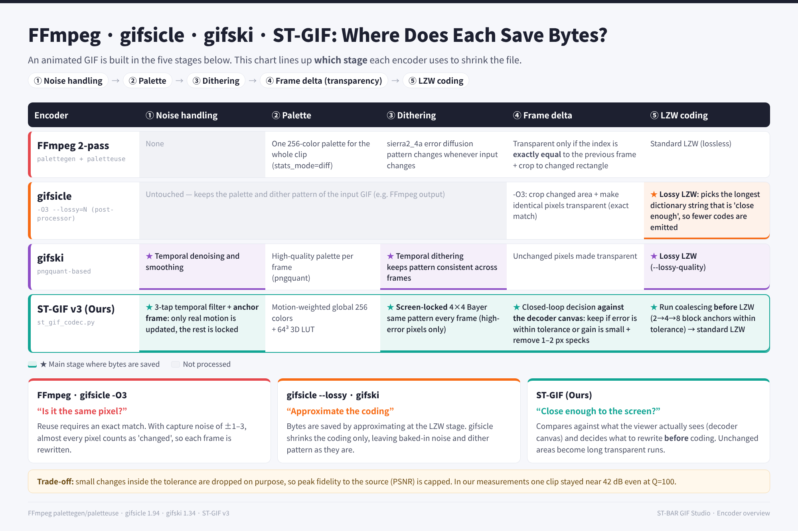

# ⚖️ Baseline (FFmpeg · gifsicle · gifski · libwebp) vs ST Comparison (English)

  <a href="../../../readme/README.en.md">⬅ Back to English README</a> •
  <a href="../ko/README.md">🇰🇷 한국어</a> •
  <b>🇺🇸 English</b>

---

## 📊 4-Encoder GIF Pipeline Overview (FFmpeg · gifsicle · gifski · ST-GIF)

---

## 🔍 Stage-by-Stage 1:1 Deep Comparison (C1 – C4)

