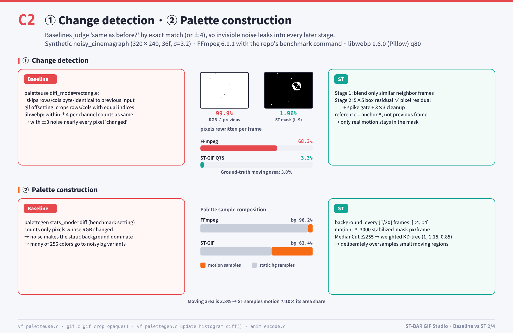
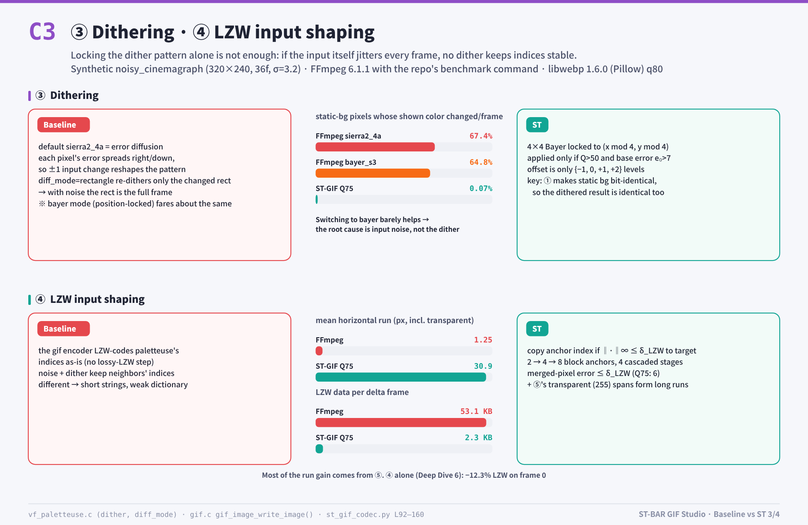
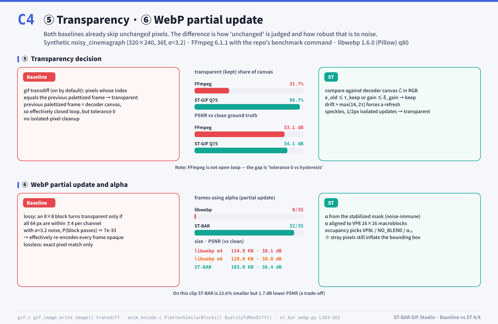

# ⚖️ Baseline (FFmpeg / libwebp) vs ST 1:1 Comparison (English C1–C4)

  <a href="../../../readme/README.en.md">⬅ Back to English README</a> •
  <a href="../ko/README.md">🇰🇷 한국어</a> •
  <b>🇺🇸 English</b>

---

