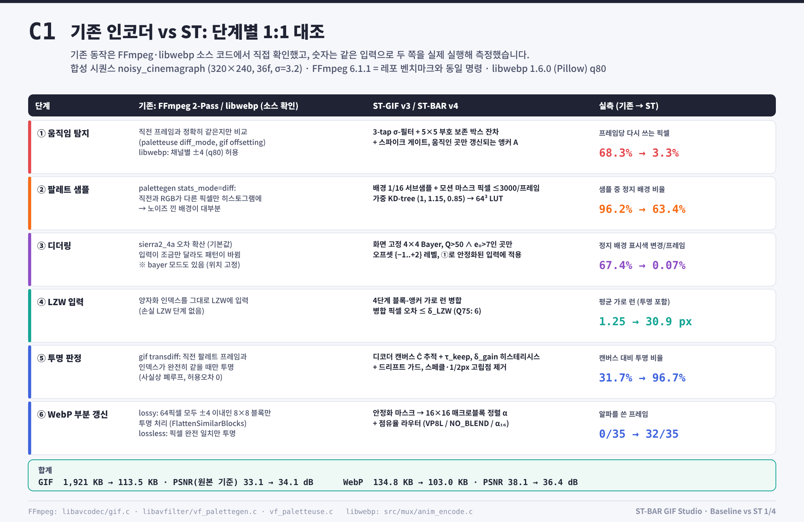
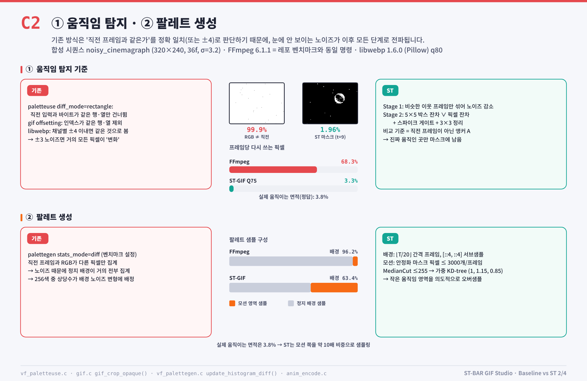
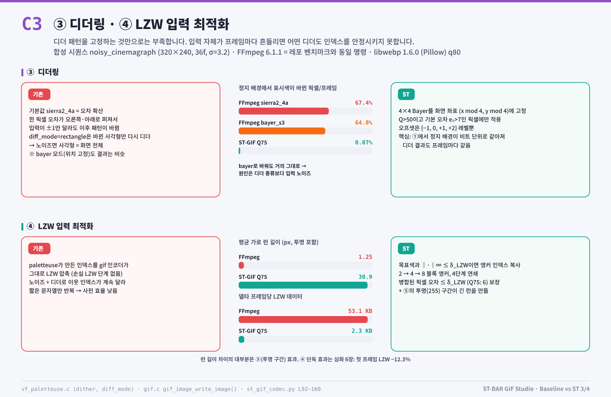
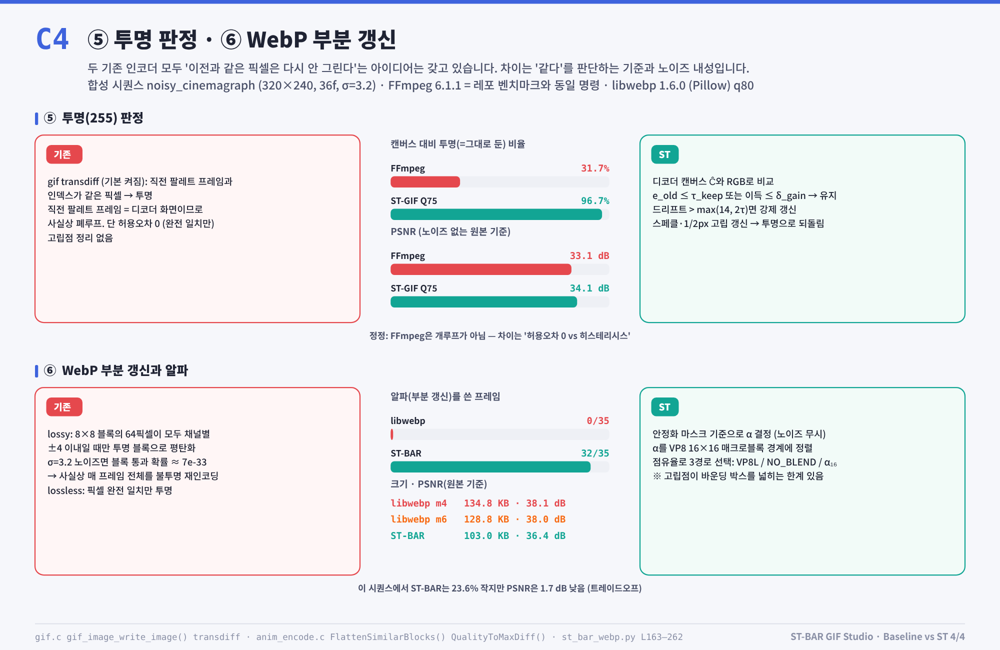

# ⚖️ 기존 인코더(FFmpeg · gifsicle · gifski · libwebp) vs ST 단계별 대조 (한국어)

  <a href="../../../README.md">⬅ 메인 README로 돌아가기</a> •
  <b>🇰🇷 한국어</b> •
  <a href="../en/README.md">🇺🇸 English</a>

---

## 📊 4대 GIF 인코더 한눈에 보기 (FFmpeg · gifsicle · gifski · ST-GIF)

---

## 🔍 파이프라인 단계별 1:1 심층 대조 (C1 ~ C4)

