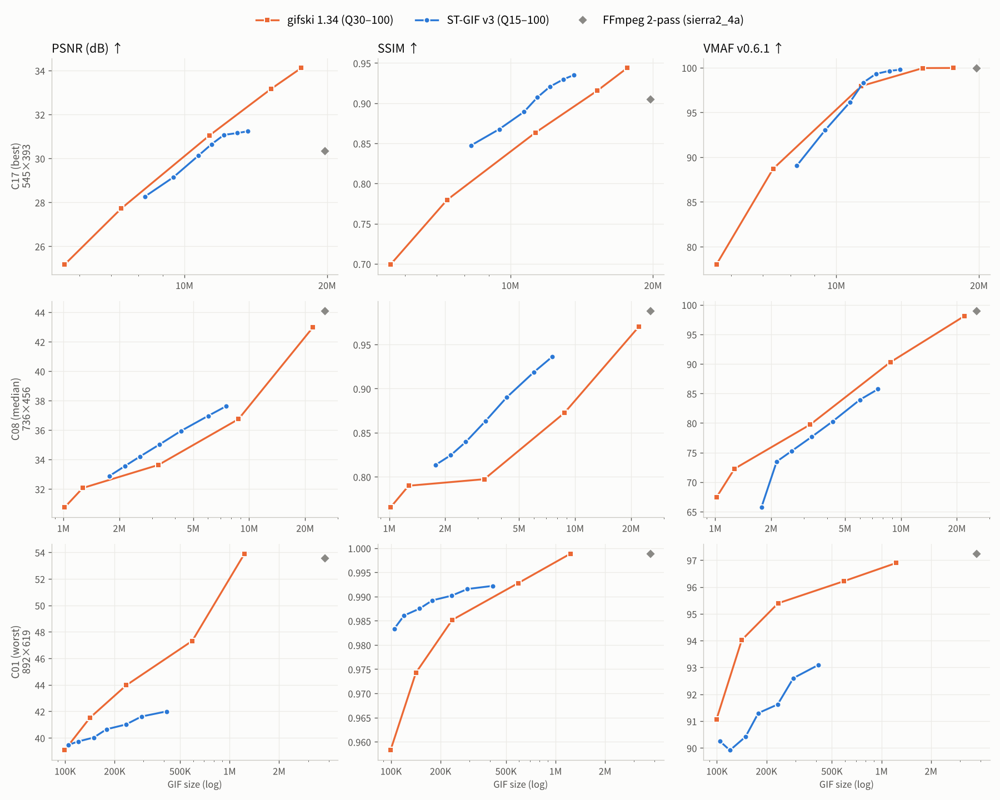
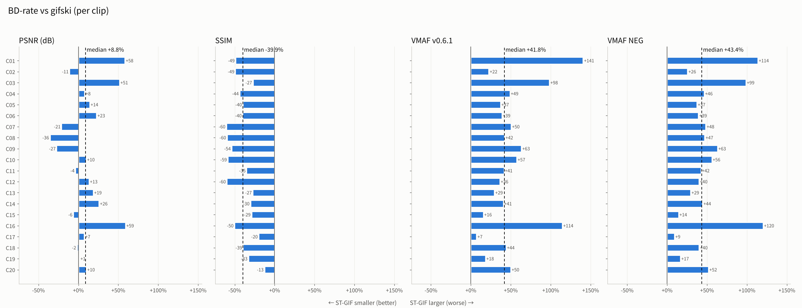
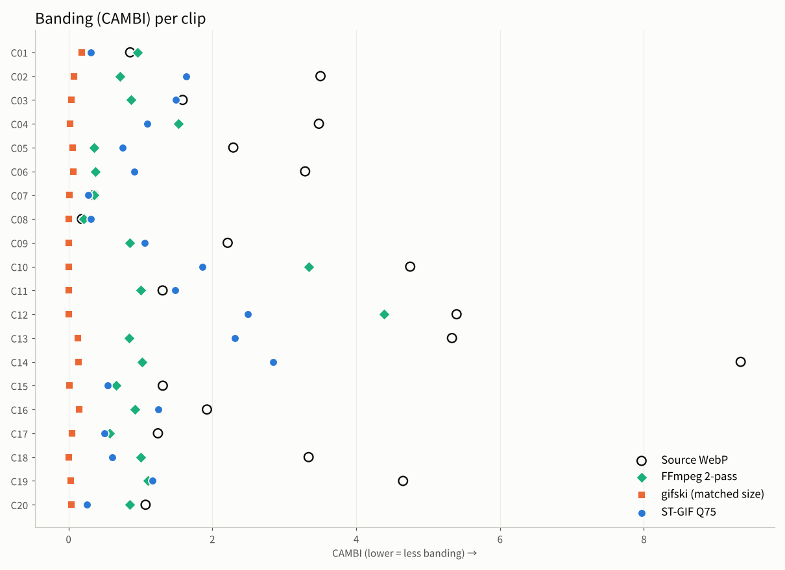

# Experiments (paper draft)

> Draft of the paper's **experiments section (Sec. 4)**. Table and figure numbers are provisional; every number is computed from the attached data.
> The [notes for authors](#notes-for-authors-before-submission) at the end list what these results **do and do not support**.

## 4.1 Experimental Setup

**Dataset.** To reflect real use, we drew 20 clips from 95 Animated WebP recordings made with a screen/game capture tool, stratified by file-size rank so that small files are not over-represented. Resolutions range from 376×293 to 1102×687; we use the first 140 frames of each clip (all frames for shorter clips). Sources have variable frame rates and contain ±1–3 levels of capture and compression noise. Prior GIF work [1]–[3] evaluates natural video or still images downscaled to 128×128–256×256; we evaluate screen-capture content at native resolution.

**Baselines.** We compare against three practical encoders that emit standard GIF89a:
- FFmpeg 6.1.1 two-pass (`palettegen=stats_mode=diff`, `paletteuse=dither=sierra2_4a:diff_mode=rectangle`)
- gifsicle 1.94 `-O3 --lossy=N` (N ∈ {20, 40, 80, 140, 200}) applied to the FFmpeg output [11], [12]
- gifski 1.34 with Q ∈ {30, 50, 70, 90, 100} [11]

ST-GIF is swept over Q ∈ {15, 30, 45, 60, 75, 90, 100}. Learned encoders [1], [2] operate on still frames; we did not reproduce them here and discuss them in Sec. 4.6.

**Quality metrics.** The reference is the decoded source WebP in RGB.
- Pixel fidelity: PSNR (mean over all frames) and SSIM [9] (about 20 sampled frames)
- Perceptual quality: VMAF v0.6.1 [7], together with VMAF-NEG, which does not reward enhancement such as denoising or sharpening
- Banding: CAMBI [8]
- Temporal stability: Flicker and TDE (defined below)

Static-region Flicker is the mean absolute frame-to-frame change of the output over pixels Ω_t whose maximum channel change in the source is at most 3. TDE (temporal-difference error) is

  TDE = mean_t mean_p |(D_t(p) − D_{t−1}(p)) − (O_t(p) − O_{t−1}(p))|

where D is the output and O the source. Flicker only measures spurious change; TDE also penalizes frozen motion. We added it so that locking static regions cannot be rewarded unfairly.

**BD-rate.** For each encoder we interpolate (quality, log bytes) with monotone PCHIP and average the rate difference over the overlapping quality range [10]. Negative values mean ST-GIF needs fewer bytes for the same quality. Across clips we report the median, a bootstrap 95% CI (5,000 resamples) and the Wilcoxon signed-rank test.

**Temporal alignment.** FFmpeg and gifski receive a constant frame rate equal to the mean source rate, so their decoded frames are aligned on a uniform timeline; ST-GIF frames are aligned on the source's variable timeline. Our first implementation aligned the baselines on the source timeline, which understated their PSNR badly (e.g. 35.4 dB instead of the correct 53.5 dB on one clip). We report this because it is an easy mistake when evaluating GIF encoders on variable-frame-rate sources.

**Implementation.** Intel Xeon 2.1 GHz with 2 vCPUs, Python 3.13 and libvmaf built from source. All encoders are deterministic; the 260 outputs re-encoded for VMAF/CAMBI matched the first run byte for byte.

## 4.2 Rate–Quality Comparison

**Table 1.** BD-rate of ST-GIF against gifski and gifsicle (20 clips)

| Anchor | Quality metric | Median BD-rate | 95% CI (bootstrap) | ST-GIF wins | Wilcoxon p |
|---|---|---:|---|---:|---:|
| gifski 1.34 | PSNR (dB) | **+8.8%** | [-2.7%, +16.3%] | 7/20 | 0.13 |
| gifski 1.34 | SSIM | **-39.9%** | [-49.7%, -31.5%] | 20/20 | < 0.001 |
| gifski 1.34 | VMAF v0.6.1 | **+41.8%** | [+36.6%, +50.2%] | 0/20 | < 0.001 |
| gifski 1.34 | VMAF NEG | **+43.4%** | [+38.2%, +50.1%] | 0/20 | < 0.001 |
| FFmpeg + gifsicle --lossy | PSNR (dB) | **-32.4%** | [-49.0%, -24.3%] | 20/20 | < 0.001 |
| FFmpeg + gifsicle --lossy | SSIM | **-53.6%** | [-61.1%, -43.1%] | 19/19 | < 0.001 |

The conclusion depends on the metric.
- **Against gifsicle `--lossy`:** ST-GIF wins on every clip (-32.4% at equal PSNR). gifsicle reduces the FFmpeg output by a median 42% (`--lossy=20`) to 70% (`--lossy=200`), but it only approximates at the LZW stage and leaves the error-diffusion pattern of its input in place.
- **Against gifski:**
  - The PSNR BD-rate is +8.8% and not significant (p = 0.13).
  - ST-GIF wins on every clip under SSIM (-39.9%).
  - It loses on every clip under VMAF and VMAF-NEG (+41.8% and +43.4%).

**Figure 1.** RD curves of representative clips: best (C17), median (C08) and worst (C01) by VMAF BD-rate.



**Figure 2.** Per-clip BD-rate against gifski



ST-GIF's RD curves are short along the rate axis and saturate early. Medians at Q=100:

| | PSNR | VMAF |
|---|---:|---:|
| ST-GIF | 33.9 dB | 87.6 |
| gifski | 39.2 dB | 98.0 |

This is the cost of deliberately locking changes inside the tolerance.

## 4.3 Perceptual Quality and Banding

To explain why SSIM and VMAF disagree, we measured banding with CAMBI (Fig. 3).

**Figure 3.** Per-clip CAMBI at matched size



Median CAMBI at matched size:
- ST-GIF: 1.08
- gifski: 0.035
- FFmpeg: 0.86
- The source WebP itself: 2.25

ST-GIF shows more banding than gifski on 20/20 clips. The dithering encoders largely mask even the banding present in the source (gifski on every clip, FFmpeg on 17/20), while ST-GIF, whose dither is effectively inactive (Sec. 4.5), leaves staircase contours in gradients.

This explains the metric disagreement. SSIM is built on local variance and covariance, so it heavily penalizes the high-frequency dither pattern of gifski. VMAF and CAMBI instead favor the smooth, dither-masked gradients and penalize ST-GIF's banding and loss of detail. VMAF-NEG agrees with VMAF, so the gap is not an artifact of enhancement gain. **The SSIM advantage alone therefore does not establish better perceptual quality.**

## 4.4 Temporal Stability

**Table 2.** Matched-size comparison (ST-GIF Q75 vs the gifski setting closest in size; median size ratio 1.06)

| Metric | ST-GIF Q75 | gifski (nearest size) | FFmpeg 2-pass | ST − gifski (median) | Clips where ST is better |
|---|---:|---:|---:|---:|---:|
| PSNR (dB) ↑ | 33.22 | 32.74 | 33.77 | +0.01 | 10/20 |
| SSIM ↑ | 0.9187 | 0.8623 | 0.9423 | +0.0571 | 19/20 |
| VMAF ↑ | 85.2 | 89.7 | 97.3 | -2.4 | 5/20 |
| VMAF-NEG ↑ | 82.8 | 87.8 | 96.2 | -2.8 | 5/20 |
| CAMBI ↓ | 1.078 | 0.035 | 0.863 | +1.068 | 0/20 |
| Flicker ↓ | 0.109 | 0.247 | 2.056 | -0.120 | 17/20 |
| TDE ↓ | 2.664 | 2.901 | 3.235 | -0.082 | 12/20 |
| Encoding time (s) | 8.3 | 9.9 | 9.5 | -3.0 | — |

ST-GIF has lower static-region Flicker than gifski on 17/20 clips, and lower TDE, which also accounts for frozen motion, on 12/20. Against FFmpeg it cuts the median size to 25% while reducing Flicker from 2.06 to 0.11. Temporal stability is a consistent strength of ST-GIF, but the margin over gifski is small (-0.120 Flicker).

## 4.5 Ablation

We removed or replaced one component at a time on 10 clips at Q45 and Q75. With the quality parameter fixed, removing a component changes both size and quality, so a fixed-Q comparison cannot show whether the component improves efficiency. We therefore compare each variant **against the full pipeline's RD curve at the same size** (Table 3).

**Table 3.** Quality change at equal size (median). Negative ΔPSNR/ΔSSIM or positive ΔTDE means the component improves efficiency.

| Component removed / replaced | ΔPSNR (dB) | ΔSSIM | ΔTDE | ΔFlicker | Points worse |
|---|---:|---:|---:|---:|---:|
| ① Spatio-temporal stabilization | -0.08 | -0.0025 | +0.040 | +0.024 | 13/20 |
| ④ LZW run coalescing | -0.09 | -0.0040 | +0.014 | -0.007 | 15/20 |
| ③ Bayer dither (off) | +0.00 | +0.0000 | +0.000 | +0.000 | 1/20 |
| ③ Bayer → Floyd–Steinberg | -1.17 | -0.0153 | +0.264 | +0.015 | 18/18 |
| ⑤ Tolerance-based keep decision | -0.23 | -0.0036 | +0.150 | +0.267 | 10/13 |
| ⑤ Speckle / isolated-run removal | -0.18 | -0.0037 | +0.066 | +0.007 | 19/20 |

**Table 4.** Fixed-Q comparison (Q45, median change vs. the full pipeline)

| Component | Size | ΔPSNR (dB) | ΔSSIM | ΔFlicker | ΔTDE |
|---|---:|---:|---:|---:|---:|
| ① Spatio-temporal stabilization | +7.8% | +0.26 | +0.0067 | +0.025 | +0.001 |
| ④ LZW run coalescing | +10.8% | +0.16 | +0.0061 | +0.000 | -0.072 |
| ③ Bayer dither (off) | +0.0% | +0.00 | +0.0000 | +0.000 | +0.000 |
| ③ Bayer → Floyd–Steinberg | +5.6% | -1.05 | -0.0162 | +0.018 | +0.274 |
| ⑤ Tolerance-based keep decision | +65.9% | +0.93 | +0.0301 | +0.312 | -0.146 |
| ⑤ Speckle / isolated-run removal | +23.2% | +0.28 | +0.0132 | +0.018 | -0.033 |

- The **tolerance-based keep decision**, a closed-loop conditional replenishment against the decoder canvas, contributes most. Removing it worsens TDE by +0.150 at equal size and grows files by +66% at Q45.
- Speckle removal helps modestly but consistently (19/20). LZW run coalescing (15/20) and stabilization (13/20) help less and vary by clip.
- Replacing the ordered dither with Floyd–Steinberg degrades every metric, which supports position-locked quantization.

In contrast, removing the Bayer dither gave **byte-identical output** at Q45 (10/10) and practically identical output at Q75 (at most 0.28% size and 0.003 dB PSNR difference). The implementation multiplies the 4×4 Bayer matrix (−7…+8) by the dither strength (0.14 at Q75) and truncates to integers, leaving only 1/16 (Q75) to 9/16 (Q100) non-zero offsets. Their magnitude (±1–2) is also below the 3D LUT's quantization step of 4. The banding deficit in Sec. 4.3 most likely stems from this implementation issue.

## 4.6 Relation to Prior Work

| Work | Standard GIF output | Uses inter-frame redundancy | Evaluates file size | Compared with practical encoders |
|---|:---:|:---:|:---:|:---:|
| GIFnets [1] | ✓ | ✗ (per frame) | ✗ | ✗ |
| VivID [2] | ✓ | ✗ (left as future work by the authors) | ✗ | ✗ |
| INR for GIF [3] | ✗ (network weights) | ✓ | ✓ | ✗ |
| Lossy LZW [4], [5] | ✓ [4] / ✗ [5] | ✗ (still images) | ✓ | ✗ |
| gifski, gifsicle [11], [12] | ✓ | ✓ | — (no paper) | — |
| **This work** | ✓ | ✓ | ✓ | ✓ |

ST-GIF's LZW run coalescing follows the same principle as the lossy LZW of Chiang and Po [4]: both extend LZW matches within a tolerance. However, [4] uses an adaptive, perception-based tolerance and searches the whole dictionary, whereas ST-GIF uses a fixed tolerance and adjacent-anchor substitution. This component is therefore not a novel contribution. The keep decision applies classic conditional replenishment [6] to GIF transparency deltas; what it adds is a closed-loop comparison against the decoder canvas and gain hysteresis.

## 4.7 Discussion and Limitations

1. **Reference quality.** The reference is a lossy WebP, so removing its noise is penalized by PSNR and VMAF. We also report the source's own banding (CAMBI 2.25); dithering encoders score below the source, so "closer to the source is better" may not hold for banding.
2. **Sample size.** 20 clips from one user's capture folder are not enough for per-genre conclusions (UI, sports games, MOBA, etc.).
3. **No learned-encoder comparison.** [1], [2] are per-frame still-image encoders, so a direct comparison is of limited value, but reviewers may ask for it.
4. **No subjective study.** Perceptual quality was estimated with VMAF and CAMBI and has not been validated with users.

## Figure captions (draft)

- **Fig. 1.** Rate–quality curves of ST-GIF and gifski on three representative clips (C17, C08, C01). Columns: PSNR, SSIM, VMAF. Gray diamond: FFmpeg two-pass.
- **Fig. 2.** Per-clip BD-rate of ST-GIF against gifski. Negative favors ST-GIF; the dashed line is the median.
- **Fig. 3.** Per-clip CAMBI at matched size (lower is less banding). Hollow circles: source WebP.
- **Appendix figures.** RD curves for all 20 clips: [PSNR](figures/en/rd_psnr_grid.png), [SSIM](figures/en/rd_ssim_grid.png), [VMAF](figures/en/rd_vmaf_grid.png).

## Notes for authors (before submission)

**Supported by the data**
- Among encoders that emit standard GIF, ST-GIF is clearly better than FFmpeg and gifsicle in size and temporal stability (every clip, p < 0.001).
- This is, to our knowledge, the first systematic comparison of practical GIF encoders on screen-capture content using RD curves, BD-rate and perceptual metrics.
- The closed-loop keep decision against the decoder canvas is the largest contributor (ablation).
- The observation that SSIM can disagree with VMAF and CAMBI for GIF, and the variable-frame-rate alignment pitfall, are methodological contributions in their own right.

**Not supported by the data**
- "Better perceptual quality" or "more efficient" than gifski. VMAF, VMAF-NEG and CAMBI all point the other way.
- "The screen-locked Bayer dither is effective." It is inactive in the current implementation.
- Novelty of LZW run coalescing. See [4].

**Suggested positioning:** a domestic conference or arXiv paper framed as "a comparison of practical encoders for screen-capture GIFs and an analysis of closed-loop conditional replenishment" fits the data. For an international venue, first check whether an improved version, with the dither fixed and the adaptive tolerance of [4] incorporated, matches or beats gifski on VMAF and CAMBI.

## References

[1] I. Yoo, X. Luo, Y. Wang, F. Yang, and P. Milanfar, "GIFnets: Differentiable GIF encoding framework," in *Proc. IEEE/CVF CVPR*, 2020, pp. 14473–14482.
[2] Y. Wang, G. Liu, Z. Zhu, X. Zhang, and Z. Qian, "VivID: A visually improved GIF encoding network design," *IEEE Trans. Circuits Syst. Video Technol.*, vol. 35, no. 6, pp. 6101–6113, 2025.
[3] Y. Wang, G. Liu, S. Li, X. Zhang, and Z. Qian, "Neural representations for animated GIFs," in *Proc. ICMR '26*, 2026, pp. 459–467.
[4] S.-W. Chiang and L.-M. Po, "Lossy LZW algorithm with adaptive threshold for palettized image compression," in *Proc. ISSPA '96*, 1996, pp. 144–147.
[5] V. Crnojević, V. Šenk, and Ž. Trpovski, "Lossy Lempel-Ziv algorithm for image compression," in *Proc. TELSIKS 2003*, 2003, pp. 522–525.
[6] F. W. Mounts, "A video encoding system with conditional picture-element replenishment," *Bell Syst. Tech. J.*, vol. 48, no. 7, 1969. (verify issue/pages)
[7] Z. Li, A. Aaron, I. Katsavounidis, A. Moorthy, and M. Manohara, "Toward a practical perceptual video quality metric," *Netflix Tech Blog*, 2016.
[8] P. Tandon, M. Afonso, J. Sole, and L. Krasula, "CAMBI: Contrast-aware multiscale banding index," arXiv:2102.00079, 2021.
[9] Z. Wang, A. C. Bovik, H. R. Sheikh, and E. P. Simoncelli, "Image quality assessment: From error visibility to structural similarity," *IEEE Trans. Image Process.*, vol. 13, no. 4, pp. 600–612, 2004.
[10] G. Bjøntegaard, "Calculation of average PSNR differences between RD-curves," ITU-T SG16/Q6 VCEG-M33, 2001.
[11] K. Lesiński, gifski (v1.34) and gifsicle `--lossy` (lossy GIF), https://gif.ski, https://kornel.ski/lossygif
[12] E. Kohler, Gifsicle 1.94, https://www.lcdf.org/gifsicle/

## Appendix A: LaTeX tables

```latex
\begin{table}[t]
\centering
\caption{BD-rate of ST-GIF against each anchor over 20 clips (negative favors ST-GIF).}
\label{tab:bdrate}
\begin{tabular}{llrcrr}
\toprule
Anchor & Metric & Median & 95\% CI & Wins & $p$ \\
\midrule
gifski & PSNR (dB) & +8.8\% & [-2.7, +16.3] & 7/20 & 0.13 \\
gifski & SSIM & -39.9\% & [-49.7, -31.5] & 20/20 & $<$0.001 \\
gifski & VMAF v0.6.1 & +41.8\% & [+36.6, +50.2] & 0/20 & $<$0.001 \\
gifski & VMAF NEG & +43.4\% & [+38.2, +50.1] & 0/20 & $<$0.001 \\
gifsicle & PSNR (dB) & -32.4\% & [-49.0, -24.3] & 20/20 & $<$0.001 \\
gifsicle & SSIM & -53.6\% & [-61.1, -43.1] & 19/19 & $<$0.001 \\
\bottomrule
\end{tabular}
\end{table}

\begin{table}[t]
\centering
\caption{Equal-size ablation: median quality change when a component is removed, relative to the full ST-GIF RD curve.}
\label{tab:ablation}
\begin{tabular}{lrrrr}
\toprule
Component & $\Delta$PSNR & $\Delta$SSIM & $\Delta$TDE & Worse \\
\midrule
Spatio-temporal stabilization & -0.08 & -0.0025 & +0.040 & 13/20 \\
LZW run coalescing & -0.09 & -0.0040 & +0.014 & 15/20 \\
Bayer dither (off) & +0.00 & +0.0000 & +0.000 & 1/20 \\
Bayer → Floyd–Steinberg & -1.17 & -0.0153 & +0.264 & 18/18 \\
Tolerance-based keep decision & -0.23 & -0.0036 & +0.150 & 10/13 \\
Speckle / isolated-run removal & -0.18 & -0.0037 & +0.066 & 19/20 \\
\bottomrule
\end{tabular}
\end{table}
```

## Appendix B: Clip IDs and per-clip numbers

| ID | Source file |
|---|---|
| C01 | `C01_892x619_134f_10fps.webp` |
| C02 | `C02_557x331_106f_10fps.webp` |
| C03 | `C03_496x395_109f_28fps.webp` |
| C04 | `C04_714x410_244f_30fps.webp` |
| C05 | `C05_1051x482_89f_6fps.webp` |
| C06 | `C06_1051x482_102f_30fps.webp` |
| C07 | `C07_751x516_230f_31fps.webp` |
| C08 | `C08_736x456_317f_31fps.webp` |
| C09 | `C09_1052x599_251f_33fps.webp` |
| C10 | `C10_751x516_348f_31fps.webp` |
| C11 | `C11_518x360_400f_30fps.webp` |
| C12 | `C12_751x516_512f_31fps.webp` |
| C13 | `C13_1018x538_204f_31fps.webp` |
| C14 | `C14_894x520_200f_31fps.webp` |
| C15 | `C15_376x293_780f_60fps.webp` |
| C16 | `C16_860x548_189f_30fps.webp` |
| C17 | `C17_545x393_599f_30fps.webp` |
| C18 | `C18_1052x599_339f_33fps.webp` |
| C19 | `C19_1102x687_584f_33fps.webp` |
| C20 | `C20_724x564_1410f_60fps.webp` |

| ID | Resolution | Frames | Source | BD PSNR | BD SSIM | BD VMAF | BD VMAF-NEG | CAMBI ST / gifski |
|---|---|---:|---:|---:|---:|---:|---:|---:|
| C01 | 892×619 | 134 | 1.2 MB | +58.2% | -48.9% | +140.6% | +113.6% | 0.31 / 0.18 |
| C02 | 557×331 | 106 | 1.3 MB | -11.1% | -49.2% | +22.5% | +25.6% | 1.63 / 0.07 |
| C03 | 496×395 | 109 | 1.4 MB | +51.5% | -27.1% | +98.3% | +98.7% | 1.49 / 0.04 |
| C04 | 714×410 | 140 | 2.6 MB | +7.8% | -43.8% | +48.8% | +46.4% | 1.10 / 0.02 |
| C05 | 1051×482 | 89 | 3.4 MB | +14.1% | -39.7% | +37.0% | +37.2% | 0.75 / 0.05 |
| C06 | 1051×482 | 102 | 3.6 MB | +22.7% | -40.0% | +38.8% | +39.1% | 0.91 / 0.06 |
| C07 | 751×516 | 140 | 4.5 MB | -21.2% | -60.5% | +50.4% | +48.4% | 0.28 / 0.01 |
| C08 | 736×456 | 140 | 4.9 MB | -35.6% | -59.6% | +42.2% | +47.0% | 0.31 / 0.00 |
| C09 | 1052×599 | 140 | 5.7 MB | -27.3% | -53.7% | +63.3% | +63.0% | 1.06 / 0.00 |
| C10 | 751×516 | 140 | 6.2 MB | +9.8% | -58.6% | +57.4% | +55.9% | 1.87 / 0.01 |
| C11 | 518×360 | 140 | 7.5 MB | -3.6% | -35.1% | +41.4% | +42.5% | 1.48 / 0.00 |
| C12 | 751×516 | 140 | 8.0 MB | +13.3% | -59.9% | +36.2% | +39.9% | 2.49 / 0.00 |
| C13 | 1018×538 | 140 | 8.6 MB | +18.5% | -27.4% | +29.3% | +29.4% | 2.31 / 0.13 |
| C14 | 894×520 | 140 | 9.2 MB | +25.9% | -30.2% | +40.6% | +44.3% | 2.85 / 0.14 |
| C15 | 376×293 | 140 | 10.5 MB | -6.3% | -28.9% | +15.5% | +14.3% | 0.54 / 0.01 |
| C16 | 860×548 | 140 | 12.9 MB | +58.9% | -50.3% | +114.5% | +120.2% | 1.24 / 0.15 |
| C17 | 545×393 | 140 | 15.1 MB | +7.4% | -19.9% | +7.1% | +9.1% | 0.50 / 0.05 |
| C18 | 1052×599 | 140 | 17.0 MB | -1.7% | -39.5% | +44.0% | +40.1% | 0.61 / 0.01 |
| C19 | 1102×687 | 140 | 22.1 MB | +1.4% | -32.8% | +18.2% | +16.6% | 1.16 / 0.03 |
| C20 | 724×564 | 140 | 51.9 MB | +10.0% | -12.6% | +49.9% | +51.8% | 0.26 / 0.04 |
