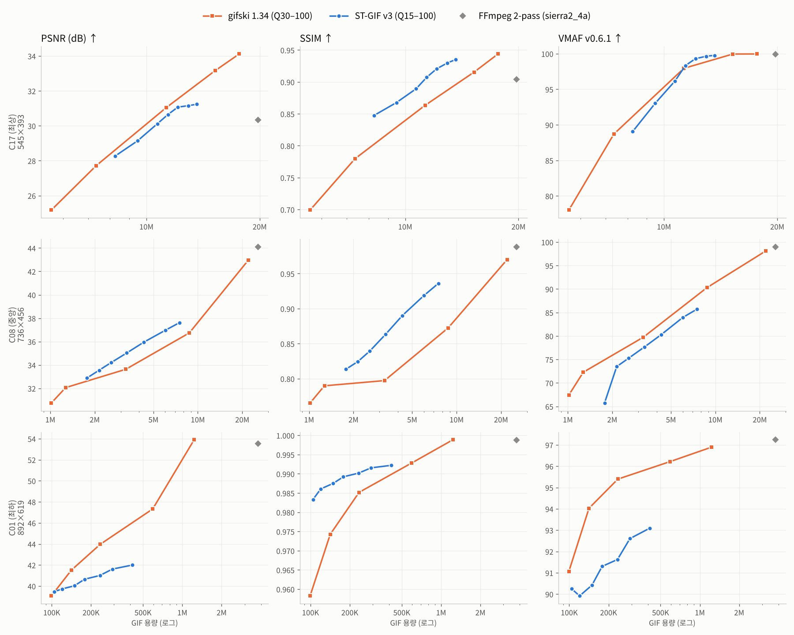
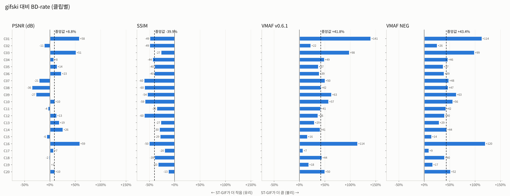
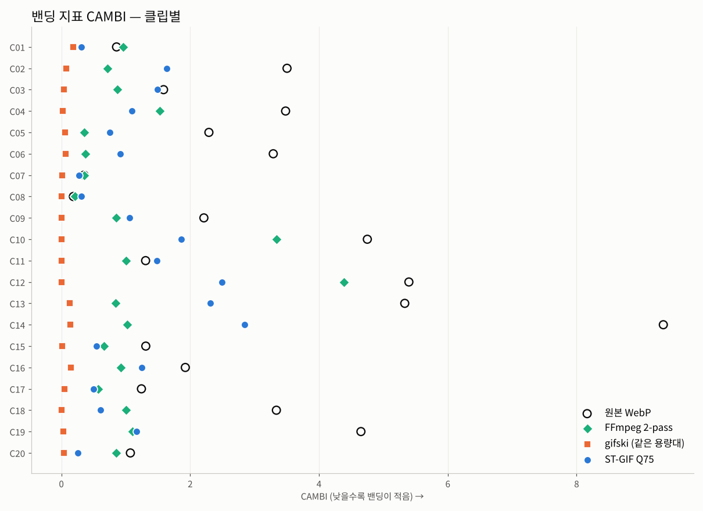

# 실험 (논문 초안용)

> 이 문서는 논문의 **실험 절(4장)** 초안입니다. 표와 그림 번호는 임시이고, 본문 수치는 모두 첨부 데이터에서 자동 계산했습니다.
> 맨 끝의 [저자용 메모](#저자용-메모-투고-전-확인)에 이 결과로 **주장할 수 있는 것과 없는 것**을 정리했습니다.

## 4.1 실험 설정

**데이터셋.** 실제 사용 환경을 반영하기 위해 화면·게임 녹화 도구로 만든 Animated WebP 95개에서 20개를 골랐습니다. 파일 크기 순위로 층화 추출해 작은 파일에 편중되지 않게 했습니다. 해상도는 376×293부터 1102×687까지이고, 각 클립은 앞 140프레임까지 썼습니다(더 짧은 클립은 전체). 원본은 가변 프레임레이트이며, 녹화 과정에서 생긴 ±1~3 수준의 센서·압축 잡음을 포함합니다. 기존 GIF 연구 [1]–[3]이 자연 영상이나 정지 이미지를 128×128 ~ 256×256으로 줄여 평가한 것과 달리, 이 실험은 원본 해상도의 화면 녹화 콘텐츠를 대상으로 합니다.

**비교 대상.** 표준 GIF89a를 출력하는 실용 인코더 세 가지와 비교했습니다.
- FFmpeg 6.1.1 2-pass: `palettegen=stats_mode=diff`, `paletteuse=dither=sierra2_4a:diff_mode=rectangle`
- FFmpeg 출력에 gifsicle 1.94 `-O3 --lossy=N`(N ∈ {20, 40, 80, 140, 200}) 적용 [11], [12]
- gifski 1.34, Q ∈ {30, 50, 70, 90, 100} [11]

ST-GIF는 Q ∈ {15, 30, 45, 60, 75, 90, 100}으로 측정했습니다. 신경망 기반 인코더 [1], [2]는 정지 이미지 단위로 동작하며, 이번 실험에서는 재현하지 않고 4.6절에서 비교 논의만 합니다.

**품질 지표.** 기준 영상은 원본 WebP를 디코딩한 RGB 프레임입니다.
- 화소 충실도: PSNR(전체 프레임 평균), SSIM [9](약 20프레임 샘플)
- 지각 품질: VMAF v0.6.1 [7]. 디노이즈나 샤프닝 같은 향상 처리에 점수를 주지 않는 VMAF-NEG도 함께 썼습니다.
- 밴딩: CAMBI [8]
- 시간 안정성: Flicker와 TDE(아래 정의)

정적 영역 Flicker는 원본에서 채널 최대 변화가 3 이하인 픽셀 집합 Ω_t에서 결과물의 프레임 간 절대 변화 평균으로 정의했습니다. TDE(temporal-difference error)는 다음과 같습니다.

  TDE = mean_t mean_p |(D_t(p) − D_{t−1}(p)) − (O_t(p) − O_{t−1}(p))|

여기서 D는 결과물, O는 원본입니다. Flicker는 "없던 변화가 생기는 것"만 측정하지만, TDE는 "있던 움직임이 사라지는 것"(얼어붙음)까지 벌점으로 줍니다. 정적 영역을 고정하는 방법이 Flicker에서 부당하게 유리해지는 것을 막으려고 넣었습니다.

**BD-rate.** 각 인코더의 (품질, log 용량) 점들을 단조 PCHIP으로 보간하고, 두 곡선이 겹치는 품질 구간에서 평균 용량 차이를 계산했습니다 [10]. 음수면 ST-GIF가 같은 품질을 더 작은 용량으로 달성합니다. 클립 간 통계는 중앙값, 부트스트랩 95% 신뢰구간(5,000회), Wilcoxon 부호순위 검정으로 보고합니다.

**시간축 정렬.** FFmpeg와 gifski는 평균 fps의 고정 프레임레이트로 입력받으므로 균등 시간축으로, ST-GIF는 원본 가변 시간축으로 디코딩 프레임을 대응시켰습니다. 처음 구현에서는 기준선을 원본 시간축에 맞춰 PSNR이 크게 낮게 측정되는 문제가 있었습니다(예: 한 클립에서 35.4 dB, 올바른 값은 53.5 dB). 가변 프레임레이트 소스로 GIF 인코더를 평가할 때 흔히 생길 수 있는 오류라서 명시합니다.

**구현 환경.** Intel Xeon 2.1 GHz 2 vCPU, Python 3.13, libvmaf(소스 빌드). 모든 인코더는 결정적으로 동작하며, VMAF와 CAMBI 측정용으로 다시 인코딩한 260개 결과물이 1차 측정과 바이트 단위로 일치함을 확인했습니다.

## 4.2 율-품질 비교

**표 1.** gifski와 gifsicle 대비 ST-GIF의 BD-rate (클립 20개)

| 기준 인코더 | 품질 지표 | BD-rate 중앙값 | 95% CI (부트스트랩) | ST-GIF 우위 | Wilcoxon p |
|---|---|---:|---|---:|---:|
| gifski 1.34 | PSNR (dB) | **+8.8%** | [-2.7%, +16.3%] | 7/20 | 0.13 |
| gifski 1.34 | SSIM | **-39.9%** | [-49.7%, -31.5%] | 20/20 | < 0.001 |
| gifski 1.34 | VMAF v0.6.1 | **+41.8%** | [+36.6%, +50.2%] | 0/20 | < 0.001 |
| gifski 1.34 | VMAF NEG | **+43.4%** | [+38.2%, +50.1%] | 0/20 | < 0.001 |
| FFmpeg + gifsicle --lossy | PSNR (dB) | **-32.4%** | [-49.0%, -24.3%] | 20/20 | < 0.001 |
| FFmpeg + gifsicle --lossy | SSIM | **-53.6%** | [-61.1%, -43.1%] | 19/19 | < 0.001 |

표 1의 결과는 지표에 따라 결론이 갈립니다.
- **gifsicle `--lossy` 대비:** ST-GIF가 모든 클립에서 앞섭니다(PSNR 기준 -32.4%). gifsicle은 FFmpeg 출력 대비 용량을 중앙값 42%(`--lossy=20`) ~ 70%(`--lossy=200`) 줄이지만, 입력 GIF에 이미 박힌 오차 확산 디더 패턴을 그대로 둔 채 LZW 단계에서만 근사하기 때문에 한계가 있습니다.
- **gifski 대비:**
  - PSNR 기준 BD-rate는 중앙값 +8.8%로 통계적으로 유의한 차이가 없습니다(p = 0.13).
  - SSIM 기준으로는 모든 클립에서 ST-GIF가 앞섭니다(-39.9%).
  - VMAF와 VMAF-NEG 기준으로는 모든 클립에서 gifski가 앞섭니다(+41.8%, +43.4%).

**그림 1.** 대표 클립의 RD 곡선. VMAF BD-rate 기준 최상(C17), 중앙(C08), 최하(C01) 클립입니다.

**그림 2.** 클립별 gifski 대비 BD-rate

ST-GIF의 RD 곡선은 용량 축으로 짧고 품질 상한이 낮습니다. Q=100에서의 중앙값은 다음과 같습니다.

| | PSNR | VMAF |
|---|---:|---:|
| ST-GIF | 33.9 dB | 87.6 |
| gifski | 39.2 dB | 98.0 |

허용오차 안의 변화를 의도적으로 고정하는 설계의 대가입니다.

## 4.3 지각 품질과 밴딩 분석

SSIM과 VMAF가 반대 방향을 가리키는 원인을 밝히기 위해 밴딩 지표 CAMBI를 측정했습니다(그림 3).

**그림 3.** 같은 용량대에서의 클립별 CAMBI

같은 용량대에서 CAMBI 중앙값은 다음과 같습니다.
- ST-GIF: 1.08
- gifski: 0.035
- FFmpeg: 0.86
- 원본 WebP 자체: 2.25

ST-GIF는 20/20개 클립에서 gifski보다 밴딩이 심했습니다. 디더를 쓰는 인코더는 원본의 밴딩까지 대체로 가리지만(gifski는 모든 클립, FFmpeg는 17/20), ST-GIF는 디더가 사실상 동작하지 않아(4.5절) 그라데이션 영역에 계단 무늬가 남습니다.

이 결과로 지표 간 불일치를 다음과 같이 해석할 수 있습니다. SSIM은 국소 분산과 공분산에 기반하므로, gifski 출력의 고주파 디더 패턴을 구조 손상으로 크게 벌점 줍니다. 반면 VMAF와 CAMBI는 디더로 가려진 매끈한 그라데이션을 더 높이 평가하고, ST-GIF의 밴딩과 세부 손실을 벌점 줍니다. VMAF-NEG도 같은 결론을 보이므로, 이 차이는 향상 처리에 의한 점수 왜곡으로 설명되지 않습니다. 따라서 **SSIM 우위만으로 지각 품질 우위를 주장할 수는 없습니다.**

## 4.4 시간 안정성

**표 2.** 같은 용량대 비교 (ST-GIF Q75 vs 용량이 가장 가까운 gifski 설정, 용량 비 중앙값 1.06)

| 항목 | ST-GIF Q75 | gifski (최근접 용량) | FFmpeg 2-pass | ST − gifski (중앙값) | ST가 나은 클립 |
|---|---:|---:|---:|---:|---:|
| PSNR (dB) ↑ | 33.22 | 32.74 | 33.77 | +0.01 | 10/20 |
| SSIM ↑ | 0.9187 | 0.8623 | 0.9423 | +0.0571 | 19/20 |
| VMAF ↑ | 85.2 | 89.7 | 97.3 | -2.4 | 5/20 |
| VMAF-NEG ↑ | 82.8 | 87.8 | 96.2 | -2.8 | 5/20 |
| CAMBI ↓ | 1.078 | 0.035 | 0.863 | +1.068 | 0/20 |
| Flicker ↓ | 0.109 | 0.247 | 2.056 | -0.120 | 17/20 |
| TDE ↓ | 2.664 | 2.901 | 3.235 | -0.082 | 12/20 |
| 인코딩 시간 (s) | 8.3 | 9.9 | 9.5 | -3.0 | — |

ST-GIF는 정적 영역 Flicker가 gifski보다 낮았고(17/20), 얼어붙음까지 반영한 TDE에서도 12/20개 클립에서 우세했습니다. FFmpeg 대비로는 용량을 중앙값 25%로 줄이면서 Flicker를 2.06에서 0.11로 낮췄습니다. 시간 안정성은 ST-GIF의 일관된 강점이지만, gifski와의 차이는 Flicker 기준 -0.120로 크지 않습니다.

## 4.5 어블레이션

구성 요소를 하나씩 제거하거나 교체한 변형을 10개 클립에서 Q45와 Q75로 측정했습니다. 품질 파라미터를 고정하면 구성 요소 제거가 용량과 품질을 동시에 바꾸기 때문에, 이 비교만으로는 효율에 대한 기여를 판단할 수 없습니다. 그래서 각 변형을 **전체 파이프라인의 RD 곡선과 같은 용량에서** 비교했습니다(표 3).

**표 3.** 같은 용량에서의 품질 변화 (중앙값). 음수 ΔPSNR·ΔSSIM, 양수 ΔTDE는 해당 구성 요소가 효율에 기여함을 뜻합니다.

| 제거·교체한 구성 요소 | ΔPSNR (dB) | ΔSSIM | ΔTDE | ΔFlicker | 효율 악화 점 |
|---|---:|---:|---:|---:|---:|
| ① 시공간 안정화 | -0.08 | -0.0025 | +0.040 | +0.024 | 13/20 |
| ④ LZW 런 병합 | -0.09 | -0.0040 | +0.014 | -0.007 | 15/20 |
| ③ Bayer 디더 (끔) | +0.00 | +0.0000 | +0.000 | +0.000 | 1/20 |
| ③ Bayer → Floyd–Steinberg 교체 | -1.17 | -0.0153 | +0.264 | +0.015 | 18/18 |
| ⑤ 허용오차 유지 판정 | -0.23 | -0.0036 | +0.150 | +0.267 | 10/13 |
| ⑤ 스페클·고립점 제거 | -0.18 | -0.0037 | +0.066 | +0.007 | 19/20 |

**표 4.** Q 고정 비교 (Q45, 전체 대비 변화의 중앙값)

| 구성 요소 | 용량 | ΔPSNR (dB) | ΔSSIM | ΔFlicker | ΔTDE |
|---|---:|---:|---:|---:|---:|
| ① 시공간 안정화 | +7.8% | +0.26 | +0.0067 | +0.025 | +0.001 |
| ④ LZW 런 병합 | +10.8% | +0.16 | +0.0061 | +0.000 | -0.072 |
| ③ Bayer 디더 (끔) | +0.0% | +0.00 | +0.0000 | +0.000 | +0.000 |
| ③ Bayer → Floyd–Steinberg 교체 | +5.6% | -1.05 | -0.0162 | +0.018 | +0.274 |
| ⑤ 허용오차 유지 판정 | +65.9% | +0.93 | +0.0301 | +0.312 | -0.146 |
| ⑤ 스페클·고립점 제거 | +23.2% | +0.28 | +0.0132 | +0.018 | -0.033 |

- **허용오차 유지 판정**(디코더 캔버스 기준의 폐루프 조건부 갱신)의 기여가 가장 큽니다. 제거하면 같은 용량에서 TDE가 +0.150 나빠지고, Q45에서 용량이 +66% 늘어납니다.
- 스페클 제거는 작지만 일관되게 기여합니다(19/20). LZW 런 병합(15/20)과 시공간 안정화(13/20)는 기여가 작고 클립에 따라 다릅니다.
- Floyd–Steinberg 교체는 모든 지표를 악화시켜, 위치 고정 양자화의 이점을 확인해 줍니다.

반면 Bayer 디더를 제거한 변형은 Q45에서 전체 파이프라인과 **바이트 단위로 동일**했고(10/10), Q75에서도 용량 차 최대 0.28%, PSNR 차 최대 0.003 dB로 사실상 같았습니다. 현재 구현은 디더 강도(Q75에서 0.14)를 Bayer 행렬(−7 ~ +8)에 곱한 뒤 정수로 자르기 때문에, 0이 아닌 오프셋이 16칸 중 1칸(Q75) ~ 9칸(Q100)에 불과합니다. 그 크기(±1~2)도 3D LUT의 양자화 간격(4)보다 작습니다. 4.3절의 밴딩 열세는 이 구현 문제에서 비롯된 것으로 보입니다.

## 4.6 선행 연구와의 관계

| 연구 | 표준 GIF 출력 | 프레임 간 중복 활용 | 파일 용량 평가 | 실용 인코더와 비교 |
|---|:---:|:---:|:---:|:---:|
| GIFnets [1] | ✓ | ✗ (프레임 단위) | ✗ | ✗ |
| VivID [2] | ✓ | ✗ (저자들이 향후 과제로 명시) | ✗ | ✗ |
| INR for GIF [3] | ✗ (신경망 가중치) | ✓ | ✓ | ✗ |
| 손실 LZW [4], [5] | ✓ [4] / ✗ [5] | ✗ (정지 이미지) | ✓ | ✗ |
| gifski, gifsicle [11], [12] | ✓ | ✓ | — (논문 없음) | — |
| **이 연구** | ✓ | ✓ | ✓ | ✓ |

ST-GIF의 LZW 런 병합은 Chiang과 Po [4]의 손실 LZW와 같은 원리입니다. 허용오차 안에서 LZW 일치를 늘리는 방식인데, [4]는 시각 특성 기반의 적응형 허용오차와 사전 전체 탐색을 쓰는 반면, ST-GIF는 고정 허용오차와 인접 앵커 치환만 씁니다. 따라서 이 구성 요소는 신규 기여가 아닙니다. 허용오차 유지 판정은 고전적 조건부 갱신 [6]을 GIF 투명 델타에 적용한 것으로, 디코더 캔버스와의 폐루프 비교와 개선폭 히스테리시스를 더한 점이 차이입니다.

## 4.7 논의와 한계

1. **기준 영상의 품질.** 기준이 손실 압축된 WebP라서, 원본 잡음을 지우는 처리는 PSNR과 VMAF에서 불리하게 측정됩니다. 원본 자체의 밴딩도 함께 보고했는데(CAMBI 2.25), 디더를 쓰는 인코더는 원본보다 낮은 CAMBI를 보여 "원본과 같을수록 좋다"는 가정이 밴딩에서는 성립하지 않을 수 있습니다.
2. **표본 규모.** 한 사용자의 녹화 폴더에서 뽑은 20개 클립입니다. 콘텐츠 유형별(UI, 스포츠 게임, MOBA 등) 결론을 내리기에는 부족합니다.
3. **신경망 기반 인코더와의 비교 부재.** [1], [2]는 프레임 단위 정지 이미지 인코더라 직접 비교의 의미가 제한적이지만, 리뷰 과정에서 요구될 수 있습니다.
4. **주관적 평가 부재.** VMAF와 CAMBI로 지각 품질을 추정했지만, 사용자 평가로 확인하지 않았습니다.

## 그림 목록 (캡션 초안)

- **그림 1.** 대표 클립 3개(C17, C08, C01)에서 ST-GIF와 gifski의 율-품질 곡선. 열은 PSNR, SSIM, VMAF이고, 회색 마름모는 FFmpeg 2-pass입니다.
- **그림 2.** 클립별 gifski 대비 ST-GIF의 BD-rate. 음수가 ST-GIF에 유리하며, 점선은 중앙값입니다.
- **그림 3.** 같은 용량대에서의 클립별 CAMBI(낮을수록 밴딩이 적음). 빈 원은 원본 WebP의 CAMBI입니다.
- **부록 그림.** 전체 20개 클립의 RD 곡선: [PSNR](figures/ko/rd_psnr_grid.png), [SSIM](figures/ko/rd_ssim_grid.png), [VMAF](figures/ko/rd_vmaf_grid.png)

## 저자용 메모: 투고 전 확인

**이 데이터로 주장할 수 있는 것**
- 표준 GIF 출력 인코더 중 FFmpeg와 gifsicle 대비 용량과 시간 안정성에서 명확한 우위가 있습니다(모든 클립, p < 0.001).
- 화면 녹화 콘텐츠에서 실용 GIF 인코더들을 RD 곡선, BD-rate, 지각 지표로 비교한 첫 체계적 평가입니다(확인한 범위 내).
- 디코더 캔버스 기준 폐루프 유지 판정이 효율에 가장 크게 기여합니다(어블레이션).
- GIF 평가에서 SSIM과 VMAF·CAMBI가 상반된 결론을 낼 수 있다는 관찰, 그리고 가변 프레임레이트 정렬 문제는 그 자체로 방법론적 기여입니다.

**이 데이터로 주장할 수 없는 것**
- "gifski보다 지각 품질이 좋다" 또는 "더 효율적이다". VMAF, VMAF-NEG, CAMBI 모두 반대입니다.
- "화면 고정 Bayer 디더가 효과가 있다". 현재 구현에서는 사실상 동작하지 않습니다.
- LZW 런 병합의 신규성. [4]에 선행 연구가 있습니다.

**권장 포지셔닝:** 국내 학술대회 또는 arXiv에 "화면 녹화 GIF를 위한 실용 인코더 비교와 폐루프 조건부 갱신 분석" 성격으로 내는 것이 데이터와 맞습니다. 국제 학회를 목표로 한다면, 디더를 고치고 적응형 허용오차 [4]를 결합한 개선판이 VMAF·CAMBI에서 gifski와 대등 이상이 되는지 먼저 확인하기를 권합니다.

## 참고문헌

[1] I. Yoo, X. Luo, Y. Wang, F. Yang, and P. Milanfar, "GIFnets: Differentiable GIF encoding framework," in *Proc. IEEE/CVF CVPR*, 2020, pp. 14473–14482.
[2] Y. Wang, G. Liu, Z. Zhu, X. Zhang, and Z. Qian, "VivID: A visually improved GIF encoding network design," *IEEE Trans. Circuits Syst. Video Technol.*, vol. 35, no. 6, pp. 6101–6113, 2025.
[3] Y. Wang, G. Liu, S. Li, X. Zhang, and Z. Qian, "Neural representations for animated GIFs," in *Proc. ICMR '26*, 2026, pp. 459–467.
[4] S.-W. Chiang and L.-M. Po, "Lossy LZW algorithm with adaptive threshold for palettized image compression," in *Proc. ISSPA '96*, 1996, pp. 144–147.
[5] V. Crnojević, V. Šenk, and Ž. Trpovski, "Lossy Lempel-Ziv algorithm for image compression," in *Proc. TELSIKS 2003*, 2003, pp. 522–525.
[6] F. W. Mounts, "A video encoding system with conditional picture-element replenishment," *Bell Syst. Tech. J.*, vol. 48, no. 7, 1969. (권호·쪽수 확인 필요)
[7] Z. Li, A. Aaron, I. Katsavounidis, A. Moorthy, and M. Manohara, "Toward a practical perceptual video quality metric," *Netflix Tech Blog*, 2016.
[8] P. Tandon, M. Afonso, J. Sole, and L. Krasula, "CAMBI: Contrast-aware multiscale banding index," arXiv:2102.00079, 2021.
[9] Z. Wang, A. C. Bovik, H. R. Sheikh, and E. P. Simoncelli, "Image quality assessment: From error visibility to structural similarity," *IEEE Trans. Image Process.*, vol. 13, no. 4, pp. 600–612, 2004.
[10] G. Bjøntegaard, "Calculation of average PSNR differences between RD-curves," ITU-T SG16/Q6 VCEG-M33, 2001.
[11] K. Lesiński, gifski (v1.34) 및 gifsicle `--lossy` (lossy GIF), https://gif.ski, https://kornel.ski/lossygif
[12] E. Kohler, Gifsicle 1.94, https://www.lcdf.org/gifsicle/

## 부록: 클립 ID와 클립별 수치

| ID | 원본 파일명 |
|---|---|
| C01 | `C01_892x619_134f_10fps.webp` |
| C02 | `C02_557x331_106f_10fps.webp` |
| C03 | `C03_496x395_109f_28fps.webp` |
| C04 | `C04_714x410_244f_30fps.webp` |
| C05 | `C05_1051x482_89f_6fps.webp` |
| C06 | `C06_1051x482_102f_30fps.webp` |
| C07 | `C07_751x516_230f_31fps.webp` |
| C08 | `C08_736x456_317f_31fps.webp` |
| C09 | `C09_1052x599_251f_33fps.webp` |
| C10 | `C10_751x516_348f_31fps.webp` |
| C11 | `C11_518x360_400f_30fps.webp` |
| C12 | `C12_751x516_512f_31fps.webp` |
| C13 | `C13_1018x538_204f_31fps.webp` |
| C14 | `C14_894x520_200f_31fps.webp` |
| C15 | `C15_376x293_780f_60fps.webp` |
| C16 | `C16_860x548_189f_30fps.webp` |
| C17 | `C17_545x393_599f_30fps.webp` |
| C18 | `C18_1052x599_339f_33fps.webp` |
| C19 | `C19_1102x687_584f_33fps.webp` |
| C20 | `C20_724x564_1410f_60fps.webp` |

| ID | 해상도 | 프레임 | 원본 | BD PSNR | BD SSIM | BD VMAF | BD VMAF-NEG | CAMBI ST / gifski |
|---|---|---:|---:|---:|---:|---:|---:|---:|
| C01 | 892×619 | 134 | 1.2 MB | +58.2% | -48.9% | +140.6% | +113.6% | 0.31 / 0.18 |
| C02 | 557×331 | 106 | 1.3 MB | -11.1% | -49.2% | +22.5% | +25.6% | 1.63 / 0.07 |
| C03 | 496×395 | 109 | 1.4 MB | +51.5% | -27.1% | +98.3% | +98.7% | 1.49 / 0.04 |
| C04 | 714×410 | 140 | 2.6 MB | +7.8% | -43.8% | +48.8% | +46.4% | 1.10 / 0.02 |
| C05 | 1051×482 | 89 | 3.4 MB | +14.1% | -39.7% | +37.0% | +37.2% | 0.75 / 0.05 |
| C06 | 1051×482 | 102 | 3.6 MB | +22.7% | -40.0% | +38.8% | +39.1% | 0.91 / 0.06 |
| C07 | 751×516 | 140 | 4.5 MB | -21.2% | -60.5% | +50.4% | +48.4% | 0.28 / 0.01 |
| C08 | 736×456 | 140 | 4.9 MB | -35.6% | -59.6% | +42.2% | +47.0% | 0.31 / 0.00 |
| C09 | 1052×599 | 140 | 5.7 MB | -27.3% | -53.7% | +63.3% | +63.0% | 1.06 / 0.00 |
| C10 | 751×516 | 140 | 6.2 MB | +9.8% | -58.6% | +57.4% | +55.9% | 1.87 / 0.01 |
| C11 | 518×360 | 140 | 7.5 MB | -3.6% | -35.1% | +41.4% | +42.5% | 1.48 / 0.00 |
| C12 | 751×516 | 140 | 8.0 MB | +13.3% | -59.9% | +36.2% | +39.9% | 2.49 / 0.00 |
| C13 | 1018×538 | 140 | 8.6 MB | +18.5% | -27.4% | +29.3% | +29.4% | 2.31 / 0.13 |
| C14 | 894×520 | 140 | 9.2 MB | +25.9% | -30.2% | +40.6% | +44.3% | 2.85 / 0.14 |
| C15 | 376×293 | 140 | 10.5 MB | -6.3% | -28.9% | +15.5% | +14.3% | 0.54 / 0.01 |
| C16 | 860×548 | 140 | 12.9 MB | +58.9% | -50.3% | +114.5% | +120.2% | 1.24 / 0.15 |
| C17 | 545×393 | 140 | 15.1 MB | +7.4% | -19.9% | +7.1% | +9.1% | 0.50 / 0.05 |
| C18 | 1052×599 | 140 | 17.0 MB | -1.7% | -39.5% | +44.0% | +40.1% | 0.61 / 0.01 |
| C19 | 1102×687 | 140 | 22.1 MB | +1.4% | -32.8% | +18.2% | +16.6% | 1.16 / 0.03 |
| C20 | 724×564 | 140 | 51.9 MB | +10.0% | -12.6% | +49.9% | +51.8% | 0.26 / 0.04 |
