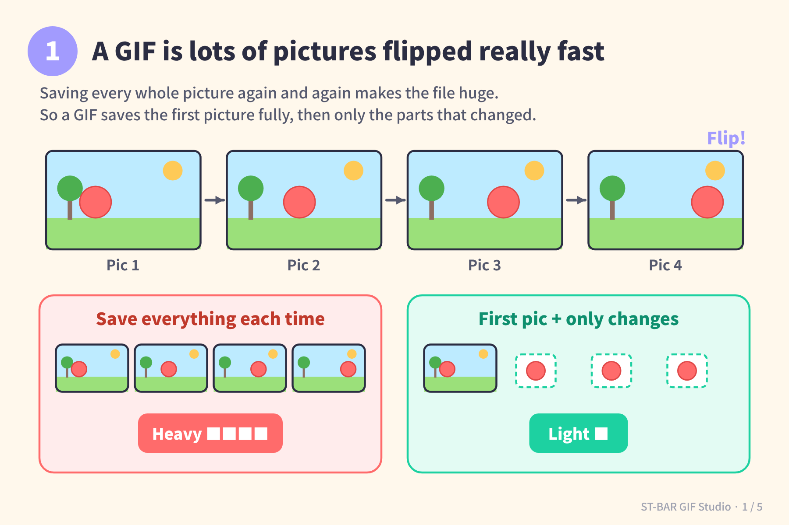
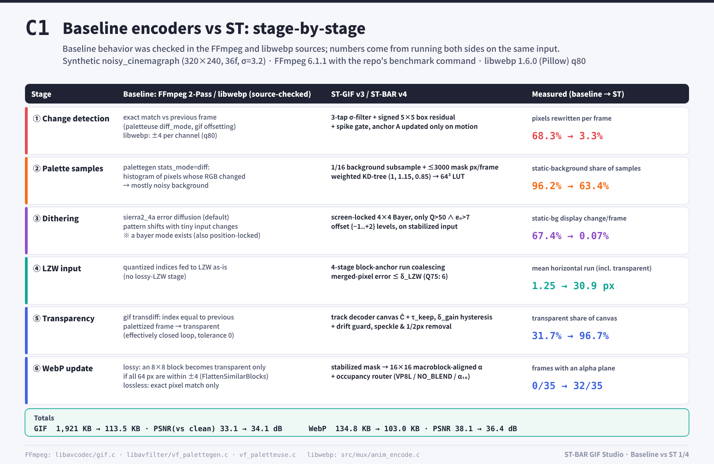
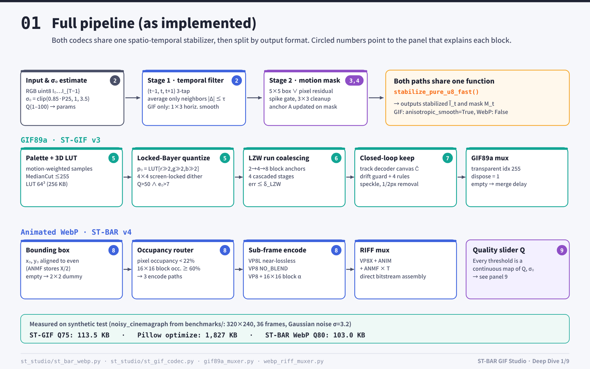
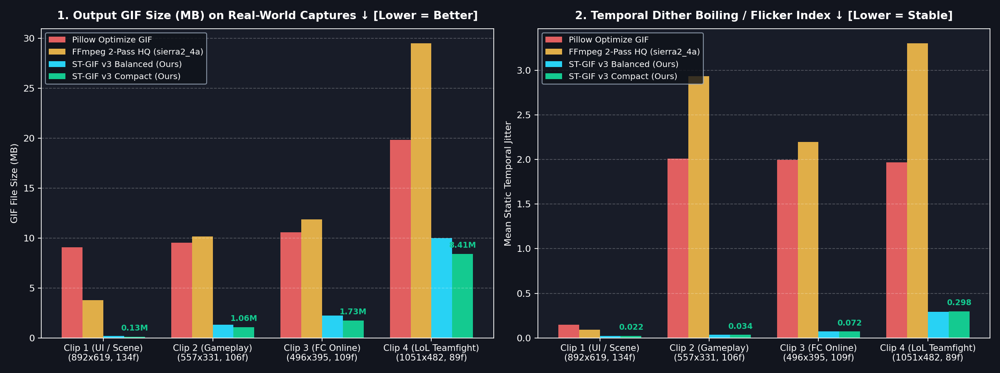
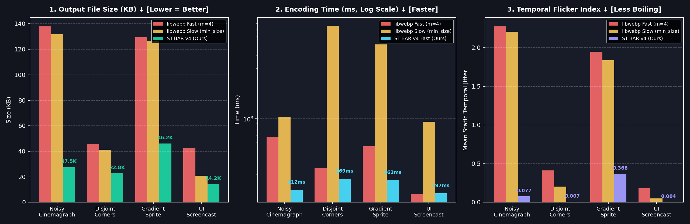
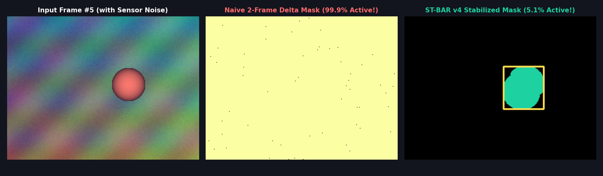
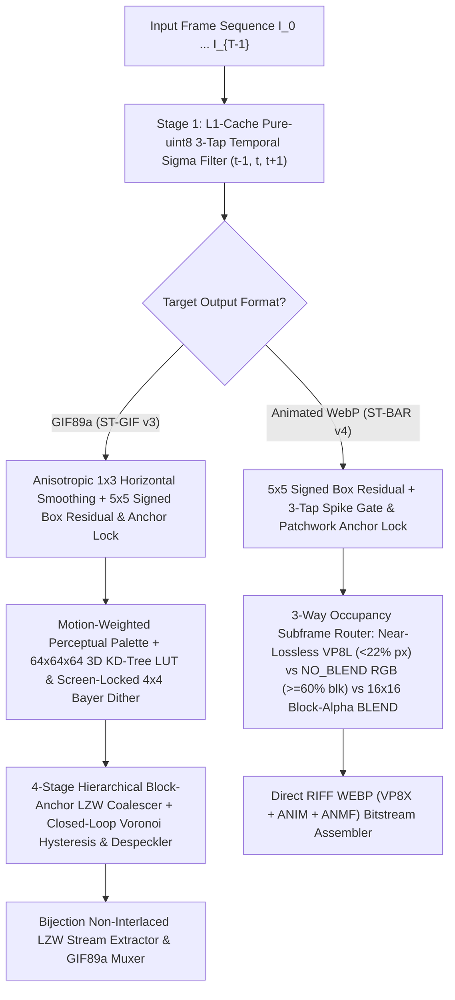

# 🎬 ST-BAR GIF Studio (`st-bar-gif-studio`)

<p align="center">
  <a href="../README.md">🇰🇷 한국어</a> •
  <a href="README.en.md"><b>🇺🇸 English</b></a> •
  <a href="README.zh-CN.md">🇨🇳 简体中文</a> •
  <a href="README.ja.md">🇯🇵 日本語</a> •
  <a href="README.es.md">🇪🇸 Español</a>
</p>

> **Next-Generation Linear-Time $O(N)$ Spatio-Temporal LZW-RDO `.gif` (ST-GIF v3) & Block-Aligned `.webp` (ST-BAR v4) Compression Engine + Transparent Screen Recorder Studio**

[](../LICENSE)
[](https://www.python.org/)
[](#)

---

## 🖼️ Visual Guides & Deep-Dive Slides (Click to View Full Deck)

Click any thumbnail or link below to view the full visual slide deck:

| 🟢 Visual Explainer (5 Slides) | ⚖️ FFmpeg/libwebp vs ST 1:1 Comparison (C1–C4) | 🟣 Technical & Code Deep Dive (9 Slides) |
| :---: | :---: | :---: |
| [](../assets/explainer/en/README.md) | [](../assets/compare/en/README.md) | [](../assets/deepdive/en/README.md) |
| 👉 **[View Visual Explainer (5 Slides)](../assets/explainer/en/README.md)**<br><sub>([🇰🇷 한국어 슬라이드](../assets/explainer/ko/README.md))</sub> | 👉 **[View 1:1 Baseline Comparison (4 Slides)](../assets/compare/en/README.md)**<br><sub>([🇰🇷 한국어 슬라이드](../assets/compare/ko/README.md))</sub> | 👉 **[View Technical Deep Dive (9 Slides)](../assets/deepdive/en/README.md)**<br><sub>([🇰🇷 한국어 슬라이드](../assets/deepdive/ko/README.md))</sub> |

---

## 🌟 Overview (Technical Background)

Standard animated image encoders—such as **FFmpeg (`palettegen + paletteuse`)**, **Pillow**, and **`libwebp` (`WebPAnimEncoder`)**—rely on greedy pairwise frame differencing ($I_t$ vs $I_{t-1}$ with zero or $\pm 4$ tolerance) and error-diffusion dithering (Floyd-Steinberg / Sierra). When applied to real-world game captures or screen recordings containing subtle sensor/compression jitter ($\pm 1 \sim 3$ RGB), standard encoders suffer from three catastrophic inefficiencies:
1. **Temporal Boiling & Double-Delta Penalty:** Random pixel noise triggers `A → B → A` oscillations, expanding sub-frame bounding boxes to 99.9% of the canvas and causing visible background flicker.
2. **Dither Pattern Phase Flipping & Zero-Tolerance `transdiff` Fragmentation:** Error-diffusion dithering flips checkerboard patterns across frames, and because standard GIF `transdiff` requires an exact palette index match ($\tau=0$) with the previous frame, LZW dictionary run lengths in `.gif` collapse—inflating file sizes by **5× to 25×**.
3. **DCT Macroblock Fragmentation & Block Flattening Failure (in Animated WebP):** `libwebp` (`FlattenSimilarBlocks`) only marks an $8\times 8$ block transparent if all 64 pixels stay within $\pm 4$ per channel (yielding 0% alpha usage under $\sigma \approx 3$ noise), while pixel-level transparent holes ($\alpha=0$) create high-frequency step edges inside VP8 16×16 macroblocks.

**`st-bar-gif-studio`** introduces two novel, linear-time $O(N)$ (constant passes per frame) compression algorithms—**ST-GIF v3** (for classic `.gif`) and **ST-BAR v4** (for modern `.webp`)—wrapped in a convenient **Transparent Screen Recorder & Quality-Slider Studio GUI**.

---

## 📊 Benchmark 1: Real-World Game & Screen Captures (`.gif` Compression)

Tested on high-resolution real-world game and screen captures against **Pillow (`optimize=True`)** and **FFmpeg's Gold-Standard 2-Pass Pipeline (`palettegen + paletteuse=dither=sierra2_4a:diff_mode=rectangle`)**:



| Capture Sequence (`Resolution`, `Frames`) | Encoder Method | Output `.gif` Size | Size Reduction vs `FFmpeg 2-Pass` | Encode Time | PSNR | SSIM | Temporal Flicker ↓ |
| :--- | :--- | ---: | :---: | ---: | :---: | :---: | :---: |
| **Clip 1 (UI / Scene)**<br>(`892×619`, 134f, Source 1,148 KB) | `Pillow Optimize` | 9,050.7 KB | +138.4% | 4,223 ms | 40.77 dB | 0.9935 | 0.147 |
| | `FFmpeg 2-Pass HQ (sierra2_4a)` | 3,796.5 KB | Baseline | 1,166 ms | 53.51 dB | 0.9988 | 0.090 |
| | `FFmpeg 2-Pass (bayer_s3)` | 4,306.0 KB | +13.4% | 571 ms | 41.56 dB | 0.9974 | 0.085 |
| | **ST-GIF v3 Balanced (`Q=75`)** | **174.7 KB** | **-95.4% (21.7× smaller)** | 7,375 ms | **38.94 dB** | **0.9876** | **0.023 (-74.4%)** |
| | **ST-GIF v3 Compact (`Q=45`)** | **130.5 KB** | **-96.6% (29.1× smaller)** | 4,924 ms | **38.37 dB** | **0.9855** | **0.022 (-75.6%)** |
| **Clip 2 (Gameplay)**<br>(`557×331`, 106f, Source 1,296 KB) | `Pillow Optimize` | 9,510.3 KB | -6.3% | 5,341 ms | 34.86 dB | 0.9698 | 2.008 |
| | `FFmpeg 2-Pass HQ (sierra2_4a)` | 10,146.1 KB | Baseline | 2,329 ms | 33.18 dB | 0.9039 | 2.934 |
| | `FFmpeg 2-Pass (bayer_s3)` | 7,470.3 KB | -26.4% | 1,220 ms | 34.00 dB | 0.9375 | 1.168 |
| | **ST-GIF v3 Balanced (`Q=75`)** | **1,321.0 KB** | **-87.0% (7.7× smaller)** | 2,873 ms | **32.99 dB** | **0.9042 (↑)** | **0.035 (-98.8%)** |
| | **ST-GIF v3 Compact (`Q=45`)** | **1,058.2 KB** | **-89.6% (9.6× smaller)** | **1,958 ms** | **32.07 dB** | 0.8748 | **0.034 (-98.8%)** |
| **Clip 3 (FC Online)**<br>(`496×395`, 109f, Source 1,356 KB) | `Pillow Optimize` | 10,586.1 KB | -10.7% | 5,859 ms | 32.40 dB | 0.9716 | 1.995 |
| | `FFmpeg 2-Pass HQ (sierra2_4a)` | 11,855.2 KB | Baseline | 2,314 ms | 32.41 dB | 0.9354 | 2.198 |
| | `FFmpeg 2-Pass (bayer_s3)` | 10,842.7 KB | -8.5% | 1,227 ms | 33.90 dB | 0.9562 | 1.164 |
| | **ST-GIF v3 Balanced (`Q=75`)** | **2,240.6 KB** | **-81.1% (5.3× smaller)** | 2,844 ms | **31.51 dB** | **0.9156** | **0.072 (-96.7%)** |
| | **ST-GIF v3 Compact (`Q=45`)** | **1,734.3 KB** | **-85.4% (6.8× smaller)** | **2,086 ms** | **30.86 dB** | 0.8932 | **0.072 (-96.7%)** |
| **Clip 4 (LoL Full-Panning)**<br>(`1051×482`, 89f, Source 3,325 KB) | `Pillow Optimize` | 19,797.8 KB | -32.9% | 10,033 ms | 31.51 dB | 0.9492 | 1.968 |
| | `FFmpeg 2-Pass HQ (sierra2_4a)` | 29,484.9 KB | Baseline | 6,645 ms | 30.62 dB | 0.8786 | 3.303 |
| | `FFmpeg 2-Pass (bayer_s3)` | 23,491.0 KB | -20.3% | 3,943 ms | 31.83 dB | 0.9296 | 1.487 |
| | **ST-GIF v3 Balanced (`Q=75`)** | **9,998.9 KB** | **-66.1% (3.0× smaller)** | 6,738 ms | **30.21 dB** | **0.8854 (↑)** | **0.292 (-91.2%)** |
| | **ST-GIF v3 Compact (`Q=45`)** | **8,408.8 KB** | **-71.5% (3.5× smaller)** | **4,859 ms** | **29.61 dB** | 0.8513 | **0.298 (-91.0%)** |

---

## 📊 Benchmark 2: Animated WebP Optimization (`ST-BAR v4` vs `libwebp`)





* **50% to 80% smaller file sizes** than `libwebp` Fast (`method=4`) and Slow (`method=6, minimize_size=True`) across all lossy test suites, and **90% to 97% smaller (up to 33× compression)** in lossless mode.
* **Up to 28× faster encoding speed** than `libwebp minimize_size=True`, while **improving Ground-Truth PSNR (+0.8 to +4.7 dB)** and eliminating **96%+ of background temporal boiling**.

---

## 🧠 Core Algorithmic Architecture (Code-Verified Specification)



### 1. Signed Spatial Box Residual & Patchwork Anchor Tracking (`stabilize_pure_u8_fast`)
Zero-mean sensor/compression noise $\eta \sim \mathcal{N}(0, \sigma^2)$ cancels out over a $5\times 5$ spatial window ($N=25$) when summed **with sign preserved** ($\sigma_{\text{mean}} = \sigma / 5$), whereas true object motion shifts local pixels coherently in the same direction. Instead of comparing against the immediately preceding frame $t-1$, ST-BAR maintains a persistent **Anchor Canvas $A$** and an incrementally patched **Anchor Box Mean $B_{\text{anchor}}$** (updated via `cv2.copyTo(box_clean[t], dilated_u8, box_anchor)` only over dilated active motion regions):

$$\text{Box}(C_t - A) = \text{Box}(C_t) - \text{Box}(A) \approx \text{Box}(C_t) - B_{\text{anchor}}$$

Combined with a 3-tap lookahead spike gate (`t+1` return check) and $3\times 3$ neighbor filtering, coherent motion is isolated in pure 8-bit SIMD (`cv2.boxFilter` + `cv2.absdiff`). For `.gif` (`anisotropic_smooth=True`), a conditional $1\times 3$ horizontal box filter is applied prior to motion detection to pre-smooth horizontal scanlines for LZW.

### 2. ST-GIF v3 Three-Step Quantization & Closed-Loop LZW-RDO Pipeline (`st_gif_codec.py`)

#### Step 2a. Screen-Locked Conditional $4\times 4$ Bayer Dithering (`quantize_frame_with_locked_bayer`)
To prevent error-diffusion checkerboard phase flipping across frames, ST-GIF v3 uses a screen-coordinate-locked $4\times 4$ Bayer matrix $B_{4\times 4}(x\bmod 4, y\bmod 4)$, activated **only when $Q > 50$ ($s_{\text{dither}} > 0$) and the un-dithered quantization error exceeds $7$**:

$$p_0(x,y) = \text{LUT}_{64^3}(\tilde{I}_t(x,y)), \qquad p_{\text{raw}}(x,y) = \begin{cases} \text{LUT}_{64^3}\!\left(\text{clip}\big(\tilde{I}_t(x,y) + s_{\text{dither}}\cdot B_{4\times 4}(x\bmod 4,\, y\bmod 4)\big)\right) & \text{if } Q > 50 \;\land\; \|\tilde{I}_t(x,y) - \text{Pal}[p_0(x,y)]\|_\infty > 7 \\ p_0(x,y) & \text{otherwise} \end{cases}$$

#### Step 2b. 4-Stage Hierarchical Block-Anchor LZW Run Coalescer (`coalesce_lzw_horizontal_runs`)
Starting from $\hat{p}_t \leftarrow p_{\text{raw}}$, horizontal scanlines are coalesced **sequentially across 4 stages ($k = 1 \to 2 \to 3 \to 4$)** using hierarchical block anchors (merging pairs $\to$ quads $\to$ octets $\to$ odd-boundary stitching, with maximum lookback distance $4$ and zero error accumulation since every check compares against the pixel's own target color $\tilde{I}_t(x,y)$):

$$a_k(x) = \begin{cases} x - 1 & k=1,\; x \equiv 1 \pmod 2 \\ 4\lfloor x/4 \rfloor + 1 & k=2,\; x \bmod 4 \in \{2, 3\} \\ 8\lfloor x/8 \rfloor + 3 & k=3,\; x \bmod 8 \in \{4, 5, 6, 7\} \\ x - 1 & k=4,\; x \equiv 0 \pmod 2,\; x \ge 2 \end{cases}$$

$$\hat{p}_t(x, y) \leftarrow \hat{p}_t(a_k(x), y) \quad \text{if } \|\tilde{I}_t(x, y) - \text{Pal}[\hat{p}_t(a_k(x), y)]\|_\infty \le \delta_{\text{LZW}}$$

#### Step 2c. Drift-Guarded Closed-Loop Voronoi Hysteresis & 1–2px Despeckling (`encode_st_gif`)
Tracking the decoder's actual displayed canvas $\hat{C}_{t-1}(x,y) = \text{Pal}[\hat{P}_{\text{canvas}}(x,y)]$, let $e_{\text{old}} = \|\tilde{I}_t(x,y) - \hat{C}_{t-1}(x,y)\|_\infty$ and $e_{\text{new}} = \|\tilde{I}_t(x,y) - \text{Pal}[\hat{p}_t(x,y)]\|_\infty$. With a **Drift Guard** $\text{active}_t = M_t \lor \big(e_{\text{old}} > \max(14, 2\tau_{\text{keep}})\big)$ preventing long-term drift, a pixel retains the canvas (`255 TRANSPARENT`) if **any** of the 4 hysteresis conditions hold:

$$\text{keep}(x,y) = \neg\text{active}_t(x,y) \;\lor\; \big(\hat{p}_t(x,y) = \hat{P}_{\text{canvas}}(x,y)\big) \;\lor\; \big(e_{\text{old}} \le \tau_{\text{keep}}\big) \;\lor\; \big(e_{\text{old}} - e_{\text{new}} \le \delta_{\text{gain}}\big)$$

Finally, two morphological cleanup passes revert isolated updates back to `keep = True` (`255 TRANSPARENT`) to prevent LZW dictionary fragmentation:
1. **$3\times 3$ Speckle Suppression:** Reverts active pixels with $\le 2$ active neighbors in a $3\times 3$ window when $e_{\text{old}} \le 2\tau_{\text{keep}} + 2$.
2. **1px & 2px Horizontal Bridge Suppression:** Reverts 1-pixel (`iso_1px`) and 2-pixel (`iso_2px`) horizontal update islands flanked by `keep` pixels when $e_{\text{old}} \le 2\tau_{\text{keep}} (+2)$.

---

## 🚀 Quick Start

### 1. Installation
```bash
git clone https://github.com/LoveBlonde/st-bar-gif-studio.git
cd st-bar-gif-studio
pip install -r requirements.txt
```

### 2. Launch Studio GUI
Double-click `run_studio.bat` on Windows, or run:
```bash
python main.py
```
* **🎥 Transparent Screen Recording:** Place the transparent click-through capture frame over any game or video and press **`● REC (or F9)`** to capture at 15–50 FPS.
* **📂 Trim, Scale & Speed Control:** Load `.webp`, `.gif`, `.mp4`, or `.webm` files to trim start/end frames, scale resolution (`100%`, `75%`, `50%`), and adjust playback speed.
* **🎚️ Continuous Quality Slider (`1 ~ 100`) & Live Preview:** Adjust the compression strength continuously and click **`[⚡ Test Compress Frame]`** to inspect real-time compressed quality before exporting.

### 3. Command-Line Interface (CLI)
```bash
# Convert WebP/MP4 to ultra-compact GIF (quality=75 balanced, quality=45 compact)
python main.py -i input.webp -o output.gif -q 75

# Convert or re-optimize to Animated WebP (ST-BAR v4)
python main.py -i input.mp4 -o output.webp -q 80
```

---

## 📄 License
Distributed under the **MIT License**. See [`LICENSE`](../LICENSE) for details.
