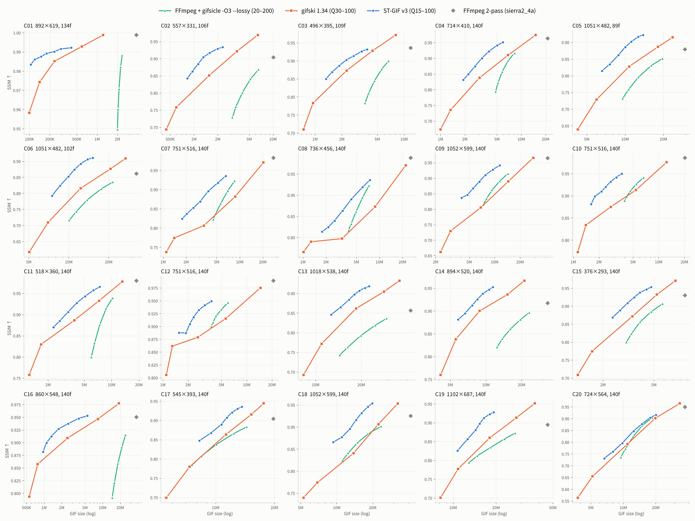

# 🎬 ST-BAR GIF Studio (`st-bar-gif-studio`)

<p align="center">
  <a href="../README.md">🇰🇷 한국어</a> •
  <a href="README.en.md">🇺🇸 English</a> •
  <a href="README.zh-CN.md">🇨🇳 简体中文</a> •
  <a href="README.ja.md"><b>🇯🇵 日本語</b></a> •
  <a href="README.es.md">🇪🇸 Español</a>
</p>

> **次世代線形時間 $O(N)$ 時空間 LZW-RDO `.gif` (ST-GIF v3) ＆ ブロック整列 `.webp` (ST-BAR v4) 圧縮最適化エンジン + 透過フレーム画面録画スタジオ**

[](../LICENSE)
[](https://www.python.org/)
[](#)

---

## 📑 目次 (Table of Contents)

1. [🖼️ 図解スライド＆徹底比較ギャラリー](#visual-slides)
2. [🌟 研究背景と主な成果 (Overview)](#overview)
3. [📊 ベンチマーク 1：実際のゲーム・画面キャプチャ (`.gif` 圧縮比較)](#benchmark-gif)
4. [📊 ベンチマーク 2：Animated WebP 最適化 (`ST-BAR v4` vs `libwebp`)](#benchmark-webp)
5. [🧠 コア数理モデルとアルゴリズム構造（コード検証済み仕様）](#architecture)
6. [🚀 クイックスタート (Quick Start)](#quickstart)
7. [🔬 詳細研究結果＆論文実験レポート (`Benchmark` & `Experiments`)](#research-experiments)
8. [📄 ライセンス (License)](#license)

---

<a id="visual-slides"></a>
## 🖼️ 図解スライド＆徹底比較ギャラリー（サムネイルをクリックして全スライドを表示）

| 🟢 わかりやすい原理図解（5枚） | 📊 4大 GIF エンコーダ比較表 | ⚖️ 従来方式 vs ST 1:1 比較（C1–C4） | 🟣 コード深掘り解説（9枚） |
| :---: | :---: | :---: | :---: |
| [](../assets/explainer/en/README.md) | [](../assets/encoder_comparison/en/README.md) | [](../assets/compare/en/README.md) | [](../assets/deepdive/en/README.md) |
| 👉 **[原理図解スライド (EN)](../assets/explainer/en/README.md)**<br><sub>([🇰🇷 KO](../assets/explainer/ko/README.md))</sub> | 👉 **[4大エンコーダ比較 (EN)](../assets/encoder_comparison/en/README.md)**<br><sub>([🇰🇷 KO](../assets/encoder_comparison/ko/README.md))</sub> | 👉 **[1:1 比較スライド (EN)](../assets/compare/en/README.md)**<br><sub>([🇰🇷 KO](../assets/compare/ko/README.md))</sub> | 👉 **[コード深掘り解説 (EN)](../assets/deepdive/en/README.md)**<br><sub>([🇰🇷 KO](../assets/deepdive/ko/README.md))</sub> |

---

<a id="overview"></a>
## 🌟 研究背景と主な成果 (Overview)

従来のアニメーション画像エンコーダ（**FFmpeg (`palettegen + paletteuse`)**、**Pillow**、**`libwebp` (`WebPAnimEncoder`)** など）は、隣接フレーム間の単純なピクセル差分（$I_t$ vs $I_{t-1}$、許容誤差 0 または $\pm 4$）と誤差拡散ディザリング（Floyd-Steinberg / Sierra）に依存しています。微細なセンサーノイズや圧縮アーティファクト（$\pm 1 \sim 3$ RGB）を含む実際のゲーム録画や画面キャプチャに適用すると、以下の3つの致命的な非効率が発生します。

1. **時間軸ボイリング (Temporal Boiling) と二重デルタペナルティ:** ランダムな微小ノイズが `A → B → A` の振動を引き起こし、サブフレームのバウンディングボックスが画面全体（99.9%）に膨張して背景のちらつき（フリッカー）を生じさせます。
2. **ディザパターンの位相反転と許容誤差 0 透明判定 (`transdiff`) の限界:** 誤差拡散ディザリングがフレームごとにチェッカーボードパターンの位相を反転させ、従来の GIF `transdiff` はパレットインデックスが完全一致（許容誤差 0）するピクセルしか透明化しないため、`.gif` の LZW 辞書ランレングスが破壊され、ファイルサイズが **5倍〜25倍** に肥大化します。
3. **DCT マクロブロックの断片化とブロック平坦化の失敗 (Animated WebP):** `libwebp` (`FlattenSimilarBlocks`) は $8\times 8$ ブロック内 64 ピクセルすべてが $\pm 4$ 以内の場合のみ透明化するためノイズ環境でアルファ更新が無効化され、ピクセル単位で透明な穴（$\alpha=0$）を開けると VP8 $16\times 16$ マクロブロック内部に高周波ステップエッジが生成されます。

**`st-bar-gif-studio`** は、線形時間 $O(N)$（フレームあたり定数パス）で動作する時空間圧縮アルゴリズムである **ST-GIF v3**（`.gif` 用）および **ST-BAR v4**（`.webp` 用）を独自実装し、直感的に使える **クリック透過型の画面録画フレーム＆連続品質スライダー (`1 ~ 100`) 搭載 GUI スタジオ** を提供します。

---

<a id="benchmark-gif"></a>
## 📊 ベンチマーク 1：実際のゲーム・画面キャプチャ (`.gif` 圧縮比較)


| キャプチャシーケンス (`解像度`, `フレーム数`) | エンコーダ方式 | 出力 `.gif` サイズ | `FFmpeg 2-Pass` 比削減率 | 処理時間 | PSNR | SSIM | 背景ちらつき (Flicker ↓) |
| :--- | :--- | ---: | :---: | ---: | :---: | :---: | :---: |
| **Clip 1 (UI / デスクトップ)**<br>(`892×619`, 134f, 元 1,148 KB) | `Pillow Optimize` | 9,050.7 KB | +138.4% | 4,223 ms | 40.77 dB | 0.9935 | 0.147 |
| | `FFmpeg 2-Pass HQ (sierra2_4a)` | 3,796.5 KB | 基準 (Baseline) | 1,166 ms | 53.51 dB | 0.9988 | 0.090 |
| | `FFmpeg 2-Pass (bayer_s3)` | 4,306.0 KB | +13.4% | 571 ms | 41.56 dB | 0.9974 | 0.085 |
| | **ST-GIF v3 Balanced (`Q=75`)** | **174.7 KB** | **-95.4% (21.7分の1)** | 7,375 ms | **38.94 dB** | **0.9876** | **0.023 (-74.4%)** |
| | **ST-GIF v3 Compact (`Q=45`)** | **130.5 KB** | **-96.6% (29.1分の1)** | 4,924 ms | **38.37 dB** | **0.9855** | **0.022 (-75.6%)** |
| **Clip 2 (ゲームプレイ映像)**<br>(`557×331`, 106f, 元 1,296 KB) | `Pillow Optimize` | 9,510.3 KB | -6.3% | 5,341 ms | 34.86 dB | 0.9698 | 2.008 |
| | `FFmpeg 2-Pass HQ (sierra2_4a)` | 10,146.1 KB | 基準 (Baseline) | 2,329 ms | 33.18 dB | 0.9039 | 2.934 |
| | `FFmpeg 2-Pass (bayer_s3)` | 7,470.3 KB | -26.4% | 1,220 ms | 34.00 dB | 0.9375 | 1.168 |
| | **ST-GIF v3 Balanced (`Q=75`)** | **1,321.0 KB** | **-87.0% (7.7分の1)** | 2,873 ms | **32.99 dB** | **0.9042 (↑)** | **0.035 (-98.8%)** |
| | **ST-GIF v3 Compact (`Q=45`)** | **1,058.2 KB** | **-89.6% (9.6分の1)** | **1,958 ms** | **32.07 dB** | 0.8748 | **0.034 (-98.8%)** |
| **Clip 3 (FC Online サッカー)**<br>(`496×395`, 109f, 元 1,356 KB) | `Pillow Optimize` | 10,586.1 KB | -10.7% | 5,859 ms | 32.40 dB | 0.9716 | 1.995 |
| | `FFmpeg 2-Pass HQ (sierra2_4a)` | 11,855.2 KB | 基準 (Baseline) | 2,314 ms | 32.41 dB | 0.9354 | 2.198 |
| | `FFmpeg 2-Pass (bayer_s3)` | 10,842.7 KB | -8.5% | 1,227 ms | 33.90 dB | 0.9562 | 1.164 |
| | **ST-GIF v3 Balanced (`Q=75`)** | **2,240.6 KB** | **-81.1% (5.3分の1)** | 2,844 ms | **31.51 dB** | **0.9156** | **0.072 (-96.7%)** |
| | **ST-GIF v3 Compact (`Q=45`)** | **1,734.3 KB** | **-85.4% (6.8分の1)** | **2,086 ms** | **30.86 dB** | 0.8932 | **0.072 (-96.7%)** |
| **Clip 4 (LoL 全画面カメラパン)**<br>(`1051×482`, 89f, 元 3,325 KB) | `Pillow Optimize` | 19,797.8 KB | -32.9% | 10,033 ms | 31.51 dB | 0.9492 | 1.968 |
| | `FFmpeg 2-Pass HQ (sierra2_4a)` | 29,484.9 KB | 基準 (Baseline) | 6,645 ms | 30.62 dB | 0.8786 | 3.303 |
| | `FFmpeg 2-Pass (bayer_s3)` | 23,491.0 KB | -20.3% | 3,943 ms | 31.83 dB | 0.9296 | 1.487 |
| | **ST-GIF v3 Balanced (`Q=75`)** | **9,998.9 KB** | **-66.1% (3.0分の1)** | 6,738 ms | **30.21 dB** | **0.8854 (↑)** | **0.292 (-91.2%)** |
| | **ST-GIF v3 Compact (`Q=45`)** | **8,408.8 KB** | **-71.5% (3.5分の1)** | **4,859 ms** | **29.61 dB** | 0.8513 | **0.298 (-91.0%)** |

---

<a id="benchmark-webp"></a>
## 📊 ベンチマーク 2：Animated WebP 最適化 (`ST-BAR v4` vs `libwebp`)


---

<a id="architecture"></a>
## 🧠 コア数理モデルとアルゴリズム構造（コード検証済み仕様）

### 1. 符号付き空間ボックス残差 ＆ パッチワーク・アンカー追跡 (`stabilize_pure_u8_fast`)
$$\text{Box}(C_t - A) = \text{Box}(C_t) - \text{Box}(A) \approx \text{Box}(C_t) - B_{\text{anchor}}$$

### 2. ST-GIF v3 3段階量子化および閉ループ LZW-RDO パイプライン (`st_gif_codec.py`)

#### Step 2a. 画面絶対座標固定・条件付き $4\times 4$ Bayer ディザリング (`quantize_frame_with_locked_bayer`)
$$p_0(x,y) = \text{LUT}_{64^3}(\tilde{I}_t(x,y)), \qquad p_{\text{raw}}(x,y) = \begin{cases} \text{LUT}_{64^3}\!\left(\text{clip}\big(\tilde{I}_t(x,y) + s_{\text{dither}}\cdot B_{4\times 4}(x\bmod 4,\, y\bmod 4)\big)\right) & \text{if } Q > 50 \;\land\; \|\tilde{I}_t(x,y) - \text{Pal}[p_0(x,y)]\|_\infty > 7 \\ p_0(x,y) & \text{otherwise} \end{cases}$$

#### Step 2b. 4段階階層型ブロックアンカー LZW 走査線統合 (`coalesce_lzw_horizontal_runs`)
$$a_k(x) = \begin{cases} x - 1 & k=1,\; x \equiv 1 \pmod 2 \\ 4\lfloor x/4 \rfloor + 1 & k=2,\; x \bmod 4 \in \{2, 3\} \\ 8\lfloor x/8 \rfloor + 3 & k=3,\; x \bmod 8 \in \{4, 5, 6, 7\} \\ x - 1 & k=4,\; x \equiv 0 \pmod 2,\; x \ge 2 \end{cases}$$

$$\hat{p}_t(x, y) \leftarrow \hat{p}_t(a_k(x), y) \quad \text{if } \|\tilde{I}_t(x, y) - \text{Pal}[\hat{p}_t(a_k(x), y)]\|_\infty \le \delta_{\text{LZW}}$$

#### Step 2c. ドリフトガード付き閉ループ・ボロノイヒステリシス ＆ 1–2px 孤立点除去 (`encode_st_gif`)
$\text{active}_t = M_t \lor \big(e_{\text{old}} > \max(14, 2\tau_{\text{keep}})\big)$ に対し：

$$\text{keep}(x,y) = \neg\text{active}_t(x,y) \;\lor\; \big(\hat{p}_t(x,y) = \hat{P}_{\text{canvas}}(x,y)\big) \;\lor\; \big(e_{\text{old}} \le \tau_{\text{keep}}\big) \;\lor\; \big(e_{\text{old}} - e_{\text{new}} \le \delta_{\text{gain}}\big)$$

---

<a id="quickstart"></a>
## 🚀 クイックスタート (Quick Start)

```bash
git clone https://github.com/LoveBlonde/st-bar-gif-studio.git
cd st-bar-gif-studio
pip install -r requirements.txt
python main.py
```

---

<a id="research-experiments"></a>
## 🔬 詳細研究結果＆論文実験レポート (`Benchmark` & `Experiments`)

**20個の層化抽出された実画面・ゲーム録画クリップ（計260設定）**において、**ST-GIF v3** と **`gifski 1.34` · `gifsicle 1.94 (-O3 --lossy)` · `FFmpeg 6.1.1 2-pass`** を RD曲線、**BD-rate**、知覚品質（**VMAF / VMAF-NEG**）、バンディング（**CAMBI**）、時間的安定性（**Flicker / TDE**）、および **等サイズ・アブレーション実験** により体系的に評価したレポート＆図表です：

| 📘 総合ベンチマークレポート (`Benchmark`) | 📙 論文第4章 実験セクション草稿 (`Experiments`) |
| :---: | :---: |
| 👉 **[🇺🇸 English Benchmark Report (`BENCHMARK.en.md`)](../assets/benchmark/BENCHMARK.en.md)**<br><sub>([🇰🇷 한국어 (`BENCHMARK.ko.md`)](../assets/benchmark/BENCHMARK.ko.md))</sub> | 👉 **[🇺🇸 English Paper Experiments (`experiments.en.md`)](../assets/experiments/experiments.en.md)**<br><sub>([🇰🇷 한국어 (`experiments.ko.md`)](../assets/experiments/experiments.ko.md))</sub> |

| 📊 `gifski` 対比クリップ別 BD-rate | 📉 代表クリップの RD 曲線 | 🌈 同サイズ帯バンディング (CAMBI) | 🗂️ 全20クリップ RD グリッド (PSNR·SSIM·VMAF) |
| :---: | :---: | :---: | :---: |
| [](../assets/benchmark/BENCHMARK.en.md) | [](../assets/experiments/experiments.en.md) | [](../assets/experiments/experiments.en.md) | [](../assets/benchmark/figures/en/rd_ssim_grid.png) |
| [🇺🇸 EN](../assets/benchmark/figures/en/bd_rate_vs_gifski.png) · [🇰🇷 KO](../assets/benchmark/figures/ko/bd_rate_vs_gifski.png) | [🇺🇸 EN](../assets/benchmark/figures/en/rd_representative.png) · [🇰🇷 KO](../assets/benchmark/figures/ko/rd_representative.png) | [🇺🇸 EN](../assets/benchmark/figures/en/cambi_per_clip.png) · [🇰🇷 KO](../assets/benchmark/figures/ko/cambi_per_clip.png) | 🇺🇸 [PSNR](../assets/benchmark/figures/en/rd_psnr_grid.png) · [SSIM](../assets/benchmark/figures/en/rd_ssim_grid.png) · [VMAF](../assets/benchmark/figures/en/rd_vmaf_grid.png) |

---

<a id="license"></a>
## 📄 ライセンス (License)
本プロジェクトは **MIT License** の下で公開されています。詳細は [`LICENSE`](../LICENSE) をご覧ください。
