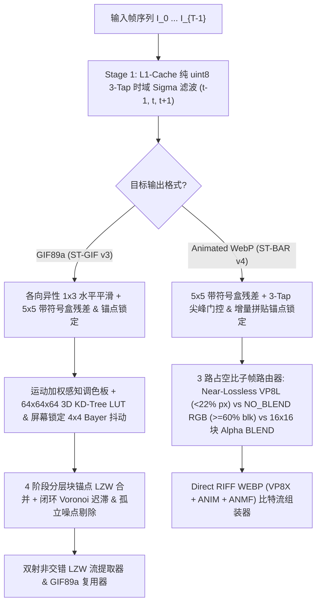

# 🎬 ST-BAR GIF Studio (`st-bar-gif-studio`)

<p align="center">
  <a href="../README.md">🇰🇷 한국어</a> •
  <a href="README.en.md">🇺🇸 English</a> •
  <a href="README.zh-CN.md"><b>🇨🇳 简体中文</b></a> •
  <a href="README.ja.md">🇯🇵 日本語</a> •
  <a href="README.es.md">🇪🇸 Español</a>
</p>

> **下一代线性时间 $O(N)$ 时空 LZW-RDO `.gif` (ST-GIF v3) 与块对齐 `.webp` (ST-BAR v4) 动图压缩优化引擎 + 透明穿透屏幕录制工作室**

[](../LICENSE)
[](https://www.python.org/)
[](#)

---

## 🖼️ 视觉化原理解析与深度对比图集（点击缩略图查看完整图集）

| 🟢 通俗原理解析（5页） | 📊 四大 GIF 编码器全景对比 | ⚖️ 传统编码器 vs ST 1:1 对比（C1–C4） | 🟣 代码级深度解析（9页） |
| :---: | :---: | :---: | :---: |
| [](../assets/explainer/en/README.md) | [](../assets/encoder_comparison/en/README.md) | [](../assets/compare/en/README.md) | [](../assets/deepdive/en/README.md) |
| 👉 **[查看原理解析 (EN)](../assets/explainer/en/README.md)**<br><sub>([🇰🇷 KO](../assets/explainer/ko/README.md))</sub> | 👉 **[查看四大编码器对比 (EN)](../assets/encoder_comparison/en/README.md)**<br><sub>([🇰🇷 KO](../assets/encoder_comparison/ko/README.md))</sub> | 👉 **[查看 1:1 对比图集 (EN)](../assets/compare/en/README.md)**<br><sub>([🇰🇷 KO](../assets/compare/ko/README.md))</sub> | 👉 **[查看代码深度解析 (EN)](../assets/deepdive/en/README.md)**<br><sub>([🇰🇷 KO](../assets/deepdive/ko/README.md))</sub> |

---

## 🌟 研究背景与核心成果 (Overview)

传统的动图编码器——例如 **FFmpeg (`palettegen + paletteuse`)**、**Pillow** 以及 **`libwebp` (`WebPAnimEncoder`)**——依赖于贪婪的相邻帧逐像素差分（$I_t$ vs $I_{t-1}$，零容差或 $\pm 4$）以及误差扩散抖动（Floyd-Steinberg / Sierra）。当处理包含细微传感器噪点或视频压缩伪影（$\pm 1 \sim 3$ RGB）的真实游戏录屏或屏幕捕获时，传统编码器会出现三个灾难性的效率瓶颈：

1. **时域沸腾 (Temporal Boiling) 与双倍差分惩罚：** 随机像素噪点触发 `A → B → A` 振荡，导致子帧边界框（Bounding Box）膨胀至全屏 99.9%，并产生肉眼可见的背景闪烁。
2. **抖动相位翻转与零容差透明判定 (`transdiff`) 瓶颈：** 误差扩散抖动在帧与帧之间不断翻转棋盘格相位，且传统 GIF `transdiff` 仅当调色板索引完全一致（容差 0）时才设为透明，彻底破坏 `.gif` 的 LZW 字典游程（Run-Length），导致文件体积暴增 **5倍 至 25倍**。
3. **DCT 宏块碎片化与块平坦化失效（在 Animated WebP 中）：** `libwebp` (`FlattenSimilarBlocks`) 要求 $8\times 8$ 块全部 64 个像素均在 $\pm 4$ 以内才设为透明（在噪声下局部透明率降为 0%），而逐像素打孔（$\alpha=0$）则会在 VP8 $16\times 16$ 宏块内部产生高频阶跃边缘。

**`st-bar-gif-studio`** 提出了两种全新的、线性时间 $O(N)$（每帧常数遍）时空压缩算法——**ST-GIF v3**（针对经典 `.gif`）和 **ST-BAR v4**（针对现代 `.webp`）——并配备了直观易用的 **鼠标点击穿透式透明录屏框架与连续质量滑块 (`1 ~ 100`) 工作室 GUI**。

---

## 📊 基准测试 1：真实游戏与屏幕录制 (`.gif` 压缩对比)

在真实高分辨率游戏与屏幕捕获素材上，与 **Pillow (`optimize=True`)** 及 **FFmpeg 黄金标准双通道管线 (`palettegen + paletteuse=dither=sierra2_4a:diff_mode=rectangle`)** 进行对比：


| 测试序列 (`分辨率`, `帧数`) | 编码方法 | 输出 `.gif` 体积 | 相比 `FFmpeg 2-Pass` 体积缩减 | 编码耗时 | PSNR | SSIM | 时域闪烁 (Flicker ↓) |
| :--- | :--- | ---: | :---: | ---: | :---: | :---: | :---: |
| **Clip 1 (UI / 桌面场景)**<br>(`892×619`, 134帧, 源 1,148 KB) | `Pillow Optimize` | 9,050.7 KB | +138.4% | 4,223 ms | 40.77 dB | 0.9935 | 0.147 |
| | `FFmpeg 2-Pass HQ (sierra2_4a)` | 3,796.5 KB | 基准 (Baseline) | 1,166 ms | 53.51 dB | 0.9988 | 0.090 |
| | `FFmpeg 2-Pass (bayer_s3)` | 4,306.0 KB | +13.4% | 571 ms | 41.56 dB | 0.9974 | 0.085 |
| | **ST-GIF v3 Balanced (`Q=75`)** | **174.7 KB** | **-95.4% (缩小 21.7 倍)** | 7,375 ms | **38.94 dB** | **0.9876** | **0.023 (-74.4%)** |
| | **ST-GIF v3 Compact (`Q=45`)** | **130.5 KB** | **-96.6% (缩小 29.1 倍)** | 4,924 ms | **38.37 dB** | **0.9855** | **0.022 (-75.6%)** |
| **Clip 2 (实机游戏画面)**<br>(`557×331`, 106帧, 源 1,296 KB) | `Pillow Optimize` | 9,510.3 KB | -6.3% | 5,341 ms | 34.86 dB | 0.9698 | 2.008 |
| | `FFmpeg 2-Pass HQ (sierra2_4a)` | 10,146.1 KB | 基准 (Baseline) | 2,329 ms | 33.18 dB | 0.9039 | 2.934 |
| | `FFmpeg 2-Pass (bayer_s3)` | 7,470.3 KB | -26.4% | 1,220 ms | 34.00 dB | 0.9375 | 1.168 |
| | **ST-GIF v3 Balanced (`Q=75`)** | **1,321.0 KB** | **-87.0% (缩小 7.7 倍)** | 2,873 ms | **32.99 dB** | **0.9042 (↑)** | **0.035 (-98.8%)** |
| | **ST-GIF v3 Compact (`Q=45`)** | **1,058.2 KB** | **-89.6% (缩小 9.6 倍)** | **1,958 ms** | **32.07 dB** | 0.8748 | **0.034 (-98.8%)** |
| **Clip 3 (FC Online 足球比赛)**<br>(`496×395`, 109帧, 源 1,356 KB) | `Pillow Optimize` | 10,586.1 KB | -10.7% | 5,859 ms | 32.40 dB | 0.9716 | 1.995 |
| | `FFmpeg 2-Pass HQ (sierra2_4a)` | 11,855.2 KB | 基准 (Baseline) | 2,314 ms | 32.41 dB | 0.9354 | 2.198 |
| | `FFmpeg 2-Pass (bayer_s3)` | 10,842.7 KB | -8.5% | 1,227 ms | 33.90 dB | 0.9562 | 1.164 |
| | **ST-GIF v3 Balanced (`Q=75`)** | **2,240.6 KB** | **-81.1% (缩小 5.3 倍)** | 2,844 ms | **31.51 dB** | **0.9156** | **0.072 (-96.7%)** |
| | **ST-GIF v3 Compact (`Q=45`)** | **1,734.3 KB** | **-85.4% (缩小 6.8 倍)** | **2,086 ms** | **30.86 dB** | 0.8932 | **0.072 (-96.7%)** |
| **Clip 4 (英雄联盟全局镜头平移)**<br>(`1051×482`, 89帧, 源 3,325 KB) | `Pillow Optimize` | 19,797.8 KB | -32.9% | 10,033 ms | 31.51 dB | 0.9492 | 1.968 |
| | `FFmpeg 2-Pass HQ (sierra2_4a)` | 29,484.9 KB | 基准 (Baseline) | 6,645 ms | 30.62 dB | 0.8786 | 3.303 |
| | `FFmpeg 2-Pass (bayer_s3)` | 23,491.0 KB | -20.3% | 3,943 ms | 31.83 dB | 0.9296 | 1.487 |
| | **ST-GIF v3 Balanced (`Q=75`)** | **9,998.9 KB** | **-66.1% (缩小 3.0 倍)** | 6,738 ms | **30.21 dB** | **0.8854 (↑)** | **0.292 (-91.2%)** |
| | **ST-GIF v3 Compact (`Q=45`)** | **8,408.8 KB** | **-71.5% (缩小 3.5 倍)** | **4,859 ms** | **29.61 dB** | 0.8513 | **0.298 (-91.0%)** |

---

## 📊 基准测试 2：Animated WebP 优化 (`ST-BAR v4` vs `libwebp`)


* 在所有有损（Lossy）测试集中，文件体积比 `libwebp` Fast (`method=4`) 和 Slow (`method=6, minimize_size=True`) **缩减 50% 至 80%**；在无损（Lossless）模式下 **缩减 90% 至 97%（最高达 33 倍压缩率）**。
* 编码速度比 `libwebp minimize_size=True` **快达 28 倍**，同时 **提升 Ground-Truth PSNR (+0.8 至 +4.7 dB)** 并消除 **96% 以上的背景时域噪点闪烁**。

---

## 🧠 核心数学模型与算法架构（代码级验证规范）



### 1. 带符号空间盒残差与增量锚点追踪 (`stabilize_pure_u8_fast`)
零均值传感器/压缩噪声 $\eta \sim \mathcal{N}(0, \sigma^2)$ 在 $5\times 5$ 空间窗口（$N=25$）内**保留符号求和**时会相互抵消（$\sigma_{\text{mean}} = \sigma / 5$），而真实的物体运动则会使局部像素向同一方向产生一致性偏移。算法维护仅在检测到运动时更新的**持久化锚点帧 $A$**，以及仅在膨胀运动掩码（`dilated_u8`）处覆写 `box_clean[t]` 的**锚点盒均值 $B_{\text{anchor}}$**：

$$\text{Box}(C_t - A) = \text{Box}(C_t) - \text{Box}(A) \approx \text{Box}(C_t) - B_{\text{anchor}}$$

### 2. ST-GIF v3 三步量化与闭环 LZW-RDO 管线 (`st_gif_codec.py`)

#### Step 2a. 屏幕绝对坐标锁定条件 $4\times 4$ Bayer 抖动 (`quantize_frame_with_locked_bayer`)
$$p_0(x,y) = \text{LUT}_{64^3}(\tilde{I}_t(x,y)), \qquad p_{\text{raw}}(x,y) = \begin{cases} \text{LUT}_{64^3}\!\left(\text{clip}\big(\tilde{I}_t(x,y) + s_{\text{dither}}\cdot B_{4\times 4}(x\bmod 4,\, y\bmod 4)\big)\right) & \text{if } Q > 50 \;\land\; \|\tilde{I}_t(x,y) - \text{Pal}[p_0(x,y)]\|_\infty > 7 \\ p_0(x,y) & \text{otherwise} \end{cases}$$

#### Step 2b. 4 阶段分层块锚点 LZW 扫描线合并 (`coalesce_lzw_horizontal_runs`)
从 $\hat{p}_t \leftarrow p_{\text{raw}}$ 出发，依次（级联）执行 $k = 1 \to 2 \to 3 \to 4$ 四个阶段（始终与自身目标色 $\tilde{I}_t(x,y)$ 比较，因此级联不会累积误差）：

$$a_k(x) = \begin{cases} x - 1 & k=1,\; x \equiv 1 \pmod 2 \\ 4\lfloor x/4 \rfloor + 1 & k=2,\; x \bmod 4 \in \{2, 3\} \\ 8\lfloor x/8 \rfloor + 3 & k=3,\; x \bmod 8 \in \{4, 5, 6, 7\} \\ x - 1 & k=4,\; x \equiv 0 \pmod 2,\; x \ge 2 \end{cases}$$

$$\hat{p}_t(x, y) \leftarrow \hat{p}_t(a_k(x), y) \quad \text{if } \|\tilde{I}_t(x, y) - \text{Pal}[\hat{p}_t(a_k(x), y)]\|_\infty \le \delta_{\text{LZW}}$$

#### Step 2c. 漂移守卫闭环 Voronoi 迟滞与 1–2px 孤立点剔除 (`encode_st_gif`)
记 $e_{\text{old}} = \|\tilde{I}_t(x,y) - \hat{C}_{t-1}(x,y)\|_\infty$，$e_{\text{new}} = \|\tilde{I}_t(x,y) - \text{Pal}[\hat{p}_t(x,y)]\|_\infty$，以及漂移守卫 $\text{active}_t = M_t \lor \big(e_{\text{old}} > \max(14, 2\tau_{\text{keep}})\big)$：

$$\text{keep}(x,y) = \neg\text{active}_t(x,y) \;\lor\; \big(\hat{p}_t(x,y) = \hat{P}_{\text{canvas}}(x,y)\big) \;\lor\; \big(e_{\text{old}} \le \tau_{\text{keep}}\big) \;\lor\; \big(e_{\text{old}} - e_{\text{new}} \le \delta_{\text{gain}}\big)$$

随后执行 $3\times 3$ 散斑（Speckle）剔除与水平 $1\text{px}$ / $2\text{px}$ 孤立更新桥接以最大化 LZW 透明游程。

---

## 🚀 快速开始 (Quick Start)

```bash
git clone https://github.com/LoveBlonde/st-bar-gif-studio.git
cd st-bar-gif-studio
pip install -r requirements.txt
python main.py
```

---

## 📄 开源协议 (License)
本项目基于 **MIT License** 分发。详情请参阅 [`LICENSE`](../LICENSE) 文件。
